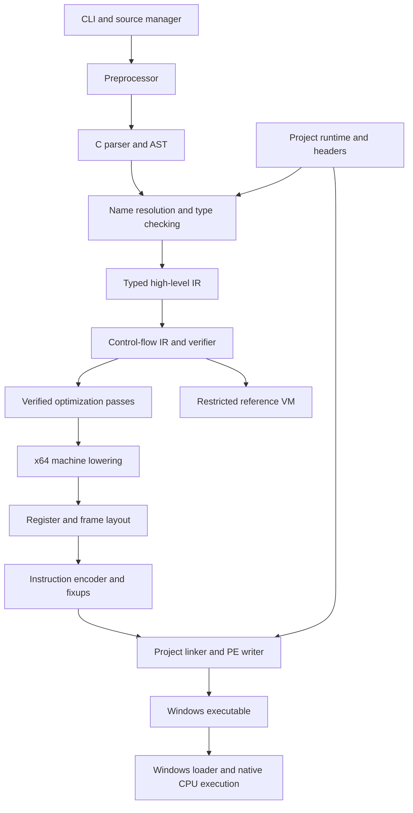
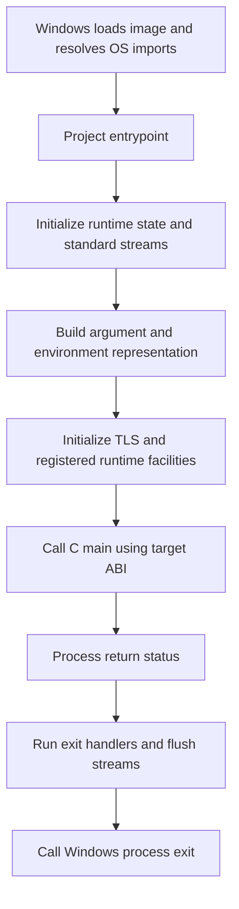
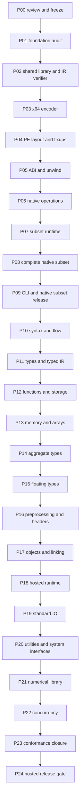

# Compiler in Rust: Product and Engineering Specification

**Canonical file:** `IMPLEMENTATION_PLAN.md`
**Repository:** [compiler-rust](https://github.com/choksi2212/compiler-rust)
**Revision:** 4.0, continuous phase execution; P01-P13 passed, P14 eligible
**Date:** 2026-11-24 (Asia/Calcutta)
**Implementation language:** Rust
**Proposed language/platform target:** hosted ISO C11, Windows x64
**Immediate implementation delivery after review:** compile the existing supported C subset into genuine native Windows executables
**Long-term delivery:** a project-owned C11 compiler, linker, runtime, headers, and standard library

This is the project's single source of truth. It combines the PRD, technical requirements, architecture, execution flows, implementation sequence, validation strategy, and change control. The README is a usage guide and must derive scope claims from this document. Git history preserves earlier plans; no parallel roadmap or competing specification should be introduced.

**Execution authorization:** after revision 3.0, the user explicitly instructed us to start P00 and impose aggressive, evidence-based phase gates. This authorizes P00 baseline work against the phased specification; it does not turn future features into implemented capabilities or make a commit itself sufficient authorization to skip gates. A change to the agreed architecture, dependency policy, target, or scope requires asking the user first, then updating this file before coding.

## Contents

1. [Product definition and requirements](#1-product-definition-and-requirements)
2. [Current implementation and evidence](#2-current-implementation-and-evidence)
3. [Scope, ownership, and compatibility contract](#3-scope-ownership-and-compatibility-contract)
4. [User experience and CLI specification](#4-user-experience-and-cli-specification)
5. [Architecture and compilation flows](#5-architecture-and-compilation-flows)
6. [Internal data contracts and module boundaries](#6-internal-data-contracts-and-module-boundaries)
7. [Frontend, preprocessing, and C semantics](#7-frontend-preprocessing-and-c-semantics)
8. [Target data model and Windows ABI](#8-target-data-model-and-windows-abi)
9. [IR, optimization, and native instruction generation](#9-ir-optimization-and-native-instruction-generation)
10. [PE image layout and project-owned linking](#10-pe-image-layout-and-project-owned-linking)
11. [Startup, runtime, headers, and standard library](#11-startup-runtime-headers-and-standard-library)
12. [Diagnostics, resource limits, and failure behavior](#12-diagnostics-resource-limits-and-failure-behavior)
13. [Phased implementation execution plan](#13-phased-implementation-execution-plan)
14. [Verification, conformance, and release policy](#14-verification-conformance-and-release-policy)
15. [Risks, decisions, traceability, and next action](#15-risks-decisions-traceability-and-next-action)
16. [References and preserved history](#16-references-and-preserved-history)

## 1. Product definition and requirements

### 1.1 Problem and intended outcome

The current compiler accepts a small C subset and executes bytecode in a VM. The user wants a compiler they can invoke from a terminal to produce an independent `.exe`, followed by progressive support for substantially more C programs. Both the implementation and its behavior must be explainable in a compiler-design viva.

The native product must translate source expressions, branches, calls, and memory operations into CPU instructions. Creating an executable that merely replays expected output, launches GCC, or interprets embedded source does not meet this requirement.

### 1.2 Users and scenarios

| User | Task | Success condition |
| --- | --- | --- |
| Student | Compile an assignment | A valid supported C source produces an executable with correct observable behavior |
| Viva presenter | Explain compilation stages | Tokens, AST, typed representation, IR, optimizations, and generated instructions can be inspected |
| Compiler developer | Add language support | Specification, implementation, positive and negative tests, and capability status agree |
| Program recipient | Run a built executable | Program runs on the target Windows installation without this compiler, Rust, GCC, or the project's VM |
| Library author | Compile several translation units | Own object writer and linker resolve declarations, definitions, relocations, and runtime calls |

### 1.3 Product requirements

| ID | Requirement | Acceptance evidence |
| --- | --- | --- |
| PR-01 | Native `.exe` output | Execute generated PE images as separate OS processes |
| PR-02 | Project-owned compilation | Audit imports and process launches; no external compile/assemble/link step |
| PR-03 | Correct supported C behavior | Deterministic fixtures, semantic tests, independent expectations, appropriate reference comparisons |
| PR-04 | Honest support reporting | Every feature has an implemented/partial/planned/unsupported status and tests |
| PR-05 | Visible compiler phases | Stable stage dumps with locations, types, and symbol identities |
| PR-06 | Predictable CLI | Documented flags, output paths, exit codes, and errors |
| PR-07 | Standalone distribution | Clean-environment process test with development tools unavailable |
| PR-08 | Progressive C11 coverage | Per-feature and per-library-function traceability to tests and implementation |
| PR-09 | Useful diagnostics | Invalid input identifies a location and cause; compiler does not crash |
| PR-10 | Gated development | Next stage begins only after its prerequisite test gate passes |
| PR-11 | Real implementations | No placeholder function, dummy result, hardcoded demo output, or silent fallback |
| PR-12 | One controlling document | Architecture and status changes land here before dependent implementation |

### 1.4 Quality requirements

Correctness and clarity take priority over optimization. `-O0` must remain a dependable baseline. Build performance is measured after native correctness, not guessed or guaranteed now. Compiler operations should be deterministic given identical inputs, options, target, and library version. Generated programs must follow their selected semantics independently of compiler debug/release mode.

No fabricated speed, coverage, security, or conformance claims are permitted. Passing examples establishes those examples, not full C support. No calendar estimate in this document substitutes for a completed test gate.

## 2. Current implementation and evidence

This inventory preserves the inspected baseline at commit `da66051`; newer verified capabilities are recorded by their passed phase evidence in section13. Do not read historical baseline gaps as overriding completed phase records. Later unpassed phases remain planned/in progress. Prior validation was recorded in earlier implementation turns. P00 has now reproduced the baseline at commit `47c881d11ff332eb7d11b071b36be6956906861b`; its new evidence and limitations are recorded in section 13.5.1.

| Component | File | Verified baseline | Gap to native/full C |
| --- | --- | --- | --- |
| Driver | `src/main.rs` | Source loading, dump flags, compile-and-run through VM | No native output flag or multi-file driver |
| Lexer | `src/lexer.rs` | Words, signed-range decimal literals, literal strings, supported punctuation/operators, positions | No general preprocessing or complete token vocabulary |
| Parser/AST | `src/parser.rs` | One `int main()`, integers, expressions, blocks, conditionals, loops, calls | No translation-unit grammar, declarators, complete type syntax |
| Semantics | `src/semantic.rs` | Integer checks, lexical scopes, built-in format validation | No general C type system, linkage, conversions or object model |
| IR | `src/ir.rs` | Numbered slots/temporaries, constants, operations, labels, jumps, print, halt, declaration reset | Untyped flat representation; no general functions or memory instructions |
| Optimizer | `src/optimize.rs` | Conservative local constant propagation/folding and straight-line unreachable instruction removal | No typed CFG or memory-effect model |
| VM | `src/bytecode.rs` | Project-owned stack execution and checked runtime failures | Not a native C backend or full-C oracle |
| Native image foundation | `src/native_pe.rs` | PE32+ packaging and generated entrypoint code invoking ExitProcess | Separate from C frontend; fixed sections/base, one import, maximum 4096 code bytes |
| Tests | Unit tests, `src/stress.rs`, `tests/cli.rs` | Arithmetic, errors, malformed input, CLI, six demos, native foundation | No end-to-end C-to-native test yet |
| Optional development oracle | `tools/differential.py` | Generates supported, defined-behavior programs for GCC comparison | Never a compiler/runtime dependency |

### 2.1 Recorded validation baseline

- 31 tests passed in debug and release configurations after the native foundation addition: 27 binary unit tests, two CLI integration tests, and two native library tests on Windows x64.
- Arithmetic stress cases executed 16,150 times across the two VM optimization settings.
- 10,000 deterministic malformed random inputs, source mutations, and oversized syntax tests were exercised.
- 100 generated programs matched GCC in optimized and unoptimized VM execution: 200 output comparisons.
- Actual generated native foundation executables exited with statuses 0, 37, and 255.
- Formatting and Clippy checks passed at that baseline.

The native foundation tests establish executable loading, imported process exit, and their tested layout cases. They do not establish a complete PE implementation, unwind correctness, native arithmetic, library behavior, or C conformance.

### 2.2 Current user-visible restrictions

The CLI currently compiles and executes immediately. It requires one `int main()` ending in literal `return 0;`. It supports the documented integer/loop/conditional subset, literal-string `printf` with `%d` and `%s`, and literal-only `strlen`. Arithmetic is checked signed 32-bit arithmetic; uninitialized variable reads produce runtime errors. Output is buffered until successful execution. Ordinary comments, `++`, arrays, pointers, user functions, general includes, and native `-o` are absent.

Current parser limits are 64 recursive syntax levels and 128 binary operators per expression tail. These are implementation limits, not an assertion that all C11 translation-limit requirements have been met. General nondecimal numbers are rejected. Built-in names are currently reserved locally, unlike the eventual ordinary-identifier rules. The VM stops after ten million instructions; native conforming execution must not inherit an arbitrary instruction budget.

### 2.3 Existing demos

`examples/addition.c`, `loop.c`, `factorial.c`, `pattern.c`, `conditional.c`, and `strings.c` have expected-output files. Their current outputs are regression fixtures. The strings example uses the teaching-mode built-in `strlen`; strict hosted-mode examples will need proper project headers and prototypes. Do not present that fixture alone as proof of strict C11 translation.

## 3. Scope, ownership, and compatibility contract

### 3.1 Meaning of full C support

The target is a documented hosted C11 implementation for one platform. The practical acceptance goal is all applicable standard language requirements plus the required hosted library within published environmental limits. Feature coverage must distinguish constraints, valid semantics, implementation-defined behavior, unspecified behavior, undefined behavior, and optional facilities.

C11's language and library are specified together; this project uses the public N1570 draft as its initial clause map, not as a claim of ISO certification. See [N1570](https://www.open-std.org/jtc1/sc22/wg14/www/docs/n1570.pdf), especially clauses 4-7 and the annex index. The conformance ledger must ultimately account for applicable requirements, reviewed defects, and implementation choices, rather than equating accepted syntax with conformance.

The phrase "any C program" cannot include programs whose behavior is undefined, source requiring a different platform, arbitrary third-party libraries, vendor-only extensions, or another C revision. Those programs need their own compatibility contracts. Within the agreed target, failures on supported, well-defined programs are defects to fix.

### 3.2 Ownership boundary

| Layer | Project builds it | Allowed underlying facility |
| --- | --- | --- |
| Lexer, preprocessor, parser, semantic analysis | Yes | Rust standard library used by compiler implementation |
| IR and optimization | Yes | No LLVM/Cranelift/TCC/C compiler substitution |
| x64 instruction encoder | Yes | Published ISA specifications, CPU execution |
| Symbol resolution, fixups, object support | Yes | No external assembler/linker in production path |
| PE image and import writer | Yes | Windows executable loader |
| CRT startup and C standard library | Yes | Windows system APIs for OS primitives |
| Generated program execution | Native CPU instructions | Windows services and system DLLs |
| Compiler bootstrap build | Rust source compiled by Cargo/rustc | Normal installed Rust build toolchain |
| Test reference executables | Optional independent oracle | GCC or another reference only during development |

Do not copy another compiler implementation or delegate its logic to a downloaded package. Consulting specifications and testing against an independent implementation are allowed. If a new production dependency is needed, ask the user and revise this document first. A requirement to implement Windows or a CPU emulator is outside this ownership boundary.

### 3.3 Scope levels and release names

| Release level | Permitted claim | Must not claim |
| --- | --- | --- |
| VM baseline | C teaching subset compiler with VM | Native C executable support |
| Native subset | Existing subset compiled to Windows x64 | General hosted C support |
| Extended native C | Enumerated additional features work | All standard syntax/library cases |
| Hosted candidate | Coverage ledger complete enough for conformance audit | Independently established conformance before audit |
| Hosted C11 release | Applicable requirements and documented options validated | GNU/MS extensions or other targets by implication |

### 3.4 Conditional and optional facilities

Track variable-length arrays, atomics, threads, and complex arithmetic as explicit work streams. Where C11 permits an implementation to omit a facility and advertise a corresponding feature-test macro, any omission must be reviewed and recorded before a conformance claim. They remain planned capability goals; absence must never be hidden. Optional Annex K interfaces and optional Annex F/G numerical binding claims are separate extensions, not automatic consequences of ordinary math support.

### 3.5 Deferred product scope

Linux/ELF, macOS/Mach-O, ARM, C++, Rust/Go frontends, GNU/MS extension compatibility, dynamic library production, debugger/PDB integration, IDE/LSP, a visual website, code signing, and package-manager publication are separate future decisions. These do not block a Windows console C compiler. No feature is silently added to this list to avoid a required hosted-C obligation.

## 4. User experience and CLI specification

### 4.1 Transitional CLI

Until the user approves a default-behavior change, preserve `compiler file.c` as current compile-and-run VM behavior. Add native generation through an explicit output option. The first native delivery must support:

```powershell
compiler program.c -o program.exe
.\program.exe
compiler program.c -o program.exe --ir --optimized-ir
compiler program.c --run-vm
```

Native compilation must not execute the program automatically. `--run-vm` is explicit teaching-subset execution and must report unsupported typed-IR features cleanly after the native compiler grows beyond VM capabilities.

### 4.2 Final driver command contract (implemented incrementally)

| Command/option | Purpose | Delivery |
| --- | --- | --- |
| `-o PATH` | Select native executable destination | 8C |
| `--tokens`, `--ast`, `--ir`, `--optimized-ir` | Inspect compiler stages | Preserve, then enrich |
| `--bytecode`, `--run-vm` | Existing subset reference mode | 8C compatibility |
| `--emit=machine` | Dump encoded instructions, offsets, symbol fixups | 8B/8C |
| `--help`, `--version` | Usage and build/capability version | 8C |
| `--print-capabilities` | Describe implemented modes and restrictions | 8C, extended each stage |
| `-O0`, `-O1` | Unoptimized baseline and verified basic optimization | Typed/native optimizer stage |
| `--no-opt` | Preserve existing alias for unoptimized mode | Compatibility |
| `--semantics=teaching` | Checked legacy subset behavior | Native migration |
| `--std=c11` | Strict language mode when usable; not a conformance claim | Frontend migration |
| `-E` | Emit preprocessed source/tokens without compilation | 13A |
| `-I DIR`, `-D NAME[=VALUE]`, `-U NAME` | Include and macro configuration | 13A |
| `-fsyntax-only` | Preprocess, parse, and type-check without native output | Typed frontend |
| `-c`, `.obj` inputs | Separate compilation and project-owned linking | 13B |
| Several source inputs | Build and link multiple translation units | 13B |

Unimplemented options must be rejected. No option may succeed while silently skipping its advertised stage. For native mode without an explicit `-o`, a later reviewed CLI revision may select `a.exe`; it is not the initial migration default.

### 4.3 Output and failure contract

Compiler stage dumps and diagnostics go to stderr; program stdout belongs only to program execution. File-generation commands report the output path without mixing code dumps into files. Compile status: 0 success, 1 source/type/link/build failure, 2 invalid CLI usage or unsupported mode. A runner propagates child exit status where representable and reports launch failure distinctly.

Never overwrite an input source, include, object, compiler executable, or directory. Detect aliases through canonical paths and file identity where available, not merely matching path strings. Write a temporary output beside the destination, validate it, close handles, then atomically publish it. Preserve a previously working output if compilation fails. Replacing an existing unrelated destination requires an explicit overwrite policy, initially an `--overwrite` flag. Invalid syntax must not leave a partial executable. No shell-based concatenation of filenames or source text is allowed.

### 4.4 End-user success scenario

The user writes a supported C file, runs the native compiler, and launches the output from a different directory. The executable imports only documented Windows facilities. Removing compiler tools from PATH does not stop it running. Unsupported constructs receive a truthful compile diagnostic, not an `.exe` that later launches another tool or fabricates output.

## 5. Architecture and compilation flows

### 5.1 High-level ownership flow



The initial native subset can lower the existing IR directly. The typed IR stages become mandatory before full types, functions and pointers. Do not implement a pretend preprocessor for the native subset; its existing conventional header accommodation remains labeled teaching-only until 13A supplies real preprocessing.

### 5.2 Native subset compile flow

1. Parse options and validate source/destination identities.
2. Load source with a file identifier and preserve location information.
3. Run existing subset lexer, parser and semantic analysis.
4. Lower to current IR; verify slot definitions, labels, and destination identities.
5. Optimize only if selected; verify again.
6. Lower each operation to native instructions and runtime symbol calls.
7. Lay out locals, initialization flags, constant bytes and function frames.
8. Encode instructions, bind local labels, collect relocations/imports.
9. Resolve runtime symbols; compute PE sections and image-relative addresses.
10. Apply fixups; validate section bounds and image metadata.
11. Publish the output file without running it.
12. Integration tests launch that actual file, capture output and status, and compare with independent expectations.

### 5.3 Runtime startup flow



The earliest native subset needs only the simpler startup path it supports. Each later lifecycle facility needs tests for initialization failure, normal exit and abnormal termination. Calling a Windows service is an OS dependency, not delegation of C implementation.

### 5.4 Multi-file flow

After separate compilation is delivered, each translation unit becomes a project-generated COFF object containing sections, symbols and relocations. The project linker resolves them together with selected runtime objects, diagnoses missing/duplicate symbols, lays out the image, and emits PE32+. In-memory fragments can use the same symbol/relocation model before on-disk object support exists. No external linker is needed in either mode.

## 6. Internal data contracts and module boundaries

### 6.1 Proposed repository organization

Keep migration incremental; paths below describe intended responsibilities, not files already implemented.

| Module family | Responsibility | Core public result |
| --- | --- | --- |
| `driver`, `cli` | Options, compilation jobs, output publication | Validated build configuration |
| `source`, `diagnostic` | Source maps, spans, errors, macro-origin notes | `SourceId`, `Span`, structured diagnostics |
| `lex`, `preprocess` | Translation input, tokens, macros, includes | Preprocessing tokens with expansion provenance |
| `parse`, `ast` | Full declaration/expression grammar | Untyped translation-unit AST |
| `sema`, `types`, `layout` | Scope, type compatibility, conversions, object layout | Typed AST/HIR and symbol table |
| `hir`, `ir`, `verify` | Typed operations and explicit control flow | Verified module IR |
| `opt` | Conservative transformations and pass verification | Equivalent verified IR |
| `codegen/x64` | ABI lowering, register/frame layout, encoding | Machine fragments and fixups |
| `object`, `link` | COFF support and symbol/relocation resolution | Linked section graph |
| `native_pe` / `pe` | Image headers, directories and validation | Executable bytes |
| `runtime`, `include` | Project C runtime and public headers | Runtime objects and C declarations |
| Existing VM modules | Restricted teaching backend/reference | VM execution for supported IR only |

### 6.2 Required identities and records

- `SourceId` indexes immutable input buffers. `Span` carries byte offset/range, with line/column rendering delegated to the source map. Macro expansion stacks preserve spelling and invocation origins.
- `Token` has a kind separate from spelling. Parser decisions must use token kinds and grammar roles, not just text comparisons.
- `TypeId` identifies canonical types in a context; qualifiers, incomplete forms, function signatures and array bounds are represented explicitly.
- `SymbolId` identifies declarations across scopes. Codegen never re-resolves a name string to decide its storage slot.
- `FunctionId`, `BlockId`, `ValueId` and `LocalId` are distinct identities; accidental cross-use is an invariant failure.
- `TargetSpec` owns widths, alignments, endianness, signedness policy, ABI classification, available instructions and image format.
- `MachineFragment` contains bytes, alignment, symbol definitions, unresolved references, and source associations. It must not contain unresolved raw magic offsets.
- `Relocation` specifies location, symbol, addend, kind and permitted range. A linker error results if range or symbol checks fail.
- `Diagnostic` contains severity, stable identifier, primary span, explanation and optional secondary spans/notes.

### 6.3 Invariants at boundaries

The parser returns a complete AST or structured errors. Semantic analysis removes unresolved names and inserts required conversions. IR has typed operands and valid terminators. Codegen receives only verified IR. Linking receives encodable fixups and consistent symbol metadata. The PE serializer accepts an already validated image layout.

Internal assertions diagnose compiler bugs; they must not serve as routine rejection of user syntax. Input-dependent sizes use checked arithmetic before allocation or serialization. Partial pipeline state must not be treated as a successful artifact.

### 6.4 Status and coverage records

Maintain capability entries keyed by stable IDs inside this document until they become too numerous for manual accuracy. Each entry needs requirement/clause reference, owning module, status, test identifiers, mode/target restrictions and known defects. A generated report may derive from code metadata, but this document remains authoritative for scope and release claims. Generating such a report does not authorize inventing a second manual plan.

### 6.5 Concrete migration from the existing crate

The current binary declares the frontend/VM modules itself, while `src/lib.rs` currently exposes only native infrastructure. Move shared compiler modules into the library in a reviewed refactor before a second backend imports them. The driver must use that library instead of building separate incompatible copies of types. Preserve all existing tests during this move; do not combine structural migration with speculative language changes.

Introduce a compilation context carrying target, source manager, diagnostics and semantics mode. Use explicit pipeline results: frontend result, verified IR, machine fragments, linked image and published artifact. The CLI owns filesystem/process policy; core compiler stages operate on provided buffers/records. This allows stage tests without inventing alternate production logic.

Keep a compatibility adapter for the legacy IR during 8B. When typed IR arrives, either lower its supported subset to the VM with an explicit capability check or retain a separate legacy teaching frontend. Do not make the VM silently accept pointers/functions it cannot represent. Record the selected adapter at package 10 before migration code.

## 7. Frontend, preprocessing, and C semantics

### 7.1 Source processing and preprocessor work

Build a source manager before a general preprocessor. The reader must retain byte offsets, handle CRLF/LF consistently, identify encoding errors, and distinguish physical lines from logical lines. Keep normalization maps so a diagnostic points to what the user actually wrote.

The preprocessing engine requires its own token stream, directive parser, macro environment, include resolver, expansion work stack, recursion suppression, conditional-expression evaluator and output renderer. Lexing into ordinary parser tokens happens after preprocessing decisions. A header cannot be implemented by deleting its `#include` line and hoping built-ins cover its declarations.

| Feature ID | Work item | Tests and edge cases |
| --- | --- | --- |
| PP-01 | Ordered translation-input handling | Line splicing, comments, character mapping, source-location preservation |
| PP-02 | Object-like macros | Empty replacement, redefinition compatibility, undefinition, nested expansion |
| PP-03 | Function-like/variadic macros | Balanced arguments, prescan, empty arguments, invocation spacing |
| PP-04 | Stringification and token pasting | Correct spelling, rescanning, invalid resulting token diagnostics |
| PP-05 | Conditional directives | Nested inactive groups, `defined`, expression evaluation and short circuit |
| PP-06 | Include resolution | Quoted/angle paths, search order, cycles, include guards, deterministic diagnostics |
| PP-07 | Source-control directives | Line remapping, deliberate error directives, documented pragmas |
| PP-08 | Predefined macros | Standard/target/feature values match actual capabilities |
| PP-09 | Environmental bounds | Expansion budget, include depth, token growth; publish limits and validate required minima |

The preprocessor must not evaluate an inactive branch as ordinary C code. Macro diagnostics need an invocation trace. Avoid global string replacement: it cannot correctly implement token pasting, comments, string literals or recursive suppression. Until this engine ships, only explicitly documented teaching-mode header handling is allowed.

### 7.2 Lexer requirements

Separate identifiers, keywords, preprocessing numbers, integer/floating constants, character/string literals, and punctuators. Decode escapes into the selected execution encoding only at the appropriate stage. Support literal prefixes and concatenation according to the selected language mode. Interpret suffixes and bases with a target-independent wide accumulator, then assign the correct target type; do not parse every number directly into Rust `i32`.

Use maximal-munch tokenization. Distinguish unsupported syntax from malformed syntax. Track malformed escapes, invalid suffix combinations, overflow during literal conversion, and tokens that are legal in preprocessing but invalid in ordinary expressions. Handle a real embedded NUL in a literal as a stored byte with length metadata; do not assume a Rust string always equals a C string.

### 7.3 Parser strategy and grammar coverage

Retain recursive descent for declarations and statements and a precedence-aware expression parser. The new grammar must parse full translation units instead of requiring one fixed main function. A typedef-name-aware scope interface is needed to distinguish declaration forms from expressions. Declarators must be represented structurally before type construction.

Required grammar families:

- Translation unit: external declarations, function definitions, declarations and definitions with linkage.
- Declaration specifiers: storage class, type specifiers, qualifiers, function specifiers and alignment specifiers.
- Declarators: identifier, nested pointer/array/function forms, abstract declarators and parameter lists.
- Type forms: builtin types, tagged aggregates, enums, typedef names, qualified types and incomplete types.
- Initializers: scalar, aggregate, nested braces, designators, compound literals and inferred array extents.
- Expressions: all required precedence levels, casts, calls, subscripts, members, pointer members, unary operations, assignments, conditional/comma operators, generic selection, size and alignment queries.
- Statements: labeled, compound, expression/empty, selection, iteration and jump forms.
- Remaining language forms: static assertions, variadic declarations, anonymous members, thread-local and atomic declarations, implementation of applicable optional syntax families.

Representative declarators that must be understood before claiming general declarations: pointer-to-int, array-of-pointers, pointer-to-array, function-returning-pointer, pointer-to-function, and array-of-function-pointers. Reject impossible combinations with a type diagnostic, not a parser panic.

A focused operator table must be part of parser tests: postfix; unary/cast; multiplicative; additive; shifts; relational; equality; bitwise AND/XOR/OR; logical AND/OR; conditional; assignment; comma. Every level needs mixed-precedence and associativity tests. Prefix/postfix updates and compound assignments must evaluate an lvalue address once.

### 7.4 Name resolution and declarations

Implement distinct C name spaces, nested scopes, tags, labels and members. Separate declaration identity from spelling. Resolve redeclarations by compatibility and linkage rules; account for prototypes, tentative definitions, file-scope internal/external linkage, block-scope extern declarations and incomplete types. Resolve function-scope labels independently of ordinary identifiers.

The legacy ban on local `main`, `printf` and `strlen` is not the final semantic model. Header declarations, applicable reserved-name rules and actual name lookup must determine legality. Built-in lowering must never override a valid declaration merely because a function has a familiar spelling.

Initialize declaration scope at the correct point, preserving the existing regression that `int x=x;` inside an inner block must not read an outer `x`. Do not promise a universally meaningful value for an uninitialized object; checked teaching mode may diagnose it, while strict-mode behavior follows the selected C contract.

### 7.5 Type system work

| Feature ID | Required facility | Implementation obligations |
| --- | --- | --- |
| TY-01 | Canonical scalar types | Width/rank/signedness independent of compiler host Rust types |
| TY-02 | Qualified types | Preserve const/volatile/restrict/atomic information through analysis |
| TY-03 | Pointer/array/function types | Distinguish decay from object representation, addressability and parameter adjustments |
| TY-04 | Integer conversions | Promotions and usual arithmetic conversions represented as explicit typed operations |
| TY-05 | Floating conversions | Correct rounding/range behavior under the published numerical model |
| TY-06 | Compatible/composite types | Redeclaration and cross-unit checks |
| TY-07 | Completeness and layout | Reject illegal incomplete-type uses; calculate size/alignment once |
| TY-08 | Lvalues and value categories | Modifiability, address formation, loads/stores, bitfield restrictions |
| TY-09 | Constant expressions | Dedicated evaluator with allowed operations and target semantics |
| TY-10 | Initializers | Object byte layout, zero-filled remainder, relocatable address constants |
| TY-11 | Variadic semantics | Argument promotions, va-list representation and builtin support |
| TY-12 | Atomic/thread constructs | Explicit memory effects, storage duration and platform mapping |

`sizeof` must use target layout, not `size_of::<RustType>()`. Unevaluated expressions must not introduce runtime side effects; variable-length forms require their own evaluation rules. Constant evaluation and runtime arithmetic should share target semantics without using host overflow behavior accidentally.

### 7.6 Control-flow semantics

Use explicit break, continue, switch and label contexts. Diagnose jumps that violate the supported lifetime rules. Resolve dangling else to its correct syntactic owner. Give `for` declarations their correct scope; `continue` targets the update block in a `for`, the condition in a `while`, and the condition check in a `do` loop. Switch must support fallthrough and duplicate-case detection.

Function returns carry typed values. Falling off main has its selected standard semantics in strict mode; other function return paths need their own diagnostics and runtime assumptions. No general return is lowered to unconditional process exit: only startup translates the completed main result into process status.

### 7.7 Evaluation order, side effects, and undefined behavior

Represent sequencing and conditional evaluation explicitly. Do not speculate a faulting expression out of a short-circuit branch. Do not duplicate reads/writes while lowering `a[i++] += value`. Calls, volatile operations, atomics and memory stores must carry effects sufficient to prevent unsafe optimization.

Tests involving multiple unsequenced modifications or undefined signed overflow must not demand equality with another compiler. Separate well-defined reference tests from required-diagnostic tests and checked-mode failure tests. An implementation may choose a deterministic permitted evaluation order, but must not document that choice as a universal C guarantee.

### 7.8 Compatibility modes and migration

Keep the existing checked teaching subset available during native migration. Its arithmetic failures, initialization checks and literal-only built-ins are explicitly an educational extension. Strict C11 mode evolves through capabilities and rejects not-yet-supported features; it does not initially advertise conformance.

A legacy VM error on undefined C behavior is not a requirement that all future native C execution trap identically. For comparisons, use defined-behavior programs and match modes. Keep the original six examples stable, then create strict-mode fixtures using correct declarations and headers when preprocessing is available. Any removal of legacy mode or change in default behavior requires approval.

## 8. Target data model and Windows ABI

### 8.1 Proposed implementation choices

These are design choices for this project, not implemented guarantees. Approving this revision freezes them for the initial native target; changing them later requires an ABI revision.

| Property | Initial target contract |
| --- | --- |
| CPU/OS | Windows x64, little-endian |
| Byte | 8 bits |
| `_Bool` / char / signed char / unsigned char | 1 byte; plain char signed |
| short / unsigned short | 2 bytes |
| int / unsigned int | 4 bytes |
| long / unsigned long | 4 bytes |
| long long / unsigned long long | 8 bytes |
| Data/function pointers | 8 bytes; target-defined interchange restrictions remain |
| float | IEEE 754 binary32 storage; numerical guarantees separately tested |
| double | IEEE 754 binary64 storage; numerical guarantees separately tested |
| long double | Proposed 8-byte representation, distinct language type and rank |
| `size_t`, `uintptr_t` | 64-bit unsigned integer type |
| `ptrdiff_t`, `intptr_t` | 64-bit signed integer type |
| `wchar_t` | 16-bit unsigned integer type |
| `wint_t` | 32-bit unsigned type, capable of representing WEOF |
| `max_align_t` | At least 16-byte alignment; allocator must honor it |
| Struct layout | Natural field alignment, padding and target layout table; bitfield policy separately frozen before implementation |
| Execution encoding | UTF-8 narrow strings in project runtime; UTF-16 wide strings; specify conversion and locale rules |
| `NULL` | Appropriate null pointer constant; representation documented as all-zero pointer bits |

Provide alignment entries alongside widths. Integer promotions, rank, floating behavior, bitfields, enum compatible types, signed right shift, implementation-defined conversions, character sets, locale, signal behavior, translation limits and stream modes need entries in the implementation-defined behavior ledger. This table alone is not that complete ledger.

Reject numeric values that cannot fit the selected typed literal rather than wrapping silently during parsing. Long-double layout and external-library ABI compatibility need separate tests; Windows does not imply compatibility with every MinGW extension or compiler configuration.

### 8.2 Calling convention

Native calls must implement the Windows x64 ABI: positional integer/pointer arguments in RCX/RDX/R8/R9, floating arguments in the corresponding XMM registers, additional arguments on the stack, caller-provided shadow space and correct stack alignment. Preserve nonvolatile registers. Handle return classification, aggregate passing, hidden result pointers, and variadic floating arguments deliberately. These rules are verified against [Microsoft's x64 calling-convention reference](https://learn.microsoft.com/en-us/cpp/build/x64-calling-convention?view=msvc-170).

Create one ABI classifier used by function definitions, direct calls, indirect calls, runtime calls and imported OS functions. Do not independently improvise register assignment at each call site. The earliest native subset uses a conservative spill-to-stack frame and a small caller-saved scratch-register set. Later register allocation cannot alter the ABI contract.

### 8.3 Stack frame and unwind model

A frame layout record includes incoming/outgoing arguments, home space, locals, temporaries, saved nonvolatile registers, alignment padding and any checked-mode initialization flags. It must compute offsets with checked size arithmetic. Large frames need a project-owned stack-probe strategy; merely subtracting a large stack size is insufficient.

Emit valid unwind metadata for generated frame-using functions and runtime helpers. Frame prologue/epilogue generation and unwind generation share the same layout description. Microsoft documents the relevant function-table and unwind structures in [x64 exception handling](https://learn.microsoft.com/en-us/cpp/build/exception-handling-x64?view=msvc-170). The existing PE foundation lacks these facilities and must not be treated as production ABI completeness.

### 8.4 Numerical and alignment policy checklist

Before floating code generation, freeze evaluation precision, rounding policy, subnormal handling, floating exception behavior and the published `FLT_EVAL_METHOD`. Do not infer optional numerical-binding compliance merely from IEEE storage. SSE operations, constant folding and decimal conversions must agree on the selected model. Long double may share storage with double while remaining a distinct C type; document that deliberately.

Before aggregate code generation, freeze every scalar alignment, enum representation selection, bitfield unit/order policy, zero-width fields, anonymous members, flexible-array tail layout, aggregate parameter/return classification and maximum alignment support. `alignas` requests must be validated against actual target support. Before atomics, specify alignment and lock-based fallback so lock-free macros match reality.

### 8.5 ABI verification fixtures

Test argument counts 0 through at least 12; signed and unsigned widths; mixed floating and integer parameters; preservation of saved registers; recursion; nested calls; callbacks; function pointers; scalar and aggregate returns; stack alignment; and variadic formatting. Use independently constructed native harnesses or reviewed known bytes in tests where permitted, never a second copy of the same classifier as the only oracle.

## 9. IR, optimization, and native instruction generation

### 9.1 Typed intermediate forms

The current flat IR can serve stage 8B. Its destinations, labels and initialization resets must have explicit invariants before native lowering. For broader C, introduce module/function/global structure, basic blocks, typed values, explicit memory operations and function signatures. Start with ordinary non-SSA IR and stack homes; an SSA conversion is a later optimization decision, not a prerequisite for correct C.

Minimum typed operations: constants; arithmetic/conversions; comparisons; address formation; load/store with width/alignment/volatility; aggregate address operations; calls; returns; branches; switch; lifetime markers where needed; atomic operations when delivered. A function call records its signature, arguments, result and effects. A print built-in is replaced by an ordinary runtime call once general calls exist.

String constants become immutable byte arrays with explicit terminators and symbols. Pointers refer to objects/addresses, not Rust host strings. Globals distinguish initialized storage, zero-filled storage, readonly data, relocatable constants and thread-local data.

### 9.2 IR verifier

Run before and after every enabled transformation. Validate unique identities, type consistency, block terminators, branch targets, legal uses, call arity/signatures, memory alignment constraints and symbol visibility. Use dominance checks where an IR form requires them. Reject a verified-module mismatch as a compiler error before serialization. Test the verifier using intentionally invalid IR; this tests validation logic, not a fake execution path.

### 9.3 Optimization policy

Initial verified passes: target-correct constant folding, local propagation, dead unreachable-block elimination and basic branch simplification. Preserve calls, volatile accesses, atomics and observable stores unless an effect proof justifies removal. Preserve arithmetic checks in teaching mode. In strict mode, apply only transformations justified by its language semantics.

Every pass declares preconditions, modified analyses, preserved invariants, and a focused regression suite. New optimization bugs must have minimal reproducible programs tested at `-O0` and `-O1`. Reaching the same answer through two backends is useful evidence but not a substitute for an independent expected answer when both share the same lowering.

### 9.4 Machine lowering and encoding

Own the entire x64 encoding path: register identifiers, instruction selection, operand width, REX prefix, opcode, ModR/M, SIB, immediates, displacements and fixups. Initially support only the instruction families required by the current subset and runtime. Add instructions with byte-level and execution tests before using them widely.

Required first families include moves, loads/stores, address formation, add/subtract/multiply, signed division/remainder, sign extension, comparison/set-condition, boolean normalization, conditional/unconditional branches, direct and indirect calls, prologue/epilogue and return. Floating-point, atomic and wider-type instructions are later additions with dedicated tests.

Division lowering must account for the operand registers required by the selected instruction, sign extension, zero divisors and the signed minimum divided by negative one. Comparisons must select signed versus unsigned condition codes from types. Branch and call offsets must be checked for displacement range. A fixup overflow is an explicit backend diagnostic, not truncated bytes.

### 9.5 First native subset runtime behavior

Implement integer-to-decimal conversion, literal/string output, format scanning for `%d`/`%s`, length calculation, runtime-error reporting and process exit. These are project-owned machine-code helpers emitted through the encoder; no imported CRT formatter and no precomputed source evaluation. Integer formatting must handle the minimum signed value without negating it in a same-width signed representation.

Model partial OS writes and failures. `printf` returns a computed output count or an error as its supported contract specifies; it cannot return a constant. Initial teaching-mode output buffering may require a project-owned growable buffer to preserve legacy all-or-error output behavior. Streaming hosted `stdio` is a later, separately tested mode. No arbitrary VM instruction quota belongs in a normal standalone native executable.

## 10. PE image layout and project-owned linking

### 10.1 Serializer expansion

Replace fixed offsets in the native foundation with a layout engine. It receives section records, entrypoint symbol, imported symbols, relocation records and function unwind records. It computes aligned file offsets and RVAs, validates all ranges, then serializes headers/directories. Distinguish file offsets, RVAs and VAs in types or strongly named wrappers.

The binary format contract is [Microsoft's PE/COFF specification](https://learn.microsoft.com/en-us/windows/win32/debug/pe-format). This project will emit its own image headers, section table, imports, relocation data and image metadata. Text/data permissions, page/file alignment, image size and directory bounds must agree. Layout must grow beyond the foundation's single code page and one import.

### 10.2 Planned sections

| Section | Content | Access intent |
| --- | --- | --- |
| `.text` | User and project runtime native instructions | Read/execute |
| `.rdata` | Literal bytes, immutable tables, readonly objects | Read |
| `.data` | Initialized writable globals/runtime state | Read/write |
| `.bss` or zero-filled section tail | Static zero-initialized storage | Read/write |
| `.idata` | OS import descriptors, names and address tables | Loader-compatible permissions |
| `.reloc` | Image-base relocations where required | Read |
| `.pdata`, `.xdata` | Function table and unwind records | Read |
| `.tls` and TLS directory data | Thread-local initialization and callbacks | As required by target lifecycle |

Not every executable needs every section. Omitted features must not leave nonzero data directories pointing to absent bytes. Favor RIP-relative references and correct relocations instead of requiring a fixed preferred image address. Enable appropriate relocation/NX/ASLR flags only when the corresponding support is real.

### 10.3 Import and fixup engine

Group imported symbols by OS DLL; deduplicate names deterministically; build lookup/address tables and names with valid terminators and alignment. Bind each import call fixup to its actual IAT entry. The first runtime will require process and output services; later file/memory/thread services expand this explicit allowlist.

Represent relative branches, image-relative fields and absolute address relocations separately. Validate negative and maximum displacements, forward/backward references, missing labels, duplicate definitions, and section growth. Never assume an import remains at a fixed RVA after adding data.

### 10.4 Symbol resolution and object support

An internal linker resolves fragment-local, module-local and external symbols. Later COFF writing/reading must support the exact machine/relocation subset needed by our emitted objects, with a documented capability list. External COFF object compatibility is a separate promise and needs tests; our own `.obj` support alone does not establish compatibility with arbitrary MSVC/GCC objects.

Select runtime objects by unresolved symbols without accidentally resolving user definitions to unrelated built-ins. Diagnose duplicate strong definitions and unresolved external references with originating translation units. Define archive indexing and search rules before delivering static library input. No executable is accepted with guessed zero addresses for missing symbols.

### 10.5 Image validation and portability gates

Perform a project-owned structural validation before publishing. Independently inspect representative files during development using published-format checks and optional external inspection tools, which are never production dependencies. Launch the output on the target OS, verify output/exit status, inspect actual imports and test a clean process environment.

Test code/data growth across alignment boundaries, empty/nonempty sections, strings crossing pages, many imports, relocation at a changed load address, large frames, unwind behavior and malformed internal records. Running one entrypoint once is insufficient evidence for all these properties.

## 11. Startup, runtime, headers, and standard library

### 11.1 Runtime bootstrap strategy

The runtime must be ours, but it must be buildable before the full C compiler exists. Stage 8B emits a small set of runtime helpers through the project's x64 encoder. This is real executable runtime logic, not a stub. As functions and types become available, portable runtime algorithms can be expressed in project C sources compiled by this compiler. Retain minimal platform glue in the encoder where necessary.

There must be no hidden Rust standard-library or system CRT dependency in generated programs. The compiler itself may use Rust standard-library IO; generated C programs may not call back into the compiler process to obtain results. A runtime function is shipped only when its implementation, declaration, calling convention and tests all exist.

### 11.2 Startup responsibilities

Initialize process-global runtime state, standard streams, argument/environment storage, floating environment policy, TLS when delivered, and exit-handler bookkeeping. Provide `main(void)` and `main(int, char **)` under the eventual hosted contract. Decode Windows process arguments according to a published project policy and test quotes, backslashes, empty arguments, Unicode and environment access. Do not treat splitting on spaces as a finished argument parser.

Translate main's returned int into process exit through the runtime. Normal `exit` runs registered handlers and stream finalization in the specified order. `_Exit`, abort paths, initialization failures and unhandled runtime checks use separate paths. Define reentrancy and error behavior before advertising each facility.

### 11.3 OS abstraction layer

Keep system import declarations and platform glue separate from portable runtime algorithms. Proposed primitive families: read/write handles; open/close/seek files; process environment and exit; memory reservation/allocation; time; synchronization/thread creation; locale/encoding support; console handling where distinct from redirected files. Each wrapper must translate OS results into the runtime's documented errors and preserve thread-local error state as required.

The generated import list must contain OS services needed by delivered capabilities, not `msvcrt`/UCRT formatting, allocation, parsing or standard-library implementations. Test interrupted/short/failed writes, inaccessible files, zero-length operations, allocation failure and invalid handle paths. OS failure injection is a test mechanism; production logic must still call real services and handle their actual results.

### 11.4 Memory and string runtime

Implement memory copy/move/set/compare with explicit overlap contracts and size handling. Implement string functions over C object memory, including terminator behavior and bounded forms. String tests must include empty input, embedded NUL storage, zero lengths, high bytes, overlapping memory where legal, alignment variations and values near allocation boundaries.

Implement an allocator over Windows memory services, with metadata integrity, alignment, overflow-checked size calculations, coalescing/reuse policy and failure behavior. `realloc` must preserve the required portion and leave the original allocation usable on allocation failure; calloc needs checked multiplication and zero initialization. Never claim `malloc` because an API call returns some bytes: the C-visible alignment, lifetime and ownership contract must also pass tests.

### 11.5 Full hosted-library inventory

This is an implementation inventory for our runtime. Every required interface in a family needs its own declaration, definition, semantic edge cases and test IDs before the family is complete. Clause-level requirements are resolved against the referenced C11 source; the table is not a substitute for those interfaces.

| Header family | Project work | Critical acceptance cases |
| --- | --- | --- |
| `assert.h` | Debug assertions and disabled form | Expression evaluation count, NDEBUG, file/function/line reporting |
| `complex.h` | Complex types and operations if selected | Representation, conversion, branch-sensitive numerical cases |
| `ctype.h` | Character classification/conversion | EOF, unsigned-char range, locale behavior |
| `errno.h` | Error constants and per-thread state | Independent threads and documented error propagation |
| `fenv.h` | Floating environment control/status | Rounding modes, exception flags, optimizer interaction |
| `float.h` | Numeric characteristics macros | Values agree with actual codegen/runtime |
| `inttypes.h` | Integer formats and conversions | Width-specific formats, limits and parse errors |
| `iso646.h` | Alternative spelling macros | Expansion and ordinary parsing |
| `limits.h` | Integer limits | Exact target widths and signedness |
| `locale.h` | Locale records and selection | C locale baseline, later named locales, stable storage/lifetime |
| `math.h` | Real math and classification | Accuracy, rounding, domain/range errors, special values |
| `setjmp.h` | Save/restore execution context | Preserved state, nested calls, specified return behavior |
| `signal.h` | Signal interfaces | Documented Windows mapping, handlers, unsupported circumstances |
| `stdalign.h` | Alignment convenience macros | Match parser and target layout |
| `stdarg.h` | Variadic access support | ABI promotion rules, copies, mixed arguments |
| `stdatomic.h` | Atomic types/operations if selected | Ordering, fences, lock-free claims and fallback behavior |
| `stdbool.h` | Boolean macros | Consistency with builtin type and conversions |
| `stddef.h` | Size/difference types, NULL, offsetof | Target identity, member layout and constant-expression behavior |
| `stdint.h` | Fixed/minimum/fast-width integer types | Correct type availability, widths and macros |
| `stdio.h` | Streams and formatted/unformatted IO | Buffering, errors, EOF, file position, text/binary mode, variadic formats |
| `stdlib.h` | Allocation, conversions, termination, utilities | Boundary parsing, overflow, sorting callbacks, exit order |
| `stdnoreturn.h` | Noreturn macro | Declaration validation and call flow |
| `string.h` | Byte/string operations | Bounds, terminators and legal overlap rules |
| `tgmath.h` | Type-generic dispatch | Real/complex argument types and evaluation counts |
| `threads.h` | Threads/mutexes/conditions/TLS if selected | Lifetime, contention, wakeup and thread result behavior |
| `time.h` | Calendar/process time conversion | Epoch policy, range, formatting, time-zone assumptions |
| `uchar.h` | UTF conversion types/functions | Stateful conversions, invalid sequences, partial inputs |
| `wchar.h` | Wide IO/string/conversion | UTF-16 policy, stream orientation and conversion state |
| `wctype.h` | Wide classification/conversion | Supported locale and valid wide-character domains |

No header may declare an apparently supported function backed by an always-success, always-zero or unimplemented implementation. A not-yet-supported header/interface gets an explicit diagnostic and capability entry. Never define hosted/feature macros that overstate delivered functionality.

### 11.6 Formatted IO work packages

Start with the existing `%d`/`%s` teaching behavior. General `printf`-family support then needs flags, width, precision, length modifiers, integer bases, pointers, characters, floating conversions, positional policy where relevant, output count and errors. `scanf`-family support is a distinct parser with input consumption, matching failure, assignment counts, whitespace and width handling; it cannot be implemented by reversing printf.

Share a project-owned format parser where useful, but keep output and input semantics separate. `snprintf` needs exact truncation/termination/count tests. Variadic ABI tests must accompany new formats. Locale-sensitive formatting waits for a specified locale subsystem. Floating conversion and accurate math need independently reviewed numerical algorithms and error budgets before their work package begins.

### 11.7 Runtime and standard-library release boundary

A native subset release may ship only a small runtime and clearly list it. A full hosted claim waits for applicable library requirements, headers, startup, environment and conformance work. Runtime version and compiler ABI version must be embedded in build metadata or inspectable diagnostics to prevent silently mixing incompatible objects.

## 12. Diagnostics, resource limits, and failure behavior

### 12.1 Diagnostic format

Human-readable format: `path:line:column: severity [ID]: message`, followed by a relevant source excerpt and notes where available. Use stable categories: CLI, preprocessing, lexical, syntax, name/type, IR invariant, backend, linkage, file IO and runtime. Macro/include errors add expansion/include context. Invalid user input must not show an unhandled Rust panic trace.

Multiple-error recovery is an incremental feature. Use synchronizing tokens only where the grammar allows; bound cascading diagnostics. A clean first-error diagnostic is better than dozens of misleading follow-on messages. Do not report successful compilation if errors were recovered for display.

### 12.2 Runtime error distinction

Teaching mode keeps explicit checks where supported. Native hosted mode is not a universal memory-safety runtime. Optional diagnostics for undefined behavior must not be described as required C semantics or guaranteed protection. OS faults, library error returns and deliberate project runtime failures have distinct reporting paths.

### 12.3 Resource handling

Publish and enforce limits for source bytes, token counts, preprocessing expansion, include depth, parser recursion, AST/IR size, image size, runtime allocation and compiler job count. Check arithmetic before allocation. Exceeding a configured limit produces a clear diagnostic. Before a hosted conformance claim, review limits against the applicable environmental requirements rather than retaining the teaching parser's limits blindly.

Infinite loops are legal in many source contexts; compilation must not execute source to discover its output. Test runners need child-process timeouts and cleanup. Ordinary generated executables have no hidden instruction budget. The compiler should support cancellation without leaving a final partial artifact.

### 12.4 Filesystem and repository behavior

Preserve user-created files such as the current untracked `addition.c`. Do not stage or overwrite them incidentally. Native output must not replace source. Handle read-only destinations, denied permissions, invalid names, paths with spaces/Unicode, long-path failure and aliases. Keep generated artifacts under ignored build/output directories during development. Do not execute arbitrary source programs inside the compiler process.

### 12.5 Determinism and artifact integrity

Use deterministic symbol/section ordering and a reproducible timestamp policy. Byte-for-byte reproducibility is a tested property of the selected options, not an assumption. Avoid embedding host absolute paths unless explicitly requested for diagnostics. Validate PE field sizes and directory bounds before writing. Use writable data and executable code permissions appropriate to their contents; do not use universal writable/executable sections to bypass layout work.

## 13. Phased implementation execution plan

### 13.1 How to use this plan

This section is the controlling implementation sequence for phases P00-P24 (25 phases). Sections 1-12 define the product and technical contracts; sections 14-16 define verification, governance and references. All are part of this same document. Earlier stage/package names are historical aliases only: they must not be maintained as another independent task sequence.

Start a phase only when its prerequisites have recorded passing gates. Within a phase, execute the numbered work items in order unless independent work is explicitly identified. Each phase has a bounded deliverable; its completion does not imply completion of later capabilities. No phase may be implemented using mocks, expected-output substitution, a hidden external compiler, or an embedded VM advertised as native code.

The user requested the phased specification before code, then explicitly authorized starting P00. P00 has passed its recorded baseline gate. The user subsequently authorized continuous execution in dependency order without stopping at each phase; P01-P13 have passed their recorded gates; P14 is the next eligible phase. Later phases remain gated and cannot start until their predecessors pass. Documentation checks do not count as implementation tests. Compiler source changes must follow the current phase scope and its gate.

### 13.2 Phase lifecycle and completion record

Allowed lifecycle: `planned -> specified -> in progress -> verifying -> passed`. A failed check returns the phase to `in progress`; a missing decision is `awaiting decision`, with the exact question recorded. Historical code alone does not make a new phase pass. Only `passed` unlocks dependent phases.

At phase start, record baseline commit, scope, relevant requirement IDs, dependencies, target/mode, and any open decisions. At phase end, fill this record in this document:

| Completion record field | Required content |
| --- | --- |
| Phase ID and status | Exact phase; passed or still incomplete |
| Implemented behavior | Concrete user/internal capability and current limitations |
| Changed components | Real source/test/runtime paths and interfaces |
| Validation | Commands, build mode, meaningful case counts and actual results |
| Artifact evidence | Representative output/image/status/diagnostic and how obtained |
| Regression evidence | Earlier phases rechecked and any expected mode-specific differences |
| Remaining defects | Reproductions and whether they block the gate |
| Decisions/deviations | User-approved change with this document updated first |
| Commit/reproducibility | Commit identifier, fixture locations, random seeds if applicable |
| Next eligible phase | First dependency-unlocked phase only |

Every phase requires focused tests plus previous regression tests appropriate to the change. Native behavior requires real process execution. A developer may perform routine choices within these contracts; an architecture/dependency/target change requires user approval under section 15.4.

### Mandatory aggressive testing and evidence rule

User instruction on 2026-11-23: no phase may advance until its work has been aggressively tested and passes; no conclusion may be reported without proof.

1. Before implementation, enumerate the current phase's acceptance obligations and relevant baseline regressions. The tests must cover success, rejection/failure, boundaries and interactions appropriate to that phase, not only happy-path demos.
2. Any failed, crashed, hung, unexpectedly skipped, unexecuted or inconclusive required check prevents `passed`. Fix the cause, add a regression for a new defect, and rerun affected checks plus relevant earlier regressions. Do not weaken expectations or remove a failing case merely to obtain green results.
3. Do not start the next phase, implement around an unmet prerequisite, or declare downstream work complete while the current gate is unresolved. Passing a subset of the gate is partial progress only.
4. Preserve evidence: exact command/input, baseline or changed-source identity, environment/mode, actual exit status, output/assertions and any random seed. Reference the evidence from this document's phase completion record. Evidence files are records, not a second implementation plan.
5. State conclusions at the scope actually demonstrated. A test count or a successful build does not prove arbitrary-program correctness, full C conformance, absence of defects, or future phases. Identify gaps and distinguish prior evidence from new runs.
6. Independent expectations are required where shared implementation could hide common bugs. Native behavior requires executing actual generated machine code; byte snapshots alone do not establish it. Differential oracles must only compare defined behavior and remain outside the production toolchain.
7. Resource-heavy checks need bounded child execution and cleanup; a timeout is evidence to investigate, never a pass. Do not silently bypass a missing tool, unavailable native platform, or environmental failure.
8. Record the phase result and first eligible next phase here. An eligible phase is not automatically started in a phase-specific user request. The earlier P00-specific stopping instruction was superseded by the user's authorization to continue through subsequent phases. Advance automatically only after recording a passing gate; architecture/dependency/target/scope changes still require approval.

### 13.3 Phase map and current status

| Phase | Bounded deliverable | Historical alias | Current status |
| --- | --- | --- | --- |
| P00 | Review, baseline and specification freeze | Plan review | Passed; evidence in section 13.5.1 |
| P01 | Native foundation audit | 8A audit | Passed; evidence in section 13.6.1 |
| P02 | Shared compiler library and legacy IR verification | 8B-1 | Passed; evidence in section 13.7.1 |
| P03 | Project x64 instruction encoder | 8B-2 | Passed; evidence in section 13.8.2 |
| P04 | Dynamic PE layout, imports and fixups | 8B-3 | Passed; evidence in section 13.9.2 |
| P05 | ABI, stack frames and unwind generation | 8B-4 | Passed; evidence in section 13.10.2 |
| P06 | Native subset arithmetic and control flow | 8B-5/6 | Passed; evidence in section 13.11.2 |
| P07 | Native subset runtime and startup | 8B-7/8 | Passed; evidence in section 13.12.2 |
| P08 | Complete C-subset-to-native integration | 8B-9 | Passed; evidence in section 13.13.2 |
| P09 | Native CLI and usable distribution | 8C | Passed: output safety, CLI and packaging |
| P10 | Conventional syntax and control flow | 9 | Passed; evidence in section 13.15.2 |
| P11 | General type system and typed IR | 10, type portion | Passed; evidence in section 13.16.2 |
| P12 | Functions, calls, globals and variadics | 10, function/storage portion | Passed |
| P13 | Pointers, arrays, memory and strings | 11 | Passed |
| P14 | Aggregates and advanced declaration forms | 12, aggregate portion | Planned |
| P15 | Floating types and numerical semantics | 12, floating portion | Planned |
| P16 | Real preprocessor and project headers | 13A | Planned |
| P17 | Own COFF objects and separate linking | 13B | Planned |
| P18 | Hosted startup, environment and allocator | 14, runtime foundation | Planned |
| P19 | Streams, files and formatted IO | 14, IO | Planned |
| P20 | Utilities, encodings, locales and system interfaces | 14, utility families | Planned |
| P21 | Numerical library and complex facilities | 14, numerical families | Planned |
| P22 | Atomics, threads and TLS facilities | 14, concurrency families | Planned |
| P23 | Remaining language/library coverage and conformance audit | 14, conformance closure | Planned |
| P24 | Release validation, packaging and truthful support report | Release gate | Planned |

No calendar promises are attached. Full C11 remains a long-term goal measured by requirements and evidence, not by the number of phases marked started.

### Phase navigation

- [P00: Review, baseline and specification freeze](#135-p00---review-baseline-and-specification-freeze)
- [P01: Audit the native executable foundation](#136-p01---audit-the-native-executable-foundation)
- [P02: Shared compilation library and legacy IR verifier](#137-p02---shared-compilation-library-and-legacy-ir-verifier)
- [P03: Own x64 instruction encoder](#138-p03---own-x64-instruction-encoder)
- [P04: Dynamic executable layout, imports and fixups](#139-p04---dynamic-executable-layout-imports-and-fixups)
- [P05: Calling convention, frames and unwind metadata](#1310-p05---calling-convention-frames-and-unwind-metadata)
- [P06: Native lowering of subset operations and control flow](#1311-p06---native-lowering-of-subset-operations-and-control-flow)
- [P07: Project native runtime and startup for the subset](#1312-p07---project-native-runtime-and-startup-for-the-subset)
- [P08: End-to-end native C subset qualification](#1313-p08---end-to-end-native-c-subset-qualification)
- [P09: Native command-line compiler and subset distribution](#1314-p09---native-command-line-compiler-and-subset-distribution)
- [P10: Conventional syntax and control-flow expansion](#1315-p10---conventional-syntax-and-control-flow-expansion)
- [P11: General C types and typed intermediate representation](#1316-p11---general-c-types-and-typed-intermediate-representation)
- [P12: Functions, calls, global storage and variadic support](#1317-p12---functions-calls-global-storage-and-variadic-support)
- [P13: Objects, pointers, arrays and mutable strings](#1318-p13---objects-pointers-arrays-and-mutable-strings)
- [P14: Aggregate layout and advanced declarations](#1319-p14---aggregate-layout-and-advanced-declarations)
- [P15: Floating types, conversions and numerical execution](#1320-p15---floating-types-conversions-and-numerical-execution)
- [P16: Real preprocessor, source provenance and project headers](#1321-p16---real-preprocessor-source-provenance-and-project-headers)
- [P17: COFF objects, symbol resolution and separate compilation](#1322-p17---coff-objects-symbol-resolution-and-separate-compilation)
- [P18: Hosted startup, environment and production allocator](#1323-p18---hosted-startup-environment-and-production-allocator)
- [P19: Standard streams, files and formatted IO](#1324-p19---standard-streams-files-and-formatted-io)
- [P20: Utilities, encodings, locale and system interfaces](#1325-p20---utilities-encodings-locale-and-system-interfaces)
- [P21: Numerical library, floating environment and complex facilities](#1326-p21---numerical-library-floating-environment-and-complex-facilities)
- [P22: Atomics, threads, TLS and concurrent runtime audit](#1327-p22---atomics-threads-tls-and-concurrent-runtime-audit)
- [P23: Remaining C11 coverage and conformance closure](#1328-p23---remaining-c11-coverage-and-conformance-closure)
- [P24: Final release validation and distribution](#1329-p24---final-release-validation-and-distribution)

### 13.4 Dependency and release flow



This deliberately preserves the earlier agreed dependency order. P09 can be a useful native-subset release without waiting for full C. P10-P15 must use documented teaching/header handling or header-free declarations until P16. P22 owns final thread-safe auditing of earlier runtime components. If practical implementation needs preprocessing, TLS infrastructure, or another dependency earlier, ask for the specific sequence amendment and update this diagram first rather than silently jumping ahead.

### 13.5 P00 - Review, baseline and specification freeze

**Purpose:** establish exactly what is being built before implementation.
**Prerequisite:** this revision exists and the user has reviewed it.
**Primary contracts:** PR-02, PR-10, PR-12; sections 3, 4, 8, 15.

Work items:

1. Record the reviewed revision and target: Rust implementation, proposed hosted C11 language scope, Windows x64, owned production pipeline and runtime.
2. Confirm that Windows OS services and the compiler's normal Rust bootstrap toolchain are allowed boundaries; neither is an external C implementation.
3. Confirm native `-o` behavior, retained teaching default, checked/strict semantics distinction, target type policy and optional-feature tracking.
4. Inspect the repository, preserve user files, record the baseline commit and identify any existing uncommitted source changes before work.
5. During implementation startup, run the baseline formatting/lint/test checks and record actual results. Do not run them merely to decorate this documentation change.
6. Establish the completion record format and initial capability matrix; label the existing PE foundation accurately.

**Deliverables:** reviewed specification, reproducible baseline record, explicit unresolved-decision list.
**Gate:** no ambiguity that would change P01-P09 architecture; user has authorized implementation against this reviewed revision; baseline checks pass or preexisting failures are repaired before dependent work.
**Boundary:** this phase adds no language or native CLI feature. If review changes the target, revise relevant contracts before proceeding.

#### 13.5.1 P00 completion record - 2026-11-23

**Result: passed for the specified baseline gate. P01 has not started.** The user's instruction to start P00 establishes revision 3.0 as the baseline for this work. Revision 3.1 adds the requested strict aggressive-testing/evidence rule; no production compiler capability changed.

| Record | Evidence and scope |
| --- | --- |
| Baseline commit | `47c881d11ff332eb7d11b071b36be6956906861b` |
| Requirements | PR-02, PR-10, PR-12; P00 work items 1-6 |
| Target frozen for baseline | Rust compiler; project-owned native Windows x64 path; hosted C11 coverage target, not current conformance |
| Ownership boundary | Rust toolchain builds the compiler; Windows services are allowed runtime primitives; no external C production compiler/assembler/linker/CRT implementation |
| CLI/mode direction | Existing VM default retained; later explicit native `-o`; teaching checks separate from strict-mode semantics |
| Environment | rustc/cargo 1.96.0, Rust host `x86_64-pc-windows-msvc`; GCC 13.2.0 target `x86_64-w64-mingw32` used only as a development oracle; Python 3.11.0 |
| Working-tree input | No tracked production changes at start; user-owned untracked `addition.c` preserved |
| Formatting | `cargo fmt --check`: exit 0 |
| Lint | `cargo clippy --all-targets --locked --offline -- -D warnings`: exit 0 |
| Debug regression | `cargo test --all-targets --locked --offline`: 31 passed, 0 failed, 0 ignored |
| Release regression | `cargo test --all-targets --release --locked --offline`: 31 passed, 0 failed, 0 ignored |
| Release build | `cargo build --release --locked --offline`: exit 0 |
| Aggressive tests within each suite | Existing 16,150 arithmetic executions, 10,000 random malformed inputs, source mutation, deep-input rejection, errors, scope/control-flow tests and all six demos |
| Native baseline evidence | Each native foundation process test launched real generated x64 entrypoints with exit statuses 0/37/255; this does not validate native C lowering |
| Independent comparison | `python tools/differential.py`: 100 generated programs, 200 comparisons across both modes, seed 2212, exit 0 |
| Additional process probes | `python validation/P00-probes.py`: 36 passed; exact inputs, expected outputs/errors, arguments, working directories and actual results are recorded |
| Process-probe coverage | Arithmetic, factorial, pattern, short circuit, printf count, strlen, scope/loops, precedence; invalid source and runtime failures; external working directory; empty PATH; missing input |
| Dependency check | `cargo metadata --no-deps --locked --offline --format-version 1`: one project package with no Cargo dependencies |
| Preservation check | SHA256 manifest confirms 26 tracked source/test/example/tool/Cargo files unchanged; user sample hash unchanged |
| User sample SHA256 | `fc5edc963aa676279b25a9172908d7bbcc5ec842d212b99af84cef9f64e2d162` |
| Release compiler SHA256 | `3446e6172052dcff519d7bbb01ea1e29ad561b9c517596b193692fda9214f7ea` |
| Changed components | This specification and supporting `validation/P00-*` evidence/reproduction files only |
| Failures/open baseline blockers | No required P00 check failed or was skipped; no P01-P09 architecture decision is left unresolved by this baseline |
| Later decisions | Detailed bitfield/numerical/concurrency and other future-phase contracts remain their explicit prerequisite tasks; they are not prematurely certified by P00 |
| Next eligible phase | P01 only; eligibility does not mean it has started |

Supporting evidence (records, not additional plans):

- [Baseline command output and environment](validation/P00-baseline.log).
- [Required command exit statuses](validation/P00-checks.json).
- [Source/test/example/tool SHA256 manifest](validation/P00-source-manifest.json).
- [Independent comparison output](validation/P00-differential.log) and [result](validation/P00-differential-result.json).
- [Exact release-probe inputs and results](validation/P00-probes.json), [raw probe records](validation/P00-probes.log), and [reproduction script](validation/P00-probes.py).
- [Machine-readable evidence consistency summary](validation/P00-summary.json).

**Bounded conclusion:** the existing tested subset and limited native foundation pass the P00 baseline checks on this recorded Windows environment. These checks do not establish absence of all bugs, a completed PE audit, end-to-end native C compilation, full hosted C11, or portability to untested systems. No production code was changed and no downstream phase work was begun.

### 13.6 P01 - Audit the native executable foundation

**Purpose:** turn the existing limited PE writer into a trusted foundation for expansion.
**Prerequisite:** P00 passed.
**Primary components:** `src/native_pe.rs`, future PE layout records, native library tests.
**Existing evidence:** actual exit statuses 0/37/255 already tested; broader gate remains outstanding.

Work items:

1. Inventory every header field, fixed RVA, file offset, section permission and import assumption in the current writer.
2. Define typed/named address domains so file offsets cannot be confused with RVAs or full addresses.
3. Add independent structural checks for header locations, machine type, optional header, directories, section bounds, image size and alignment.
4. Exercise code sizes around file/page boundaries, including 1, 511, 512, 513, 4095 and 4096 bytes; reject empty and oversized foundation input clearly.
5. Verify lookup/address import tables, null termination, entrypoint location and code/data access intent.
6. Preserve real Windows process tests including paths containing spaces and child-process timeout cleanup.
7. Specify the interfaces needed for symbolic imports, dynamic sections, relocation and unwind work in later phases; do not certify them as implemented now.

**Deliverables:** audited foundation, structural regression fixtures, explicit fixed-base/one-import/one-page constraints.
**Gate:** structural and actual process checks pass; no unexplained field values or range truncation remain; expanded layout requirements are recorded.
**Boundary:** this phase does not make C input compile natively and does not add `-o`.

#### 13.6.1 P01 completion evidence

Baseline: `4d26c53`. P01 passed its constrained foundation audit; this is not a general native backend. New `Rva`, `FileOffset`, and `Va` types distinguish address domains; `FoundationLayout` validates code size before layout. The existing serializer uses its checked constrained layout. No source-language capability changed.

Field inventory for this foundation (other reserved/default fields are zero):

| Field group | Chosen values and purpose |
| --- | --- |
| DOS/signature | MZ, e_lfanew 128, PE signature; Windows-only image, no DOS execution claim |
| COFF | AMD64, two sections, optional header 240 bytes; no symbols/timestamp; executable/large-address/relocations-stripped flags |
| Optional core | PE32+, text RVA 4096, fixed base 0x140000000; aligned code size and 512 initialized data bytes |
| Alignment/sizes | File 512, section 4096, headers 512, image 12288; checked one-page code limit |
| Versions/subsystem | OS/subsystem major 6, minor 0; console subsystem |
| Runtime image policy | NX flag; no ASLR/relocation claim, default checksum zero |
| Stack/heap | Reserve 1 MiB, commit 4096 each; unused loader fields zero |
| Directories | 16 slots; import RVA 8192/size40 and IAT RVA8272/size16 only |
| Text | Read/execute initialized code at file512, actual virtual size, rounded raw size |
| Imports | Read/write initialized data at next raw block, virtual256/raw512 |
| Import records | One Kernel32 descriptor and null descriptor; 64-bit lookup/IAT entries, zero terminators, hint0 and ExitProcess name |

Future interface contract (not implemented by P01): dynamic sections carry alignment/permissions and byte/zero-fill sizes; symbol IDs identify code/data/import targets; fixups distinguish relative32, RVA32 and VA64 references. P04 will own dynamic layout/import resolution/base relocation and range checks. P05 will provide function bounds plus frame actions for shared unwind records. The fixed foundation cannot certify either facility.

Independent integration checks decode bytes without importing layout constants. All 4096 supported payload lengths are checked, including exact payload copy and raw padding; invalid sizes 0/4097/usize::MAX and address overflow are rejected. Actual native payloads of 15/511/512/513/4095/4096 bytes exit with status37, including spaced paths and bounded waits. Existing native tests retain statuses0/37/255.

Validation: `python validation/run_gate.py P01` passed formatting, warnings-denied Clippy, and all-target debug/release tests: 34 passed per mode, zero failed/ignored. Exact commands, outputs and source hashes: [P01 log](validation/P01-gate.log), [P01 manifest/results](validation/P01-gate.json). An initial new test failed to compile because its numeric loop type was ambiguous (E0689); it was corrected with an explicit usize range before any gate passed. There is no remaining P01 failure. Existing VM/stress/CLI regressions passed unchanged. Next eligible phase: P02.

### 13.7 P02 - Shared compilation library and legacy IR verifier

**Purpose:** give native and VM backends the same real frontend without duplicate incompatible types.
**Prerequisite:** P01 passed.
**Primary contracts:** sections 6 and 9.2.

Work items:

1. Move shared frontend/IR modules behind library interfaces; keep the binary responsible for CLI policy and filesystem actions.
2. Preserve all current source/diagnostic/output behavior; perform the structural move before adding new language syntax.
3. Introduce a compilation context with source identities, target configuration, mode and structured diagnostics, adapting old interfaces incrementally.
4. Define legacy IR invariants: destination slots, definitions, resets, valid operator kinds, label uniqueness, branch targets and halt semantics.
5. Implement a verifier and run it before and after the existing optimizer. Do not reject a runtime-uninitialized source solely because its read is not statically proven initialized; teaching checks remain runtime behavior where specified.
6. Ensure invalid IR returns a compiler diagnostic before encoder/VM execution, rather than a user-triggered indexing panic.
7. Update tests to import one shared library representation and retain the recorded arithmetic/mutation/demo corpus.

**Tests:** duplicate/missing labels, malformed operands, unsupported operators, bad symbol references; unchanged six-demo results; optimizer output verification; CLI regression.
**Deliverables:** shared library API, verifier, migration evidence with no capability loss.
**Gate:** all existing tests pass through shared types; deliberately invalid IR is rejected; neither backend reconstructs symbol identity from unbound source spelling.
**Boundary:** no new C syntax, full type system, or simulated native backend is introduced here.

#### 13.7.1 P02 completion evidence

Baseline: `1e667ce`. P02 passed after the structural-only library migration first preserved the full existing suite. The binary now imports shared frontend/IR/VM types from `compiler`; stress tests live in that library instead of a duplicate binary compilation. `CompilationContext` records source identities, the currently supported Windows-x64/teaching configuration, and stage-tagged structured diagnostics. Driver error rendering preserves filename/message behavior. Source retrieval and invalid identity errors are tested; general source maps/types remain later work.

Legacy IR contract: integer and string slots are type-stable; Reset declares an integer slot without proving initialization; constants/copies/operators must have valid operand kinds; supported unary/binary operators are enumerated; labels are unique and all targets exist; print formats/argument arity/types agree; a program cannot fall off its last instruction. The verifier is deliberately structural/type checking, not definite-runtime-initialization analysis. Driver verification runs before and after optimization; bytecode generation independently requires verification. Labels and slots remain separate logical namespaces. No new C syntax was added.

Validation command: `python validation/run_gate.py P02`. Formatting and warnings-denied Clippy passed; all-target debug and release suites each passed 41 tests, zero failed/ignored. Invalid-IR tests cover duplicate/missing labels, undefined operands, unsupported operators, invalid types/formats/arity and missing termination; 72 malformed fragments additionally verify non-panicking rejection behavior. A reset-then-read case is accepted by verification and still fails at VM runtime, preserving teaching semantics. Every demo verifies before/after optimization. Independent GCC testing passed 100 generated programs/200 comparisons, seed2212. Additional release-process probes passed all36 cases after the refactor.

Evidence: [full gate log](validation/P02-gate.log), [gate/source hashes](validation/P02-gate.json), [independent comparisons](validation/P02-differential.log), [comparison result](validation/P02-differential.json), [release probes](validation/P02-probes.json) and [reproduction](validation/P02-probes.py). The first warnings-denied lint check failed on a collapsible conditional; its [failed output](validation/P02-first-lint-failure.log) and [incomplete gate](validation/P02-first-lint-failure.json) were preserved. The conditional was corrected and all gates rerun before advancement. No baseline failure remains. Next eligible phase: P03.

### 13.8 P03 - Own x64 instruction encoder

**Purpose:** generate trustworthy CPU instruction bytes without an assembler.
**Prerequisite:** P02 passed.
**Primary contracts:** section 9.4; target integer widths in section 8.

Work items:

1. Specify supported registers, operand sizes, addressing forms, immediates and encoding errors.
2. Implement REX, opcode, ModR/M, SIB and displacement construction using checked operands.
3. Add moves, register/memory access, address formation, arithmetic, compare/set-condition and boolean normalization required by the subset.
4. Add sign extension, signed division/remainder with correct implicit register usage, branches, calls and return encodings.
5. Represent labels and fixups symbolically; range-check relative displacements instead of truncating them.
6. Build readable instruction/offset dumps from the same selected instructions, not from unrelated explanatory strings.
7. Execute reviewed tiny native sequences to verify encodings in addition to byte fixtures.

**Tests:** low/high registers, 32/64-bit widths, stack/frame addressing, zero/positive/negative displacements, boundary immediates, forward/backward fixups, invalid combinations. Byte expectations must be justified independently against the relevant ISA reference.
**Deliverables:** encoder module, machine-fragment contract, reviewed encoding corpus.
**Gate:** required instruction families pass byte and real-execution tests; impossible operands/fixups fail explicitly.
**Boundary:** no broad optimizer, register allocator or full C source integration yet; scratch-register allocation remains conservative.

#### 13.8.1 P03 implementation contract before coding

The initial encoder accepts typed register IDs0-15, explicit 32/64-bit widths and base/index/scale/displacement memory operands. RSP cannot be an index; R12 can. Displacement is signed32, with valid disp8 shortening and required zero displacement for base RBP/R13. Byte loads zero-extend; low-byte stores and condition results require the appropriate REX form. Unsupported operands return errors before any executable publication.

Instruction inventory: immediate/register moves, memory loads/stores, LEA, byte load/store, add/sub/and/or/xor/compare/test, signed multiply, negation, CDQ/CQO, signed division, condition-to-normalized-integer, immediate add/sub/compare, push/pop, direct/indirect calls, labels, conditional/unconditional branches, RIP-relative import calls and symbol-address LEA, return and NOP. This covers bootstrap/native subset needs without claiming the whole x64 ISA.

`MachineFragment` owns encoded bytes, instruction-offset/debug records and unresolved symbolic RIP references. Local labels resolve during encoding; duplicate/missing labels are errors. External symbol fixups resolve only with an explicit code RVA/symbol map and checked signed32 displacement. P04 will supply dynamic symbol addresses; P03 native tests use the already tested fixed foundation as a harness. Encoder tests do not certify ABI/frame/unwind behavior reserved for P05.

Encoding review reference: [Intel SDM manuals](https://www.intel.com/content/www/us/en/developer/articles/technical/intel-sdm.html), Volume2 instruction encodings and chapter2 operand-format tables. Independent byte fixtures and real-execution tests are both required. The dump derives offsets and instruction descriptions from the exact encoded instruction list.

#### 13.8.2 P03 completion evidence

Baseline: `16d2860`. `src/x64.rs` implements the specified typed encoder, addressing, local labels, external fixups and exact-instruction listings. No external assembler/disassembler is used by production encoding. Unsupported registers, 32-bit immediate overflow, RSP index, duplicate/missing labels, invalid external boundaries and rel32 overflow have explicit errors. Byte loads/stores and boolean results handle low-byte REX encodings.

`tests/x64_encoder.rs` includes independently reviewed byte fixtures, rel32 limits, malformed fixups and native execution. The four native batches execute 49 generated processes per build mode, covering arithmetic, signed division/remainder, all 14 delivered branch conditions, overflow flags, high/low byte registers, stack/base/index memory, qword values above32bits, direct/indirect calls, RIP-relative symbol addresses and balanced push/pop. These are encoding/CPU tests, not a claim of P05 ABI/unwind compliance.

`python validation/run_gate.py P03` passed formatting, warnings-denied Clippy, and all-target debug/release tests: 47 passed in each mode, zero failed/ignored. See [gate log](validation/P03-gate.log) and [source hashes/results](validation/P03-gate.json).

The independent development-only oracle generated 14740 instruction fixtures spanning every register, 32/64-bit forms, addressing/displacement boundaries, SIB scales, byte forms and condition results. GNU as/objcopy/objdump independently decoded 14964 instructions matching our operations/operands. Six encodings differ in bytes because the assembler chooses the valid shorter accumulator-immediate form; the retained operands/operations match, and both byte forms are recorded. All cases remain in the comparison. This is not a claim that every x64 encoding is supported. See [oracle result and alternatives](validation/P03-encoding-oracle.json), [command output](validation/P03-encoding-oracle.log), [initial overstrict-byte-oracle failure](validation/P03-first-oracle-failure.log), and `tools/encoding_differential.py` / `examples/encoding_oracle.rs` for reproduction. The generator/fixture hashes are recorded.

Two warnings-denied checks initially rejected range-loop style in the fixture generator; [first](validation/P03-first-lint-failure.log) and [second](validation/P03-second-lint-failure.log) failures were retained, loops corrected, and full gates rerun. No unresolved P03 failure remains. Next eligible phase: P04.

### 13.9 P04 - Dynamic executable layout, imports and fixups

**Purpose:** remove the native foundation's hardcoded one-page/one-import layout.
**Prerequisite:** P03 passed.
**Primary contracts:** section 10.

Work items:

1. Introduce section records and a checked alignment/layout algorithm with distinct file and virtual ranges.
2. Lay out executable code, readonly literal bytes, writable state and zero-filled storage as needed.
3. Group and deduplicate OS imports; generate descriptors, name records and lookup/address tables dynamically.
4. Resolve text/data/import symbols and apply relative/image-relative/absolute fixups according to kind.
5. Implement required base relocations and compatible flags rather than silently relying on a preferred address forever.
6. Reserve interfaces and directories for unwind metadata consumed by P05.
7. Validate the image internally before returning bytes; keep file publication in P09's driver layer.

**Tests:** multiple imports, ordering stability, added sections, code/data crossing page boundaries, maximum field arithmetic, relocation at a changed load address, missing symbols, duplicate definitions and displacement overflow. Test resulting images as actual Windows processes.
**Deliverables:** dynamic PE serializer/layout engine, import/fixup engine, image validator.
**Gate:** no production import call depends on a magic fixed IAT offset; image bounds and relocation claims are independently checked; representative expanded images execute.
**Boundary:** this is in-memory executable linking, not delivered COFF file or static archive support.

#### 13.9.1 P04 implementation contract before coding

The initial dynamic builder caps file and virtual image sizes at 64 MiB, section count at 96, import count at65535 and import-name input at32 MiB; failures are explicit implementation limits, not hosted-C conformance claims. A native image specification contains an encoded text fragment, code symbol exports, data sections with explicit read/write/zero-fill intent, OS imports, absolute64 data fixups and an entry offset. The builder owns section/file/RVA layout, symbol resolution, import tables and PE serialization. A build returns bytes plus a section/symbol report for inspection. Text/data/import symbol IDs share one checked namespace; missing/duplicate definitions are errors.

Imports are grouped deterministically by ASCII DLL name (case-insensitive DLL identity) and function name; equivalent imports may alias the same IAT address. Descriptor and lookup/address tables are terminated and aligned; distinct OS DLL groups are supported. Input strings reject NUL/non-ASCII invalid names. Data virtual size must cover its bytes; zero-fill sections have no raw payload. Section count, all u32 PE fields and relative/absolute fixups use checked sizes before allocation.

Absolute64 data references produce actual DIR64 base relocation entries grouped by page with legal padding. Images without absolute references are position-independent through RIP-relative addressing; if a padding-only relocation block is used to describe a movable image, this is recorded and actual OS relocation behavior must be tested before enabling flags. No image may claim ASLR merely by setting a flag. Unwind section emission is reserved through generic readonly sections plus a checked exception-directory descriptor; P05 owns generation of valid function unwind records.

Tests must decode layout independently, execute multiple-import/code/data images larger than the old limit, exercise real loader base relocation, reject invalid/duplicate/missing symbols and field overflow, and retain every prior phase regression. Dynamic PE generation is not yet a C CLI or hosted runtime.

#### 13.9.2 P04 completion evidence

Baseline: `eb98c80`. `src/pe.rs` now builds dynamic code/readonly/writable/zero-fill/import/relocation sections, deterministic OS import tables with aliases, checked code/data/import symbols and absolute64 data fixups. It resolves P03 machine fixups and runs the owned structural validator before returning bytes. It enforces the documented initial budgets and rejects missing/duplicate symbols, invalid names/ranges, entry offsets, malformed exception-directory ranges and address overflow. Exception metadata placement is supported; actual unwind records remain P05.

Actual Windows process tests executed code beyond6000 bytes with two DLL groups; loaded/used relocated absolute data pointers; read zero-filled storage; verified changed load base both with DIR64 relocations and a fully RIP-relative image; and executed an image containing the maximum96 sections with headers extending beyond the first page. Position-independent images have a valid padding-only relocation block because they require no address edits; tests verify the OS really moves them before enabling the mobility claim. Absolute pointer images contain actual DIR64 entries, not just padding.

Validation: `python validation/run_gate.py P04` passed formatting, warnings-denied Clippy and all-target debug/release suites: 55 passed per mode, zero failed/ignored. Dynamic-image tests cover deterministic layout/import ordering, alias IAT identity, invalid specs, every truncated length of the representative image, directory corruption, 5000 random buffers and 5000 mutations of a valid image without parser panic. Five dynamic native process launches per mode complement all prior native/VM regressions. [Gate output](validation/P04-gate.log), [results/source hashes](validation/P04-gate.json).

Independent `objdump -p/-h` inspection of the same actual pointer-test executable confirmed PE32+, real Kernel32 ExitProcess import, DIR64 relocation, section layout/protection intent and dynamic-base/NX/high-entropy flags. [Inspection output](validation/P04-independent-image-inspection.log), [artifact identity/reproduction commands](validation/P04-artifact.json). The executable is regenerated by the `loader_relocates_absolute_pointer_and_zero_fill` test at ignored path `target/P04-relocation-audit.exe`.

An initial malformed-directory fixture accidentally left an absent directory unchanged; its [failure and diagnosis](validation/P04-first-fixture-failure.log) were retained, and the fixture was corrected to actually be invalid. A subsequent [lint failure](validation/P04-first-lint-failure.log) was corrected without suppressions. All gates were rerun before advancement. No remaining P04 failure; no native C CLI or runtime is claimed. Next eligible phase: P05.

### 13.10 P05 - Calling convention, frames and unwind metadata

**Purpose:** make calls to runtime helpers and Windows services correct and scalable.
**Prerequisite:** P04 passed.
**Primary contracts:** sections 8.2, 8.3 and 8.5.

Work items:

1. Build the shared ABI classifier for currently supported integer/pointer arguments and returns, preserving extension points for later types.
2. Allocate shadow/outgoing argument space, locals, scratch homes, initialization flags and saved registers from one frame-layout record.
3. Generate prologue/epilogue sequences with correct call-site alignment and nonvolatile preservation.
4. Generate unwind records from the same frame actions; serialize function tables through P04.
5. Define and implement a project-owned stack-probe path for frames that cross the documented probe threshold before such frames are accepted.
6. Add internal runtime-function boundaries and imported-function call fixups without source-level user functions yet.

**Tests:** 0-12 scalar arguments in native harnesses, nested helper calls, register preservation, frame offsets, alignment at each call, large frames, unwind record inspection and controlled unwind behavior. Later mixed-float/aggregate classifications must not be advertised now.
**Deliverables:** ABI helper, frame builder, unwind emitter, stack-probe behavior and fixtures.
**Gate:** actual native calls preserve state and deliver arguments/results correctly; metadata agrees with executed frame operations.
**Boundary:** passing exit-only code is insufficient evidence for this phase.

#### 13.10.1 P05 implementation contract before coding

The first shared ABI classifier covers delivered integer/pointer scalars: positional argument registers RCX/RDX/R8/R9, subsequent stack arguments beginning32 bytes above caller RSP, scalar return in RAX. Classification for floating and aggregate types remains explicitly unsupported until their phases. Incoming stack offsets account for return address, saved pushes and frame allocation. Register preservation covers the Windows nonvolatile integer set; floating saves remain later work.

A frame request specifies outgoing call argument capacity, aligned locals, eight-byte temporary homes, byte initialization flags and explicitly saved nonvolatile registers. The frame planner computes one checked layout, keeps body/call-site RSP16-aligned, reserves shadow space for calls, and emits push/sub and add/pop/ret sequences. Unwind version1 records encode the same pushes/allocation with correct code offsets and small/large allocation forms; no frame-pointer or handler/chained record is advertised initially. Prologue size and unwind-slot counts must fit their fields.

For allocations beyond4096 bytes, emit owned inline page probes through scratch RAX/R10/R11 before the final RSP adjustment. A compact loop touches each intervening page and the final extent; incoming argument registers are preserved. This is compiler-owned runtime behavior, not a call to system CRT chkstk. Resource limits and scratch clobbers are explicit. Probe labels must come from the caller's label allocator.

P05 tests must exercise scalar arguments0-12, callee-saved preservation, nested calls, large probed frames, independent unwind decoding and Windows' actual unwind functions against real generated frames. Test-only Rust/Windows-API harnesses may allocate native executable memory and inspect copied execution contexts; CPU execution and the OS unwinder are the actual engines, never a simulated unwinder. P04 image exception-directory placement is reused for serialized metadata inspection; no source-level function feature is claimed before P12.

#### 13.10.2 P05 completion evidence

Baseline: `8447451`. `src/abi.rs` implements scalar argument locations, checked stack layout with read-only plan accessors, outgoing shadow/stack arguments, aligned locals/temporaries/initialization flags, saved integer nonvolatiles, matching prologues/epilogues and version1 unwind records. Allocations over4096 use an owned compact page-probe loop; the initial frame cap is1MiB. Small and both large unwind allocation encodings are supported. Floating/aggregate ABI and handler/chained unwind forms remain unsupported as specified.

The owned unwind validator checks headers, slot/padding lengths, operation forms, ordering and save/allocation fields. Function records reject invalid/overlapping ranges. `with_unwind` transactionally lays out .xdata/.pdata, fills real image-relative records and connects the PE exception directory without external linking; supplied records are checked against text/prologue bounds. This links metadata generation to the same frame plan used by actual instructions.

Tests cover 468 frame-layout/prologue combinations, allocation encoding boundaries through1MiB, invalid requests, incoming argument offsets and metadata errors. Real generated code receives0-12 scalar arguments and preserves tested saved state. Windows RtlCaptureContext/RtlLookupFunctionEntry/RtlVirtualUnwind restore the expected caller RIP/RSP/RBX through actual generated frames for local sizes8/8240/65536/600000; these are not synthetic stack simulations. The test harness uses Rust/Windows APIs only to allocate executable test memory and ask the actual OS unwinder to inspect live frames. Native code and unwind records are ours. Metadata corruption tests include10000 deterministic random buffers, seed2212.

A standalone generated PE imports RtlLookupFunctionEntry and successfully finds its own serialized .pdata record. Independent objdump inspection decodes the same .pdata/.xdata and allocation40 prologue: [inspection log](validation/P05-unwind-inspection.log), [artifact identity](validation/P05-artifact.json). Reproduce the artifact with `cargo test --test abi_image windows_finds_serialized_function_unwind_table` at ignored `target/P05-unwind-audit.exe`.

`python validation/run_gate.py P05` passed formatting, warnings-denied Clippy and all-target debug/release tests: 62 passed per mode, zero failed/ignored. [Gate log](validation/P05-gate.log), [results and source hashes](validation/P05-gate.json). No unresolved P05 failure. Source-level C functions are still future P12 work. Next eligible phase: P06.

### 13.11 P06 - Native lowering of subset operations and control flow

**Purpose:** translate every non-library operation in the current IR into CPU instructions.
**Prerequisite:** P05 passed.
**Primary components:** current IR, optimizer, x64 lowering, native checked-mode state.

Work items:

1. Assign stack homes to integer locals/temporaries and track declaration reset state.
2. Lower constants, copies, unary minus/not and arithmetic using the correct width and checked-mode failure branches.
3. Lower comparisons, boolean normalization, labels and conditional/unconditional branches.
4. Preserve short-circuit evaluation by control flow; never eagerly evaluate a skipped faulting operand.
5. Preserve fresh declarations on every loop iteration and correct inner-scope self-initialization behavior.
6. Emit helper/trap symbols for checked failures; complete user-visible error output when P07 provides runtime IO.
7. Compare optimized and unoptimized lowering without sharing a second handwritten evaluator as the only oracle.

**Tests:** signed boundary values, divisor zero, minimum/-1, modulo signs, all comparison outcomes, nested loops, nested conditionals, forward/backward branches, reset/read state and faulting skipped operands. Use actual native return statuses or internal harnesses before formatted output exists.
**Deliverables:** native lowering for the legacy arithmetic/control-flow IR and source-linked machine dumps.
**Gate:** native execution matches independent expected results for the supported operations and checked failure branches.
**Boundary:** print/string behavior and complete source-to-executable demos wait for P07/P08.

#### 13.11.1 P06 implementation contract before coding

`lower_integer` accepts verified legacy integer IR and a shared machine-label allocator, producing an actual zero-argument Windows-ABI function with matching frame/unwind records. Success/Halt returns status0; checked division-by-zero, overflow and uninitialized reads return1/2/3 respectively. These statuses are internal native teaching results; P07 supplies messages/startup behavior. No arithmetic result is precomputed by a test-only interpreter.

Each distinct slot gets an eight-byte home and a one-byte initialization flag, allocated by slot identity rather than maximum numeric ID. All flags start clear; Reset clears the corresponding flag on every execution. Reads check flags; stores set them. Integer arithmetic uses32-bit signed instructions and immediate overflow checks. Division/remainder explicitly handle zero and minimum/-1 before IDIV. Comparisons/boolean normalization produce0/1; IR labels preserve short circuit and loop flow. A shared fresh-label allocator prevents collisions among IR labels, frame probes, handlers and wrappers.

String constants, strlen and Print are explicit unsupported operations at this P06 boundary, not stubs or fallbacks. P07 will implement their real native behavior before P08 can qualify all demos. Tests observe computed values by native comparisons/branches into known checked failure paths, plus direct checked-error statuses. Source programs without output can be compiled and executed for success/error evidence. Initial slot-count budget is65535 within the existing1MiB frame limit; resource rejection is explicit.

#### 13.11.2 P06 completion evidence

Baseline: `97cb510`. `src/native_integer.rs` lowers verified integer IR to owned CPU instructions with P05 frames/unwind records. Sparse slot identities map to bounded stack homes/flags; each read is checked, entry flags are cleared, and Reset clears lifetime state on every execution. Add/sub/multiply/negation check OF; division/remainder guard zero and minimum/-1; signed comparisons/boolean operations and label branches execute natively. Success/errors return the specified status0/1/2/3. `LabelAllocator` supplies shared collision-free labels. No output or string operation is mocked; unsupported cases are rejected at this boundary.

Tests execute 6825 small arithmetic/comparison cases plus845 integer-boundary cases as actual Windows-ABI native calls per build mode. Additional cases test all checked error categories, sparse usize::MAX slot identity, lifetime resets, source-level loops/scopes/short circuit in both optimization modes, a600-declaration probed stack frame, label namespace isolation and explicit rejection at65536 slots. Two real C factorial/check programs are also packaged with own startup/PE/unwind metadata and launched as independent processes: expected-factorial720 exits0, deliberately wrong expected721 reaches the generated divide-error path and exits1.

`python validation/run_gate.py P06` passed formatting, warnings-denied Clippy and all-target debug/release tests: 70 passed each, zero failed/ignored. [Command output](validation/P06-gate.log), [results/source hashes](validation/P06-gate.json). Reproduce focused native tests with `cargo test --test native_integer`; fixed matrices and inputs are in the hashed test source. No unresolved P06 failure. This proves tested integer lowering, not full native demo support or a public `-o` option. Printing/strings/startup messages remain P07; complete source integration remains P08. Next eligible phase: P07.

### 13.12 P07 - Project native runtime and startup for the subset

**Purpose:** supply actual output/string/error behavior without importing a system CRT.
**Prerequisite:** P06 passed.
**Primary contracts:** sections 9.5 and 11.1-11.3.

Work items:

1. Emit runtime helper instructions through the owned encoder, with symbols, frames and unwind records like other native functions.
2. Implement signed integer decimal conversion, literal/string byte output, supported format parsing and length calculation.
3. Implement OS-handle acquisition, partial-write loops, failure checks and real computed printf return counts.
4. Implement empty strings, escapes and terminators according to teaching-mode source contracts.
5. Implement checked-mode error reporting, program status and process exit using Windows services.
6. Preserve teaching-mode buffered-output behavior with real project-owned storage where required; specify allocation/growth failures.
7. Generate an entrypoint that initializes supported state, runs compiled program instructions, finalizes supported output and exits.

**Tests:** minimum/maximum integers, zero, negative values, empty/large strings, tabs/newlines, format/argument mismatch rejection, output counts, short/failed writes, stdout/stderr distinction and process statuses. Failure injection is permitted for wrapper tests, but real OS execution tests remain mandatory.
**Deliverables:** native subset runtime, startup, diagnostics, documented OS import set.
**Gate:** helpers execute correct algorithms; imports contain OS primitives rather than CRT substitutes; no placeholder library results exist.
**Boundary:** this is not yet full stdio, general variadic C support, or a hosted C library.

#### 13.12.1 P07 implementation contract before coding

Extend the same P06 lowering engine through explicit runtime bindings; retain its integer-only entrypoint and regression corpus. Runtime-enabled program functions receive a context pointer in RCX, preserve it in a saved register, support string pointer homes, actual literal strlen loops, and calls to an owned formatter. Context fields are buffer pointer at0, length at8, capacity at16, runtime status at24. Stack argument arrays for printf are built from checked slot reads. Format/literal bytes are project-generated readonly image data, never precomputed program output.

The formatter implements `%d`/`%s` and literal bytes using CPU loops. Signed minimum formatting uses a valid unsigned-magnitude algorithm, not overflowing signed negation semantics. It returns the actual appended byte count and checks capacity/format arity. Startup allocates a buffer using VirtualAlloc, calls the compiled program, flushes only successful execution through an owned WriteAll helper, releases the buffer and exits. Main errors discard buffered stdout and emit a real stderr message. Windows primitives imported: VirtualAlloc/VirtualFree, GetStdHandle, WriteFile, ExitProcess; no CRT routines.

Default output capacity is16MiB; internal options may select1..64MiB for resource-boundary testing. The cap is an explicit teaching runtime limit, not hosted stdio behavior. Source strings containing raw NUL are diagnosed lexically; escaped NUL semantics belong to the later literal/strict-language work. The literal pool has a32MiB compile-time budget. Existing status0/1/2/3 remain success/division/overflow/uninitialized; P07 adds4 output-capacity,5 invalid-runtime-format,6 memory-service failure,7 IO failure. Runtime helpers perform real checks and never substitute constant success. Complete hosted IO/allocation semantics remain their later phases.

The OS write helper bounds each WriteFile request to4096 bytes and advances by the actual returned count, handling partial and zero-progress writes and invalid handles. This avoids requesting an entire large output buffer atomically from a smaller nonblocking pipe quota. Tests must execute generated PE programs for integer/string/count/buffering/error behavior and real OS IO failures. A real nonblocking named-pipe test should exercise partial writes when supported; no fake OS result may count as evidence of that actual platform path. Every generated function receives P05 unwind metadata. This phase exposes an IR-to-image runtime build API; P08 owns the supported C-source API and P09 owns the CLI.

#### 13.12.2 P07 completion evidence

Baseline: `b613063`. `src/native_runtime.rs` emits the owned formatter, bounded-chunk WriteAll helper and startup/cleanup/error paths. The same P06 lowering engine supports runtime bindings, checked argument arrays, real literal strlen loops and pointer-width string slots; the integer-only API still explicitly rejects output/string operations. Combined function encoding resolves real inter-function labels, and P05 supplies unwind metadata for all four generated functions. Production uses only owned code plus Kernel32 VirtualAlloc/VirtualFree/GetStdHandle/WriteFile/ExitProcess.

Native process tests cover signed-min/max/zero/negative formatting, a265-value integer-format matrix, UTF-8 bytes and strlen, actual printf return counts, empty strings, exact/full output-capacity boundaries,200000-byte output,12 format arguments, copied/reassigned string slots, invalid actual formatter input/arity, and discarding buffered stdout for integer errors. Real VirtualAlloc failure and invalid-handle IO paths are exercised through deliberately invalid OS inputs in generated fixtures, not fake API results. This proves the error paths, not all possible out-of-memory situations.

Real Windows nonblocking named pipes exercise positive partial total transfer followed by backpressure and a prefilled message pipe's zero-progress path. Returned counts/data prefixes and stderr/status are asserted; no fake write result is injected. Bounded requests are4096 bytes. This does not claim that this machine returned a positive short count for one oversized WriteFile call: that initial assumption failed and the real observations are preserved in [pipe investigation](validation/P07-first-pipe-fixture-failure.log).

`python validation/run_gate.py P07` passed formatting, warnings-denied Clippy and all-target debug/release tests: 80 passed each, zero failed/ignored. [Gate output](validation/P07-gate.log), [results/source hashes](validation/P07-gate.json). A standalone audit executable also ran from a fresh directory with PATH empty and produced the independently expected UTF-8 output/count: [observed result and binary SHA256](validation/P07-standalone-observation.json). Independent [import/unwind inspection](validation/P07-import-unwind-inspection.log) confirms only the five documented direct Kernel32 imports and four function records. Reproduce `target/P07-runtime-audit.exe` with the integer/string/count native-runtime test.

Resolved failures remain recorded: [premature per-function linking](validation/P07-first-link-failure.log), [raw source NUL acceptance](validation/P07-raw-nul-failure.log), [warnings-denied lint](validation/P07-first-lint-failure.log). Raw NUL source strings are now diagnosed by the shared lexer; no valid documented demo was removed. The Unicode inspector initially failed only when printing to Python's cp1252 console after assertions; the reporter was rerun with ASCII-safe console JSON and the UTF-8 evidence file/executable output remained exact. No unresolved required P07 check remains. No source-file API or public `-o` is claimed yet. Next eligible phase: P08.

### 13.13 P08 - End-to-end native C subset qualification

**Purpose:** prove that actual C source now becomes a standalone native program.
**Prerequisite:** P07 passed.
**Primary contracts:** PR-01, PR-03, PR-07, PR-11.

Work items:

1. Connect source loading, existing subset frontend, verified IR, optimizer, native lowering, runtime resolution and PE generation through the shared library.
2. Generate files in controlled test directories without introducing the public CLI output policy early.
3. Compile all six existing demos and launch their actual executables.
4. Compare output/status with expected fixtures and both VM modes for the shared defined-behavior subset.
5. Add source-level stress programs covering nested flow, scoping, reset state, arithmetic checks and large constants/data.
6. Run executables from another directory with compiler/GCC/Rust tooling unavailable through PATH.
7. Inspect imports and machine output to rule out VM embedding, source replay or hidden tool invocation.

**Tests:** optimized/unoptimized native, legacy VM equivalence where appropriate, genuine process failures, image growth and relocation/unwind regressions. Include different source constants/program structures so hardcoded demo output cannot masquerade as compilation.
**Deliverables:** callable native compilation API, end-to-end corpus, recorded dependency audit.
**Gate:** every currently supported demo and specified subset operation has native evidence; no unimplemented operation falls back to the VM.
**Boundary:** broader C syntax is still unsupported; public `-o` arrives only in P09.

#### 13.13.1 P08 implementation contract before coding

The initial shared lexer input budget is16MiB and at most1000000 non-EOF tokens; token emission checks the budget before growing beyond it. Native/source tests use small configured token budgets for precise boundary cases and reject oversized input before building a character vector. These are teaching implementation limits requiring later conformance review. Add a shared source-buffer compilation API on CompilationContext that returns tokens, AST, verified pre/post-optimization IR and a native Image. Options select optimization and the already specified teaching runtime capacity. The pipeline uses the same lexer/parser/sema/IR/optimizer/native runtime, with stage-tagged source diagnostics; no second frontend or external subprocess is used to compile. The API performs no output publication or program execution.

Qualification tests publish only into owned temporary directories, delete their test source before child launch, use fresh execution directories with empty PATH, and capture stdout/stderr/status with bounds. All six demos must match their exact expected files and both VM modes at both native optimization settings. Additional source cases cover branch/loop/scope interactions, strings/counts, large output and checked failures. A finite loop exceeding the VM's instruction budget must still finish natively, documenting that the reference VM is a bounded oracle rather than the native runtime. Required malformed/unsupported source must produce diagnostics and no image.

Independent defined-behavior source comparison may use development-only compiler tools; differences from the teaching runtime's specified IO/error semantics must not be misrepresented as C conformance. Public native CLI and safe arbitrary output publication remain P09 work.

#### 13.13.2 P08 completion evidence

Baseline: `e3c698b`. `CompilationContext::compile_native` in `src/pipeline.rs` now connects real source buffers, tokens, AST, semantic checks, verified pre/post-optimization IR and the owned native image/runtime. It returns artifacts and structured stage/source diagnostics without publishing or executing files. Optimization/runtime capacity options are explicit. No second frontend or external compiler is used in this production path.

All six source demos were compiled and launched at both native optimization settings; each matched its expected-output file and both VM representations. Controlled tests removed their temporary source before executing from a fresh Unicode/spaced directory with PATH empty. Interaction cases cover short circuit, shadows, counts/UTF-8, large output and teaching-mode checked failures with discarded stdout. A600000-iteration finite loop exceeded the reference VM budget yet completed natively with the expected printed value, demonstrating the intended bounded-VM/native distinction. Invalid source, unsupported syntax, invalid source identity and capacity errors return stage-tagged diagnostics instead of an image. Shared lexical limits reject input above16MiB before character-vector allocation and enforce at most1000000 non-EOF tokens; configured small token budgets and exact source-size boundaries are tested.

`python validation/run_gate.py P08` passed formatting, warnings-denied Clippy and all-target debug/release suites: 85 passed each, zero failed/ignored. [Gate log](validation/P08-gate.log), [results/source hashes](validation/P08-gate.json). `python tools/native_source_differential.py` then regenerated100 deterministic defined-behavior C programs and200 native executables from the current source, seed2212: all200 output comparisons against GCC passed. Only CRLF/LF was normalized; native PATH was empty. [Oracle summary and compiler-source hashes](validation/P08-native-oracle.json), [source/expected/actual outputs and binary hashes](validation/P08-native-oracle-cases.json), [all command exits](validation/P08-native-oracle-commands.json). The generator only writes controlled ignored `target/P08-oracle` fixtures and is not the user CLI.

Resolved fixture failures: unsupported ++ was correctly classified by the lexer rather than parser, so its test expectation was fixed while rejection remained mandatory; [diagnostic evidence](validation/P08-first-diagnostic-fixture-failure.log). A host-default cp1252 edit corrupted a UTF-8 test literal; it was restored, edits switched to explicit UTF-8, and an encoding assertion retained; [encoding evidence](validation/P08-unicode-fixture-failure.log). Both focused and full checks passed after fixes. No unresolved P08 failure. This qualifies the specified teaching C subset end-to-end, not hosted C11. Output CLI/publication is still not implemented. Next eligible phase: P09.

### 13.14 P09 - Native command-line compiler and subset distribution

**Purpose:** make the native compiler usable in the expected terminal workflow.
**Prerequisite:** P08 passed.
**Primary contracts:** section 4 and section 12.4.

Work items:

1. Add `compiler input.c -o output.exe` without automatically running the result.
2. Preserve the existing default VM behavior; expose explicit `--run-vm` and reject incompatible option combinations.
3. Implement path identity checks, temporary output creation, verified publication and explicit existing-output overwrite policy.
4. Add documented exit codes, help/version, native machine dump and capability reporting reflecting only implemented support.
5. Update installed command/portable packaging from the actual tested release binary.
6. Verify required runtime files and DLL imports; ship own runtime statically into the image where specified, not as an undeclared compiler installation dependency.
7. Update README usage from this specification and record this limited native release honestly.

**Tests:** compile/run workflow, destination aliasing, input/output spaces and Unicode, permissions, missing sources, unknown flags, failing compilation preserving an old executable, output path equal to compiler/input, installation from another directory and clean-environment launch.
**Deliverables:** usable native CLI, tested Windows package and accurate instructions.
**Gate:** a user can compile a supported file and run the resulting `.exe` independently. All prior gates pass.
**Release claim:** native compiler for the documented C subset; never full C yet.

#### 13.14.1 P09 implementation contract before coding

Version0.2.0 identifies the first native-subset CLI. Parse OsString arguments without losing file paths; preserve source-only VM execution and existing dump flags. Native generation requires `-o PATH`, does not run the output, rejects `--bytecode`/`--run-vm` conflicts, supports `--emit=machine`, `--overwrite`, `--version` and truthful `--print-capabilities`. Invalid usage exits2; source/build/IO errors exit1; help/version/capabilities and successful compilation exit0. A `--` terminator may delimit a source whose filename begins with a dash.

Source loading accepts regular disk files, resolves the source path once and reads at most the shared16MiB budget plus a detection byte. Output preparation precedes compilation. Existing/new destination paths are resolved through their actual parent; Windows reserved device names, alternate data streams, trailing dot/space aliases, invalid filenames and directories are rejected. Compare protected canonical paths and actual Windows volume/128-bit file IDs (FileIdInfo; fail closed when unavailable) so hard-link aliases to the source or running compiler cannot be replaced, even with --overwrite. The publisher accepts a protected input list for future includes/objects.

Publication first validates the PE, writes/syncs a unique create-new temporary file beside the destination, rechecks protected identities and destination policy, then uses the OS atomic move primitive with no replacement unless --overwrite was explicitly selected. Failure removes only its own temporary artifact and preserves any previous output. No existing destination is opened for truncation. These protections cover ordinary path/alias/race handling; this is not a formal adversarial-filesystem security proof.

Tests cover default/explicit VM behavior, all six native builds, stage/machine dumps, exit codes, unsupported flags, Unicode/spaced/dash paths, source/compiler and hard-link alias protection, directories/invalid names, missing/read-only targets, failed compilation preserving an old output, no partial files, existing-output policy, installation and clean-environment execution. Packaging contains the tested compiler plus accurate usage; official release publication is not requested. The running compiler remains a Rust bootstrap executable; generated programs use only the owned runtime and documented OS imports.

#### 13.14.2 P09 completion evidence (2026-11-23)

P09 passed its defined gate. `validation/P09-gate.json` and `.log` record formatting, strict all-target Clippy, debug/release all-target tests: **90 passed per mode, zero failed/ignored**. Source hashes match the tested files. The initial permission-restoration lint failure is preserved in `validation/P09-first-lint-failure.log`; the fixture now restores its original permission object instead of calling set_readonly(false).

Native CLI tests build all six demos with/without optimization, assert compilation does not run them, and execute real output images with empty PATH. They check stage/machine dumps, usage/IO exit codes, Unicode/spaced/dash paths, bounded/invalid source files, existing/read-only/missing/directory/reserved/ADS paths, protected source/compiler aliases including hard links, failed-build preservation, cleanup and destination changes between preparation/publication. File identity uses Windows FileIdInfo's 128-bit identifier plus volume serial; unavailable identity queries fail closed. This is ordinary filesystem safety, not a hostile concurrent-filesystem proof. Implementation references: [FileIdInfo](https://learn.microsoft.com/en-us/windows/win32/api/winbase/ns-winbase-file_id_info), [information classes](https://learn.microsoft.com/en-us/windows/win32/api/minwinbase/ne-minwinbase-file_info_by_handle_class), [MoveFileExW](https://learn.microsoft.com/en-us/windows/win32/api/winbase/nf-winbase-movefileexw).

`cargo install --path . --locked --offline --force` installed version0.2.0. `tools/package_windows.py` verified the installed binary equals the gated release, assembled `target/compiler-0.2.0-windows-x64.zip`, checked ZIP integrity, and recorded39 successful distribution commands and binary/archive hashes in `validation/P09-distribution.json`. Both installed/packaged compilers built all six demos outside the repository with empty PATH; after deleting each temporary source the executable ran with expected output. GNU objdump independently verified every generated image imports only kernel32.dll. The bootstrap compiler's existing Rust/MSVC build imports VCRUNTIME140.dll and UCRT/API-set services; README and package START-HERE explicitly declare this prerequisite. No Microsoft DLL is redistributed, no production dependency was added, no official release was published, and a clean-machine/all-Windows-version certification is not claimed.

Full C11 remains unimplemented. P10 is eligible only because the P09 gate and distribution checks passed.

### 13.15 P10 - Conventional syntax and control-flow expansion

**Purpose:** accept ordinary small C programs without educational spelling restrictions where the existing value model permits it.
**Prerequisite:** P09 passed.
**Primary contracts:** sections 7.2, 7.3, 7.6.

Work items:

1. Define comment, character/escape and literal token rules; preserve source positions through skipped text.
2. Accept supported integer bases and retain suffix/rank information structurally. General typed literal selection is completed in P11; do not fake wide/unsigned semantics in an i32 slot.
3. Implement prefix/postfix increment/decrement and compound assignments with single address evaluation.
4. Implement general integer returns from main and corresponding process-status flow, preserving legacy mode where promised.
5. Add break/continue contexts, do/while, switch/default/case and label/goto resolution under the supported lifetime model.
6. Add empty loop clauses where specified and correct continue destinations, without assigning an arbitrary iteration budget.
7. Migrate negative lexical tests: a previously unsupported operator becomes a positive test only when its semantics and native lowering are real.

**Tests:** comment/literal errors, precedence, update result versus stored value, nested loops/switches, case duplication, fallthrough, labels, zero-iteration loops and early returns. Required diagnostics and runtime behavior are tested separately.
**Deliverables:** expanded grammar/lowering and updated capability matrix.
**Gate:** each accepted construct executes correctly natively; no newly tokenized feature is silently assigned wrong types.
**Boundary:** user functions and pointer-address updates still wait for their type/memory phases.

#### 13.15.1 P10 implementation contract before coding

Add real comment skipping with accurate line/column reporting; decimal/octal/hex token metadata (magnitude, radix, suffix); ASCII character constants and simple/octal/hex escapes. Literal integer values that fit current signed int execute; suffixes and wider/unsigned values remain explicit diagnostics until P11's type system, never truncated into i32. Numeric character/string escapes outside ASCII remain explicit diagnostics until byte-oriented character representation is delivered. Escaped NUL is stored in pooled strings, and printf/strlen use C's first-NUL semantics; raw source NUL remains invalid.

Use expression AST nodes for assignment, arithmetic compound assignment and prefix/postfix updates; validate modifiable int-variable operands. Lower lvalue evaluation once, preserve postfix old values and prefix/new assignment values, and retain checked arithmetic. Existing arithmetic/logical precedence remains; assignment is right-associative below logical OR. Unary plus is supported. Bitwise/shift semantics are not advertised before P11.

Implement optional for clauses, do/while, break/continue, switch/case/default with fallthrough and nested dispatch, function-wide labels/goto, general int returns and implicit main return0. Reject duplicate/undefined labels, misplaced break/continue/case/default and duplicate/nonconstant case values. Preallocate fixed int local slots and reset locals on entering a new lexical scope through a goto/switch dispatch so bypassed initializers cannot reuse a previous lifetime's values. No VLA/lifetime feature is claimed. Future declaration/type phases extend that model.

Add verified Return(slot) IR and real bytecode/native return handling. Keep runtime-error status separate from main's signed32 process result in the native context; successful nonzero returns flush stdout and do not become runtime-error diagnostics. CLI VM execution propagates the program result; library run() retains its output-only compatibility API alongside a result-bearing execution API. Native loops keep no artificial step quota. Aggressive tests cover each construct in both backends/modes, faults, positions, malformed and mutated syntax; development-only GCC comparisons independently check defined behavior and process results.

#### 13.15.2 P10 completion evidence (2026-11-24)

P10 passed its defined gate. `validation/P10-gate.json` and `.log` record formatting, strict all-target Clippy, and debug/release all-target tests: **99 passed per mode, zero failed/ignored**. Source hashes match the tested files. All six original demos remain stable.

`tests/control_flow.rs` executes updates/assignment/short-circuit combinations, all loop forms and continue destinations, switch nesting/fallthrough/default, labels/goto scope entry, implicit/early/general integer returns, decimal/octal/hex and ASCII character/escape handling, embedded-NUL string operations and comments. Each behavior fixture runs both native/VM and optimized/unoptimized paths; native fixtures execute real PE images with empty PATH and a timeout. Error fixtures verify checked overflow/division/initialization and fresh scope lifetime across inward jumps. Mutation tests drive successful frontend results through verified optimized IR and native image generation without executing potentially unbounded mutated programs. Negative IR return operands/types, malformed case/label/control contexts, nonconstant/duplicate cases and invalid update targets are checked. CLI tests cover return codes1,2,7,27,-1,INT_MIN with stdout visible and stderr empty, distinguishing successful process results from runtime faults.

`tools/control_differential.py` independently compiled100 deterministic defined-behavior C11 programs with GCC and compared **200 native plus200 VM executions** across optimization modes. `validation/P10-control-oracle*.json` records all sources, commands, expected stdout/process codes and image/source hashes; final run passed100/100, with only CRLF/LF and unsigned32 Windows-status normalization. GCC is a development oracle only. Both the gate and oracle source manifests match the final implementation.

The initial native-control tests found a real for-loop lowering defect: the body lacked an active control context. The correction installs the context around the body and gives continue a distinct update destination. `validation/P10-first-control-failures.log` preserves the failing run. `validation/P10-legacy-expectation-failures.log` preserves old rejection tests that became obsolete; those were migrated only after positive native/VM tests proved the new octal/update/return semantics. Raw source NUL is still rejected; escaped NUL is real stored data with C string termination. Unary plus retains an rvalue AST node so (+x) is not accepted as a modifiable lvalue.

This is the extended checked teaching subset, not full C11. Wide/unsigned/suffixed values, non-ASCII numeric escapes/character constants, bitwise/shift operations, general declarations/functions/pointers and preprocessing remain explicitly unsupported until their planned phases. P11 is eligible because all P10 gates passed.

### 13.16 P11 - General C types and typed intermediate representation

**Purpose:** replace integer-only assumptions with target-correct types before general functions and memory.
**Prerequisite:** P10 passed.
**Primary contracts:** sections 6.2, 7.4, 7.5, 8.1 and 9.1-9.3.

Work items:

1. Define canonical types, qualifiers, incomplete types, pointer/array/function type records and target layout queries.
2. Add general declaration/declarator AST structure and typedef-aware grammar without pretending all related runtime operations already exist.
3. Implement integer type widths/ranks, typed literal selection, promotions, conversions and constant expressions.
4. Introduce typed module/function/block IR with explicit conversions and memory/call operation shapes; verify every boundary.
5. Preserve legacy mode through a documented adapter; select the restricted typed-IR-to-VM subset or retained legacy path explicitly here.
6. Implement namespaces, declaration identity and compatibility checks needed by the supported typed declarations.
7. Migrate optimizations to typed operations and explicit effects without changing defined observable behavior.

**Tests:** signed/unsigned boundaries, rank combinations, invalid conversions, incomplete types, sizeof/layout constants for delivered types, typedef/declarator disambiguation, verifier rejection and legacy regressions. Native integer widths and signed/unsigned comparisons must be tested, not merely printed in AST dumps.
**Deliverables:** type context, typed frontend/IR/verifier, target arithmetic evaluator, migration adapter.
**Gate:** accepted typed operations have correct native semantics and explicit conversions; existing examples still work; unsupported type operations are rejected.
**Boundary:** parsing a pointer type alone does not qualify pointer execution or full declarator coverage as complete.

#### 13.16.1 P11 implementation contract before coding

Retain the existing checked teaching frontend/IR/VM explicitly, including source-only execution and native default behavior. Add a separate typed frontend/IR path for explicit `--std=c11` native compilation and `-fsyntax-only`; the option describes selected language rules and partial capability, never a conformance claim. Reject typed VM requests rather than silently erasing widths/types. Runtime/call/memory facilities not delivered by this phase remain diagnostics. All production logic stays in Rust with no new dependencies.

Freeze the Windows LLP64 scalar layout already specified in section8: signed plain char8, short16, int/long32, long long64, Bool8, pointers64; natural scalar alignment. Canonical TypeIds represent integer kinds/ranks, void, qualifiers, pointers, constant/incomplete arrays and function signatures. Queries diagnose invalid/incomplete layouts instead of using Rust host sizes. Typedef names participate in scoped grammar/name lookup with declaration identities; compatibility and qualifier rules are explicit. Array/function type records and sizeof queries do not imply their execution support before P12/P13. Floating/aggregate types remain future phases.

Implement target integer values as normalized bit patterns with their TypeId. Literal selection follows C11 decimal versus octal/hex candidate lists and suffixes; promotions/usual arithmetic conversions distinguish equal-width int and long ranks. Define signed narrowing as target two's-complement low-bit conversion, signed right shift as arithmetic, and unsigned arithmetic modulo its width. Signed overflow/division faults may be diagnosed/trapped as checked extensions; oracle programs exclude undefined behavior. Bool conversions compare against zero. sizeof returns target size_t (unsigned long long), does not evaluate scalar operands, and rejects incomplete/function/void operands. Parser and semantic checks insert explicit conversions rather than storing wide values in legacy i32 slots.

Typed IR has distinct module/function/block/value/local/symbol identities, typed constants/operations/conversions, explicit control terminators and declared effects. Memory/call record shapes are validated but unimplemented execution paths are rejected until their owning phases; no placeholder code is emitted. Native integer lowering uses actual64-bit homes/instructions, normalization and signed/unsigned comparison/division/shift semantics as required. Extend the owned encoder only with independently checked bytes and CPU tests. Typed optimizations use target arithmetic and preserve observable effects and checks; verification runs before/after each enabled transformation. The compatibility path remains independent and keeps all prior gates.

Parser resource checks also cover aggregate complexity across nested subexpressions/declarators, not just each individual tail. An actual compatibility probe found a pre-existing teaching-parser stack overflow from an8157-byte nested/tail combination; preserve its failing process result and add a clean-diagnostic regression in both frontends. The expression operator ceiling is128 across a complete expression, syntax recursion64, type derivation128 and typed CFG blocks4096. These are explicit partial-compiler resource limits, not a final conformance/translation-limit claim.

The phase is not complete after type-model or AST-only tests. Required evidence includes native signed/unsigned width/rank/conversion behavior, typed IR invalid-case rejection, typedef/declarator/sizeof diagnostics, unoptimized/optimized agreement on defined programs, and independent GCC comparisons. Documentation updates and passing foundation subtests alone do not open P12.

#### 13.16.2 P11 completion evidence (2026-11-24)

P11 passed its defined gate. `validation/P11-gate.json` and `.log` record formatting, strict all-target Clippy, and debug/release all-target tests: **135 passed per mode, zero failed/ignored**. The gate now fingerprints Rust examples and the gate runner itself as well as source/tests/Cargo files. Its final source manifest matches the implementation.

Implemented modules: `types` (canonical target types, qualifiers, complete/incomplete derived records and layouts), `integer` (target arithmetic), `typed_front` (scoped typedef-aware declarators and typed integer expressions/statements), `typed_ir` (distinct identities, typed/effect-bearing operations and CFG verifier), `typed_lower` (explicit conversions/control/lifetimes), `typed_opt` (verified constant/branch folding and unreachable removal), `typed_native` (real x64 integer lowering), and `typed_pipeline`. Compilation contexts explicitly select Teaching or C11; mixed pipeline/context requests are rejected. The separate teaching frontend/IR/VM remains the default. No new production dependency was added.

Tests cover LLP64 width/rank/literal-candidate lists, every pair of integer conversion kinds and boundary patterns, exhaustive byte conversions, signed/unsigned arithmetic/comparisons/division/shifts on the actual CPU, narrow updates/Bool conversion, volatile preservation, typedef shadowing and a separate label namespace, pointer/array/function declarator precedence, constant/incomplete layouts, scalar sizeof without evaluation, return conversion and status/result separation. Native ABI fixtures exercise twelve mixed integer-width parameters across registers/stack and probed large frames. Negative typed IR tests check malformed identities, wrong types/arity/alignment/volatile effects/const stores, duplicate converted cases and temporary definitions on all reachable predecessor paths. Syntax mutation and10000 random token inputs drive successful results through typed IR verification, optimization and real machine lowering without executing potentially unbounded mutations.

`tools/typed_differential.py` independently compiled100 deterministic C11 programs with Windows-target GCC and compared **200 native executions** at -O0/-O1. `validation/P11-typed-oracle*.json` records commands, sources, exact Windows32 process results and image/source hashes. Arithmetic avoids undefined behavior; the final unsigned-to-signed conversion follows the documented low-bit implementation policy. All passed and the final source manifest matches. `tools/encoding_differential.py --phase P11` independently matched **16020 fixtures /16244 decoded instructions** against GNU as/objdump. The original six reviewed accumulator immediate alternate encodings remain recorded. A shift-by-one disassembly spelling difference is preserved in `P11-first-encoder-oracle-failure.log`; selecting the compact D1 encoding resolved it, with every fixture retained. Initial example-loop lint evidence is preserved separately.

Aggressive compatibility probing found an actual older teaching-parser stack overflow from an8157-byte combination of nested parentheses and long binary tails: Windows exit3221225725, preserved in `P11-legacy-depth-probe.json`. Aggregate expression budgets now reject that case cleanly in teaching VM/native and typed syntax-only modes; the corrected process result and CLI regression are recorded. Typed derivation/declaration resource budgets are also tested. These limits remain explicit partial-compiler limits for the later translation-limit audit.

`P11-native-import-inspection.log` independently inspects a generated typed image: only kernel32.dll is imported. `cargo install --path . --locked --offline --force` updated the command; `P11-install.log` and `P11-installed-qualification.json` prove installed/release binary equality and teaching/typed compilation outside the repository with empty PATH, followed by successful execution after deleting each temporary source. The Rust/MSVC bootstrap prerequisite remains as declared in P09; no new DLL was redistributed.

User commands are `compiler source.c --std=c11 -o program.exe` and `compiler source.c --std=c11 -fsyntax-only`; -O0/-O1/--no-opt select verified optimization modes. `examples/typed_integers.c` executes in both modes and returns0 only after its real arithmetic/layout checks pass. Typed mode rejects VM combinations. Syntax-only type records do not claim pointer/array execution. General calls/globals, pointer/array execution, floats/aggregates, preprocessing and hosted library families remain assigned to later phases; typed output currently uses main's process result. Full C11 conformance is not claimed.

Semantic references: [C11 committee draft N1570](https://www.open-std.org/jtc1/sc22/wg14/www/docs/n1570.pdf), notably6.2.5/6.2.7/6.3.1/6.4.4.1/6.5/6.7.3/6.7.6, interpreted with this document's frozen target choices. P12 is eligible because P11's implementation and independent gates passed.

### 13.17 P12 - Functions, calls, global storage and variadic support

**Purpose:** compile real multi-function C programs under one consistent ABI.
**Prerequisite:** P11 passed.
**Primary contracts:** sections 7.4-7.7, 8.2-8.5, 9.1.

Work items:

1. Parse translation units containing function prototypes, definitions and global declarations; resolve compatible redeclarations.
2. Implement parameter scopes, typed returns, direct calls, recursion, indirect-call groundwork and complete frame lifetime.
3. Extend ABI classification to delivered integer/pointer signatures and preserve all caller/callee responsibilities.
4. Implement globals, static locals, static/extern linkage, zero initialization, constant initialization and tentative-definition handling.
5. Add function-pointer expressions/calls once compatible with P13 memory representation; reject unfinished combinations rather than faking them.
6. Implement required default argument promotions, variadic access representation and compiler support for va-list operations.
7. Replace spelling-based special handling with symbol-aware built-in/runtime resolution; valid name lookup must not be bypassed.

**Tests:** recursion/mutual recursion, nested calls, 0-12 arguments, prototypes, mismatched returns/parameters, duplicate definitions, static lifetime, global initialization and per-call locals. Exercise variadic argument order and native register/stack boundaries independently.
**Deliverables:** functioning typed calls/storage and ABI-backed variadic primitives.
**Gate:** multi-function native programs and delivered variadic behavior pass; a function return never exits the process except through main/startup completion.
**Boundary:** multiple source-file linking remains P17; floating/aggregate calling cases wait for their types.

#### 13.17.1 P12 implementation contract before coding

Extend the typed path only; preserve the checked teaching frontend/VM. Parse multiple integer/pointer/void function definitions and prototypes, retain parameter declaration identities/scopes, and use a shared ordinary-identifier/linkage table. Parameters share the function body's outer scope, so redeclaring a parameter there is rejected while nested shadowing is permitted. Resolve recursive/mutually recursive direct calls through stable symbols, validate prototype arity/types, insert fixed-argument conversions and variadic default promotions. Nonprototype calls and unfinished indirect function-pointer execution remain explicit diagnostics; function-pointer declaration/signature records remain usable. Function return goes to the caller; only startup exits the process. Falling off a nonvoid function preserves no promised result (C11 permits an unused call result); it must not skip body side effects or fabricate a value. Main still receives its required implicit zero return. Main remains int main(void) until P18's argv/environment work.

Add static-duration scalar global/static-local storage, static/extern linkage, compatible redeclarations, tentative definitions, zero initialization and target constant initialization. Automatic locals remain per call; static locals initialize once from valid constant initializers. Diagnose conflicting linkage/types, duplicate initialized definitions and unresolved used externals. Support literal addresses/null pointers and addresses of scalar globals where required for relocatable constant initializers and delivered pointer signatures. General dereference/indexing/array execution and pointer arithmetic remain P13. Actual scalar data use target8/16/32/64-bit widths and alignments, with owned byte/word/dword/qword loads/stores; no eight-byte overread of a narrow global.

Expand typed IR with module external/data records, direct calls, global reads/writes/addresses, literal addresses and variadic operations. Verify signatures, symbols, result/effect types, storage mutability and operand definitions. Codegen uses the same Windows ABI/frame planner for caller and callee: RCX/RDX/R8/R9, stack arguments/shadow space/alignment, integer normalization, saved registers and probed frames. Bind every module function to an actual label and emit each function's own unwind record; cross-function calls are resolved only after combining the module. Extend the common owned-runtime/image builder to accept module functions/data/fixups without duplicating startup/linker logic.

Keep runtime fault status in the owned context, separate from user-function returns. Each call propagates a recorded fault; a valid return1/2/etc is a normal C value. The main adapter returns status separately and startup handles the completed main result. String literals become immutable module byte-array data with explicit NUL terminators and relocatable symbols, not host-string execution. Implement only delivered pointer-value operations; unsupported memory behavior cannot disappear through a fallback.

Bind existing owned printf/strlen services through declared, signature-checked external symbols. A local variable or project definition with the same spelling cannot be bypassed. Until P19, printf remains the explicitly limited %d/%s, literal-format service with checked argument count/type and owned buffered output; typed caller integer promotions are real. Required conversion arguments must exist; any extra evaluated arguments are ignored as C specifies. These services call project-owned native helpers, never an imported CRT. Ordinary user functions can print and return through the same ABI.

Implement real Windows variadic homing/cursors: the callee saves all four incoming GP positions to their caller-provided home slots, then va_start locates the first unnamed position and va_arg loads/normalizes an actual8-byte argument slot and advances the cursor. Deliver compiler primitives __builtin_va_list, __builtin_va_start(ap,last), __builtin_va_arg(ap,type), __builtin_va_copy and __builtin_va_end; future owned stdarg.h macros use them in P16. Validate variadic context, last named declaration identity, modifiable list objects and supported promoted requested types. va_copy makes an independent cursor; va_end invalidates its cursor in checked execution. Float/aggregate variadic classification waits for its type phase; no fabricated argument arrays stand in for ABI stack/register values.

Tests must execute recursion/mutual recursion, nested calls, all argument counts0..12, signed/unsigned widths, typed/void returns, prototypes/errors, global/static lifetime and initialization/relocation, shadowed runtime names, real variadic register/stack boundaries, va_copy/end and fault propagation. Run debug/release full gates and independent defined-behavior GCC comparisons, plus metadata/import inspection. P13 cannot start until this whole P12 contract passes; parsing signatures or passing only integer direct calls is insufficient.

#### 13.17.2 P12 completion evidence (2026-11-24)

Baseline: `9c58231`. The typed frontend/IR/native image path now emits real multiple C functions, prototypes, recursive/direct calls, scalar integer/pointer/void ABI values, scalar static-duration storage, relocatable literal/global addresses and Windows register-home/stack varargs. Owned signature-checked external printf/strlen bridges share the existing formatter/startup/PE builder. User definitions retain normal symbol identity; no external compiler, CRT, assembler or linker is called by production compilation. General object dereference, arrays and indirect source calls remain P13.

`python validation/run_gate.py P12` passed formatting, warnings-denied Clippy and all-target debug/release suites: **148 tests per mode, zero failures/ignored**. [Gate log](validation/P12-gate.log), [results/source hashes](validation/P12-gate.json). A first full gate found an actual debug CLI stack overflow after expression parsing grew; the failed [gate log](validation/P12-gate-stack-failure.log) is retained. Splitting prefix/postfix/infix parsing reduced recursive frame size; the original subprocess regression and five additional extreme-depth subprocess [probes](validation/P12-depth-probes.json) now reject cleanly. No failure was waived.

[Independent GCC comparison](validation/P12-functions-oracle.json): 100 defined-behavior Windows LLP64 programs, 200 native O0/O1 comparisons, matching output and full Windows32 exit status; recursion/mutual recursion, arguments0..12, fixed vararg boundaries1..6, independent copied cursors, globals/static locals and actual output counts. [Cases](validation/P12-functions-oracle-cases.json) and [commands](validation/P12-functions-oracle-commands.json) retain source/image hashes. A separately Rust-compiled native caller supplies positions0..11 to the emitted variadic callee, preventing mutual caller/callee mistakes from being the sole ABI evidence. [Encoder oracle](validation/P12-encoding-oracle.json): 16533 fixtures /16757 decoded instructions agree with GNU as/objdump, including actual word loads/stores and UD2.

Native tests also cover narrow adjacent globals, const/volatile effects, tentative definitions/linkage conflicts, local statics, actual DIR64 entries, per-function unwind ranges, runtime-fault propagation distinct from C returns, malformed IR identities and vararg operations, runtime prototype/format errors, shadowed names, UTF-8/NUL and extra evaluated printf arguments. The [installed qualification](validation/P12-installed-qualification.json) proves the installed compiler equals the gated release and builds typed/teaching executables outside the repository with empty PATH; source is removed before execution. [Install log](validation/P12-install.log). P13 may now begin; these finite checks are evidence of this delivered contract, not a claim that every C program is supported or mathematically bug-free.

### 13.18 P13 - Objects, pointers, arrays and mutable strings

**Purpose:** implement the C object model and usable memory operations.
**Prerequisite:** P12 passed.
**Primary contracts:** sections 7.5, 7.7 and 11.4.

Work items:

1. Freeze object lifetime/storage/address representation and pointer arithmetic rules in the target contract.
2. Add typed loads/stores, address/dereference, array decay, subscripting and pointer comparisons under applicable rules.
3. Implement fixed/multidimensional arrays, pointer-to-array/function declarators, string/character arrays and initializer layout.
4. Store C strings as bytes/objects with explicit terminators, not compiler-owned Rust string handles.
5. Complete function-pointer calls and pointer argument/return ABI tests.
6. Implement real primitive memory/string helpers plus an initial allocator over Windows services; validate alignment and overflow.
7. Add alias/effect information sufficient to keep existing optimizations correct; defer unproven memory optimizations.
8. Track variable-length forms explicitly as partial/planned until their dynamic lifetime/size semantics pass in P23 or an approved earlier substep.

**Tests:** element scaling, row strides, decay contexts, address constants, overlap where permitted, embedded NUL storage, empty strings, allocation failures, stack/global/heap identity and indirect calls. Test valid boundaries; do not require a prescribed result for undefined out-of-bounds operations.
**Deliverables:** native object memory, arrays/pointers and actual mutable string programs.
**Gate:** typed memory instructions and runtime helpers have native evidence; no host-pointer or host-string representation leaks into generated programs.

#### 13.18.1 P13 implementation contract before coding

Keep the existing owned encoder, ABI, runtime and PE builder. Generated pointers are actual Windows64 virtual addresses; every object is target-aligned byte storage with target layout, never a Rust-side handle. Scalar automatic homes retain at least8 bytes for normalized ABI values; address-derived loads/stores use the pointed-to physical1/2/4/8-byte width. Arrays reserve their complete layout in the owned frame/data builder; scalar normalization cannot turn an array into an integer slot. Frame/section budget overflow is diagnosed before publication.

Implement in tested internal steps: (a) native typed AddressLocal/Load/Store and width/alias tests; (b) source lvalue/address/dereference, single-evaluation indirect assignment/update, pointer scaling/difference/comparison and native indirect function calls; (c) complete fixed arrays/multidimensional row layout, string/brace initialization, array decay and subscripts; (d) declared owned memcpy/memmove/memset/strlen/strcmp/strcpy helpers and malloc/free/calloc/realloc over Windows primitives. Each internal step needs focused native and negative tests; none alone completes P13. All existing phase gates and independent P13 defined-behavior GCC comparisons remain required at the final boundary.

Preserve object and pointee qualifiers in address formation and assignment constraints. Distinguish functions, arrays, lvalues and scalar rvalues; suppress decay in sizeof and unary address. Reject void/incomplete/function pointer arithmetic and invalid array assignment. Pointer arithmetic scales by complete element layout, subtraction returns signed64 ptrdiff_t and divides by element stride, and relational comparisons require compatible object pointers. Valid same-object arithmetic, one-past formation and comparisons need evidence; undefined out-of-bounds/dangling/null dereference need no invented language result. Addressed automatic objects follow native C uninitialized-read rules; direct non-addressed scalar locals keep the existing checked diagnostics. Taking an address is not initialization, and alias stores must remain visible to later direct reads. No optimizer may propagate local values across unknown memory effects without alias proof.

Represent source lvalues explicitly enough to evaluate each address once for compound assignment and prefix/postfix updates. Use verified typed IR memory/effect instructions and a dedicated pointer-offset/difference representation rather than pretending pointers are ordinary C integer operands. Lower direct variable access and aliased memory into the same actual object storage. Function addresses bind actual text labels/symbols; indirect calls use CallReg and the same checked signature/caller ABI as direct calls. Static address initializers produce real DIR64 relocation entries, including legal array offsets and function addresses.

Fixed array initializers build exact target bytes/elements and zero-fill the required remainder; incomplete outer bounds are inferred from valid initializers, and string-array sizes follow C's terminator rule. Automatic initializers execute at each lifetime entry; static-duration initializers remain link-time constants/relocations. Nested row strides come from TypeContext layout. Dynamic VLA execution remains explicitly deferred to P23 as allowed above. Designated initializers for arrays and aggregates remain P14 with the unified aggregate initializer; P13 delivers the brace/string forms above.

Memory/string helpers operate on runtime bytes and return actual destination/count/comparison results. memmove chooses a safe direction for overlap; memcpy overlap is outside its defined contract. The allocator uses owned metadata and Windows VirtualAlloc/VirtualFree, enforces16-byte alignment, checks size arithmetic and returns null on failure; calloc clears bytes, realloc preserves the lesser old/new extent and leaves the old allocation live on failure. The selected zero-size policy is malloc(0)/calloc with a zero factor return null, realloc(p,0) frees p and returns null, and free(NULL) is a no-op. Every nonzero allocation has a16-byte owned header (requested byte count at0, reserved bytes at8), followed by a16-byte-aligned user extent; VirtualAlloc supplies actual zero-filled pages. Size overflow or OS allocation failure returns null without setting a fatal output-runtime status. Realloc allocates before copying/freeing, preserving the old extent on allocation failure. Tests must inspect preserved/cleared bytes and the zero/overflow policies before those helpers ship. Taking the limited owned printf service address remains an explicit diagnostic until P19 general format support; user function pointers and the other delivered helper addresses execute normally. No imported CRT or external allocator/compiler is introduced. Helpers bind only unresolved compatible external declarations, preserving user definitions/name lookup.

#### 13.18.2 P13 completion evidence (2026-11-24)

Baseline: `db87d3b`. Real AddressLocal/Load/Store instructions, addressable scalar storage, single-evaluation indirect modification, scaled PointerOffset/PointerDifference IR, object/function addresses, indirect CallReg, fixed arrays and initializer serialization now execute through the owned pipeline. Nested arrays, inferred outer bounds, brace elision, scalar braces, character arrays, zero-filled remainders, static pointer offsets and function-pointer arrays are included. Const/volatile constraints and target widths are preserved; addressed automatic objects follow the selected native C uninitialized-read contract. VLAs, designated initializers and aggregates remain at their documented later boundaries.

Owned native memcpy/memmove/memset/strcpy/strcmp and existing strlen execute on runtime bytes; the allocator emits its own metadata and real VirtualAlloc/VirtualFree calls. Tests observe overlap in both directions, comparison signs, returned destinations, zero-count access, requested size preservation,16-byte alignment, calloc zeroing, grow/shrink realloc, failure preserving the old object, checked size overflow, actual Windows allocation refusal and the chosen zero-size/free-null policy. No Rust host-string/host-pointer execution or imported CRT implements the C program.

`python validation/run_gate.py P13` passed formatting, warnings-denied Clippy and all-target debug/release suites: **162 tests per mode, zero failures/ignored**. [Gate log](validation/P13-gate.log), [results/source manifest](validation/P13-gate.json). Expanded parser mutations found an actual panic for malformed `2[2]` subscripting; it now reports the pointer/integer constraint and the mutation corpus passes. A valid multidimensional static address initially exposed missing decay handling; nested static offsets are now recursively serialized and independently compared. [Depth/resource probes](validation/P13-depth-probes.json) reject excessive initializer nesting/elements/frames cleanly and accept a48-dimensional fixed initializer within the stated budgets.

[Independent GCC comparison](validation/P13-memory-oracle.json):100 defined-behavior Windows LLP64 programs /200 O0/O1 native comparisons, matching stdout and Windows32 result. Cases combine local/global multidimensional arrays, interior static addresses, function-pointer arrays/callbacks, real memory/string helpers and heap allocation/reallocation. [Sources/results](validation/P13-memory-oracle-cases.json), [commands](validation/P13-memory-oracle-commands.json). Final gate/oracle source hashes match. [Import inspection](validation/P13-import-inspection.json) verifies only Kernel32 in an actual heap/string program. The encoder is unchanged from P12's independently verified16533-fixture boundary.

The [installed qualification](validation/P13-installed-qualification.json) proves the installed compiler equals the gated release and compiles/runs a heap/string/callback program and a teaching program outside the repository with empty PATH and sources removed before execution. [Install log](validation/P13-install.log). P14 is eligible; the finite passing gate establishes this scoped delivery, not universal C conformance or absence of every possible bug.

### 13.19 P14 - Aggregate layout and advanced declarations

**Purpose:** support composed types without guessing their memory or calling layout.
**Prerequisite:** P13 passed.
**Primary contracts:** sections 7.3-7.5, 8.1, 8.4.

Work items:

1. Freeze struct/union field layout, padding, alignment, enum policy and bitfield unit/order decisions.
2. Implement tagged/anonymous aggregates, member access, pointer-member access, nested members and flexible array tails where applicable.
3. Implement aggregate/designated initialization, compound literals and required zero-filled remainder behavior.
4. Complete typedef/declarator combinations and compatible/redeclared aggregate types.
5. Extend the ABI classifier to aggregate arguments and return values, including hidden storage parameters.
6. Implement delivered alignment constructs, static assertions and type-generic selection with correct evaluation behavior.
7. Add explicit handling of volatile aggregate/member operations; preserve qualifier requirements.

**Tests:** independently computed sizes/offsets, nested padding, union storage, bitfield boundaries, anonymous members, flexible tails, aggregate copies/returns, designated initializer nesting and invalid layouts. Generic selection must not evaluate its controlling expression accidentally.
**Deliverables:** documented layout ledger, typed aggregate lowering, aggregate ABI fixtures.
**Gate:** parser, layout, memory codegen, initializer serializer and ABI agree; target-specific decisions are documented and tested.
**Boundary:** vendor packing pragmas and binary compatibility with arbitrary external compiler objects are not implied.

### 13.20 P15 - Floating types, conversions and numerical execution

**Purpose:** support actual floating computation before claiming numerical C or building math libraries.
**Prerequisite:** P14 passed.
**Primary contracts:** sections 8.1, 8.4 and 9.4.

Work items:

1. Freeze floating storage, evaluation precision, rounding/subnormal policy and relevant target macros.
2. Parse decimal/hexadecimal floating constants and suffixes using a reviewed target conversion algorithm.
3. Implement typed floating arithmetic, comparisons, conversions and constants in IR, optimizer and encoder.
4. Extend ABI classification for floating and mixed signatures, including variadic duplication/promotion behavior.
5. Implement project-owned primitive floating output/input conversion needed for tests, with exact published scope and accuracy expectations.
6. Add initial environment handling; full `fenv.h`/math/complex functionality is P21.
7. Test long-double policy as a distinct C type even if its target storage equals double.

**Tests:** finite values, signed zero, subnormals, infinities/NaNs under the selected model, conversion boundaries, rounding-sensitive constants, mixed argument positions and optimization equivalence. Use independent numerical expectations and meaningful tolerances; an approximate constant result is not a math implementation.
**Deliverables:** native floating execution and conversion/ABI evidence.
**Gate:** compiler folding and native operations agree with the chosen semantics for tested cases; precision limits and exceptions are explicit.
**Boundary:** optional numerical binding claims and a complete math library remain undelivered.

### 13.21 P16 - Real preprocessor, source provenance and project headers

**Purpose:** compile normal include/macro-based sources using our own translation environment.
**Prerequisite:** P15 passed; any approved dependency reorder must be recorded first.
**Primary contracts:** PP-01 through PP-09, section 7.1 and library ownership in section 11.

Work items:

1. Implement ordered source processing with location maps and preprocessing-token representation.
2. Implement macro definition/undefinition, object/function/variadic expansion, recursion suppression, stringification, pasting and rescanning.
3. Implement conditional groups, conditional expressions, includes, line mapping, error directives and defined pragmas.
4. Implement deterministic include paths, command definitions and preprocessing-only output options.
5. Preserve spelling/invocation/include provenance in diagnostics; bound expansion and include growth gracefully.
6. Add own public headers for actually delivered facilities; required but unavailable interfaces must not be backed by stubs.
7. Remove teaching-only include deletion from strict mode; build strict demo variants with genuine prototypes/includes.
8. Advertise only target/language/optional features justified by delivered capabilities; do not make premature conformance claims.

**Tests:** inactive invalid source, nested conditionals, recursive/empty/variadic macros, pasted-token errors, include guards/cycles/search order, repeated/self-contained headers, command macros, diagnostic traces and resource limits. Ensure no host compiler headers are accidentally included.
**Deliverables:** token-based preprocessor, source maps, real headers and CLI include/macro options.
**Gate:** PP-01 through PP-09 have substantive tests; header-based programs compile against project declarations and real implementations.

### 13.22 P17 - COFF objects, symbol resolution and separate compilation

**Purpose:** build multi-file C programs entirely with project-owned linking.
**Prerequisite:** P16 passed.
**Primary contracts:** section 10.4 and multi-file flow in section 5.4.

Work items:

1. Freeze the emitted/read COFF subset, symbol records, section metadata and relocation mappings.
2. Implement `-c` to create real objects without an executable or missing-main error.
3. Read project-generated objects with bounds checks; diagnose unsupported foreign objects explicitly.
4. Resolve internal/external symbols, strong/tentative definitions, runtime references and cross-unit calls.
5. Lay out combined sections and feed the same project-owned PE serializer/fixup engine.
6. Implement static runtime object selection; define archive indexing/search before exposing archive options.
7. Preserve deterministic ordering and originating-source context for link failures.
8. Add multi-source driver jobs and output-path safety for object and final artifacts.

**Tests:** helper/main units, shared extern globals, internal-symbol isolation, duplicate/missing definitions, relocation range errors, mutually recursive cross-unit calls, malformed object records, object round-trips and same behavior as a combined unit.
**Deliverables:** own object writer/reader, linker, `-c`, multi-input build workflow.
**Gate:** resulting executables use no external linker; every unresolved reference fails rather than becoming a zero address.
**Boundary:** support for own objects does not imply arbitrary MSVC/GCC library compatibility.

### 13.23 P18 - Hosted startup, environment and production allocator

**Purpose:** turn the subset runtime into a foundation for the hosted library.
**Prerequisite:** P17 passed.
**Primary contracts:** sections 11.2-11.4; project header inventory.

Work items:

1. Specify and implement argument/environment decoding, storage ownership, standard-stream initialization and startup failure behavior.
2. Support delivered main signatures and standard exit status flow without special-casing only `return 0`.
3. Implement exit-handler registration/order, normal exit, immediate exit and abnormal paths with distinct cleanup rules.
4. Mature the P13 allocator into the hosted allocation family, including alignment, checked sizes, reuse/coalescing, calloc and realloc semantics.
5. Establish runtime error-state representation and per-thread extension points; full concurrency behavior is audited in P22.
6. Migrate portable runtime helpers into own C sources when possible and compile them using this compiler; retain owned encoded platform glue only where needed.
7. Version runtime/compiler ABI records so incompatible objects are rejected or diagnosed.

**Tests:** empty/quoted/Unicode arguments, environment lifetime, handler order, flush/exit behavior, allocation alignment/failure/overflow, zero-size contract and realloc preservation. Inspect generated imports for CRT leakage.
**Deliverables:** hosted runtime bootstrap, allocator and termination facilities with real header declarations.
**Gate:** normal independent process lifecycle works with documented policies; no allocation or startup API is just a success placeholder.
**Boundary:** complete streams, threads and library coverage remain later phases.

### 13.24 P19 - Standard streams, files and formatted IO

**Purpose:** implement `stdio` behavior rather than just demo printing.
**Prerequisite:** P18 passed.
**Primary contracts:** section 11.5 `stdio.h` row and section 11.6.

Work items:

1. Define FILE representation, buffering/orientation/state, locking extension points and ownership.
2. Implement standard streams, open/close/read/write/seek, EOF/error tracking, position and flushing behavior.
3. Define text/binary translation on Windows and test redirected files separately from console handles.
4. Expand output formatting through exact flags, widths, precisions, length modifiers and supported conversion families; share a real format parser.
5. Implement formatted input as a separate consumption/matching engine with assignment counts, widths, whitespace and failure behavior.
6. Implement bounded string formatting/scanning and correct truncation/termination/return contracts.
7. Cover relevant variadic, integer, floating and string forms only when their runtime implementation exists.

**Tests:** short/failed IO, EOF versus error, binary bytes/CRLF policy, seek/update streams, flush, format boundaries, minimum integers, floating conversions, truncation, failed matches and zero assignments. Compare byte streams and counts, not just visible console lines.
**Deliverables:** implemented stdio interface ledger and stream/format/input corpus.
**Gate:** every advertised stdio interface has substantive success/error tests; no declaration is presented as available with unimplemented logic.
**Boundary:** locale/wide/concurrency interactions must receive the later cross-phase audits before hosted completion.

### 13.25 P20 - Utilities, encodings, locale and system interfaces

**Purpose:** complete nonnumerical hosted library families and their platform policies.
**Prerequisite:** P19 passed.
**Primary contracts:** section 11.5 inventory and implementation-defined behavior ledger.

Work items:

1. Enumerate exact interfaces/macros for assertions, character classification, errors, limits/types, memory/string utilities and standard utility functions.
2. Implement integer/numeric parsing, searching/sorting callbacks and utility contracts with overflow and end-position reporting.
3. Implement locale state, encoding conversion and wide-character/string/IO behavior under the documented UTF-8/UTF-16 model.
4. Implement time/calendar formatting/conversion and environment-related services with explicit epoch/range/time-zone policy.
5. Implement context save/restore and signal interfaces with an honest Windows mapping and native register-state tests.
6. Audit all typedefs/macros against actual target layout, not host Rust or another compiler headers.
7. Track every completed interface in the library ledger; keep missing functions explicitly unavailable.

**Tests:** classification domains, parse boundaries, callback signatures, conversion state/partial invalid sequences, locale transitions, wide stream orientation, calendar edge cases, context restoration and permitted signal behavior.
**Deliverables:** reviewed interface inventory and implementations for these library families.
**Gate:** all advertised interfaces match declarations, errors, lifetime and target policy; required remaining gaps are assigned to P23 rather than hidden.
**Boundary:** numerical math/fenv and concurrent correctness are finalized in P21/P22.

### 13.26 P21 - Numerical library, floating environment and complex facilities

**Purpose:** supply trustworthy numerical library behavior beyond native arithmetic.
**Prerequisite:** P20 passed; P15 numerical model remains the contract.
**Primary contracts:** `math.h`, `fenv.h`, complex/type-generic inventory in section 11.5.

Work items:

1. Freeze per-function accuracy/rounding/error requirements and independent reference datasets before implementation.
2. Implement project-owned real mathematical algorithms with argument reduction, edge domains and error reporting.
3. Implement floating environment state, rounding modes and exception flags consistently with compiler optimizations.
4. Complete complex types/operations and library functions if selected, including representation and ABI rules; do not claim them from real math alone.
5. Implement type-generic numerical dispatch without repeated evaluation or incorrect type selection.
6. Validate floating input/output conversion interactions introduced in P15/P19 and locale interactions from P20.
7. Keep optional Annex F/G binding claims distinct and unavailable until their separate evidence exists.

**Tests:** independent high-quality references, exceptional inputs, boundary intervals, signed zero, under/overflow, domain/range behavior, rounding changes, complex-sensitive cases and optimizer consistency. Numerical tolerance cannot be loosened merely to make a wrong algorithm pass.
**Deliverables:** numerical interface ledger, algorithms, documented accuracy evidence and environment behavior.
**Gate:** every advertised numerical interface meets its chosen contract; no external CRT math implementation is imported.
**Boundary:** ordinary math availability alone does not certify optional floating-point annexes.

### 13.27 P22 - Atomics, threads, TLS and concurrent runtime audit

**Purpose:** implement selected C11 concurrency facilities and make earlier runtime guarantees true under concurrency.
**Prerequisite:** P21 passed; earlier introduction of required TLS infrastructure needs a recorded sequence amendment.
**Primary contracts:** sections 3.4, 7.5 and hosted-library concurrency families.

Work items:

1. Resolve any still-open optional-facility support decision explicitly; default roadmap goal remains implementation, not silent omission.
2. Define memory ordering, atomic layout/alignment, supported sizes, lock-free guarantees and lock-based fallback.
3. Implement atomic operations/fences with the encoder and prohibit optimizer reorderings that violate their effects.
4. Implement thread creation/join, mutexes, condition variables, once initialization and thread-specific state over Windows primitives.
5. Implement TLS image/runtime lifecycle and per-thread errno, locale/error state where required.
6. Audit allocator, streams, exit machinery and library static storage for required thread safety and permitted reentrancy.
7. Make feature and lock-free macros reflect actual implementation capabilities.

**Tests:** allowed ordering litmus cases, contested operations, wakeups/timeouts, join results, TLS initialization/destruction, independent errno, allocator/stdio contention and shutdown. Stress success is supporting evidence, not proof of a memory model.
**Deliverables:** real concurrency facilities, platform wrappers, cross-runtime audit and truthful feature macros.
**Gate:** selected facility contracts and earlier runtime invariants survive focused and stress tests; unsupported optional scope is approved/documented before conformance claims.

### 13.28 P23 - Remaining C11 coverage and conformance closure

**Purpose:** close standard-language/library gaps instead of declaring victory after common examples.
**Prerequisite:** P22 passed.
**Primary contracts:** sections 3, 7, 11.5 and 14.6.

Work items:

1. Build a requirement-by-requirement language and library ledger against the chosen C11 references and applicable corrections.
2. Audit rare declarators, legacy declaration forms, initialization corner cases, variably modified types, qualifiers, inline/linkage, alignment and required diagnostics.
3. Complete missing applicable features or explicitly resolve permitted optional choices; do not silently exclude mandatory facilities.
4. Finish every required library interface, header macro/type and implementation-defined behavior record.
5. Audit translation/environmental limits against the target requirements rather than retaining the original teaching parser limits.
6. Run independent conformance suites where permitted and minimize every failure into a permanent project regression.
7. Classify tests by defined/unspecified/undefined behavior, platform dependence and extension requirements.
8. Record unresolved defects as release blockers; compile success alone does not close semantics/runtime obligations.

**Tests:** clause-mapped positives/negatives/boundaries, applicable independent suites, multi-unit/native/library regressions, strict-mode diagnostics and mode compatibility.
**Deliverables:** completed applicability/coverage ledger, known-deviation report and reproducible conformance evidence.
**Gate:** no unreviewed mandatory gap; conditional choices and implementation-defined behavior are documented; release claim matches evidence.
**Boundary:** C11 audit does not confer vendor-extension, other-OS or third-party-library support.

### 13.29 P24 - Final release validation and distribution

**Purpose:** ship the capability that actually passed, with reliable reproduction and installation.
**Prerequisite:** P23 passed for a hosted candidate; P09 already permits its separately bounded subset release.
**Primary contracts:** PR-04, PR-06, PR-07 and section 14.8.

Work items:

1. Build the release from a known commit and run applicable debug/release, native, library, conformance and packaging gates.
2. Produce an import/dependency manifest; verify no production compiler/assembler/linker/VM/CRT substitution remains.
3. Test the packaged compiler and its generated programs in a clean target environment, including redirected IO and user paths.
4. Check deterministic artifacts under the recorded settings and identify any intentional variable metadata.
5. Package tested binaries, project headers/runtime objects, license notices and derived usage instructions together with compatible versions.
6. Generate support/restriction notes from the authoritative ledger and state optional facilities/deviations accurately.
7. Publish or upload an official release only when requested; repository maintenance is not blanket authorization for unrelated distribution services.
8. Record exact versions, checksums, commands, environment and known issues so the release can be reproduced.

**Tests:** clean install/uninstall policy, relocated compiler directory, multi-file native builds, executable launch without toolchain availability, corrupted/missing package components and source-output safety.
**Deliverables:** release artifacts, dependency/support report and completed phase evidence.
**Gate:** the user-facing claim is no broader than verified scope; no unresolved correctness blocker is waived because packaging succeeds.
**After release:** regressions become minimized tests and specification corrections; new targets/extensions require reviewed scope changes.

### 13.30 Release checkpoints and handoffs

| Checkpoint | Eligible after | Demonstrable result |
| --- | --- | --- |
| Native foundation | P01 | Audited generated entrypoints; still no C native compiler |
| Native subset engine | P08 | Current C subset becomes real executed machine code |
| Usable native subset | P09 | `compiler demo.c -o demo.exe` works independently |
| Extended language | Each P10-P15 gate | Only enumerated newly verified constructs |
| Header-based compilation | P16 | Real preprocessing and project headers |
| Multi-unit toolchain | P17 | Own objects/linker build multi-file programs |
| Hosted runtime candidate | P18-P22 | Enumerated implemented runtime/library families |
| Hosted C11 candidate | P23 | Applicable coverage reviewed, deviations explicit |
| Released hosted toolchain | P24 and requested publication | Tested distribution with truthful support claim |

At every checkpoint, update section 2's current-state table and the phase status/evidence records. Do not copy this sequence into a new manually maintained roadmap. A handoff must identify the last passed phase, current task, outstanding failures and first eligible next phase within this same file.

## 14. Verification, conformance, and release policy

### 14.1 Test layers

| Layer | What it establishes | What it cannot establish alone |
| --- | --- | --- |
| Source/token fixtures | Spelling, location, preprocessing behavior | Correct native execution |
| Parser/semantic positives and negatives | AST/type rules and diagnostics | ABI or image correctness |
| IR verifier tests | Internal invariants and rejection | Semantic equivalence of every lowering |
| Constant-evaluator tests | Target arithmetic and permitted expression handling | Runtime memory semantics |
| Encoder byte fixtures | Intended instruction encoding | Correct whole-program control flow |
| Native sequence execution | CPU behavior of selected encodings | Complete C semantics |
| Native program tests | Actual generated output/status and side effects | Full standard coverage |
| Cross-backend comparisons | Migration regressions in the shared subset | Independence from shared frontend bugs |
| Reference-compiler comparisons | Defined-behavior compatibility cases | A universal oracle for unspecified/undefined behavior |
| Structural PE checks | File-format consistency | Correct runtime logic |
| Clean-environment execution | Distribution dependency contract | Every target OS configuration |
| Fuzz/mutation/resource tests | Robustness against exercised inputs | Absence of all compiler crashes |
| Standard/library coverage ledger | Traceable scope and missing requirements | Correctness without passing substantive tests |

### 14.2 Required test case record

A meaningful regression records source/input, language/semantics mode, target, options, expected output/status or expected diagnostic category, the requirement it exercises and a reproducible command. Random testing records seeds and minimized failing inputs. A test that only repeats the implementation's formula without independent justification is insufficient for a complex ABI/layout case.

Test production logic directly. Intentionally malformed AST/IR/PE inputs test validators; failure injection tests OS error handling; neither permits mock production features. Real-process native tests remain mandatory even if encoder snapshots pass.

### 14.3 Native subset release corpus

Required initial cases: six existing demos; negative arithmetic and remainder; minimum/maximum integers; all comparisons; chained boolean expressions; short-circuit division by zero; nested loops with scoped declarations; both conditional arms; empty output; strings with tabs/newlines; `%d`/`%s` count/type errors; declaration resets; uninitialized-read teaching diagnostics; early main termination; code/data growth across section boundaries.

For every valid defined-behavior case, test unoptimized native, optimized native when enabled, independently expected behavior, and both VM modes where representable. Include programs that depend on runtime input once IO is supported, so precomputing output cannot accidentally pass the corpus.

### 14.4 Future feature test inventory

- Frontend: every keyword/operator, declarator shape, required conversion, qualifier, constant-expression restriction, tag/typedef scope, redeclaration and initializer family.
- Preprocessor: token growth, inactive syntax, include cycles, recursive macros, empty/variadic arguments, spelling/expansion diagnostic mapping.
- Functions: recursive and mutually recursive calls, indirect calls, separate prototypes, aggregate/variadic arguments, frame alignment and preserved state.
- Memory: arrays and subarrays, pointer arithmetic, aliasing-sensitive cases, object lifetime and allocation failures under valid contracts.
- Runtime: EOF versus error, partial IO, format boundaries, conversion range, buffer sizes, termination order, thread-local errors, locale/encoding transitions.
- Numerical: signed/unsigned boundaries, shifts, division/remainder, conversion edges, finite/nonfinite floats, rounding modes, independent accuracy references.
- Link/image: relocation boundaries, missing/duplicate symbols, zero-initialized storage, readonly protections, unwind metadata and imported OS services.
- Robustness: deeply nested and large valid inputs, truncated input, random tokens, malformed files, cancellation, destination aliasing and stale outputs.

### 14.5 Test execution policy

Use `cargo fmt --check`, `cargo clippy --all-targets -- -D warnings`, focused `cargo test` filters and the full `cargo test` suite after implementation stages. Use release tests when integer arithmetic, optimizer behavior, code generation, binary layout or build-mode assumptions change. Native child tests need bounded waits and cleanup. Do not rerun expensive random/reference suites after documentation-only changes.

The optional GCC comparison script remains a developer-only oracle; it does not make the generated program dependent on GCC. If the user later prohibits even independent test-tool usage, replace that oracle with reviewed reference fixtures and other permitted validation, record the resulting confidence limit here, and do not alter the compiler's production ownership boundary.

### 14.6 Conformance ledger format

| Entry | Required fields |
| --- | --- |
| Language requirement | Clause/facility, supported mode, implementation module, positive/negative/boundary tests, status |
| Library interface | Header, exact prototype, type prerequisites, implementation, errors, tests, status |
| Implementation-defined choice | Reference, target decision, rationale, observable test, documentation location |
| Conditional feature | Chosen support policy, advertised macro, actual implementation/tests, known limits |
| Known defect | Minimal reproduction, affected options/target, workaround if any, owner and blocking release gate |

Allowed statuses: planned, in progress, implemented but unverified, verified for stated cases, conforming requirement reviewed, deferred by approved optional policy. A single verified case must not upgrade an entire library/header to complete.

### 14.7 Definition of done for a feature

The specification is explicit; implementation contains real logic; the capability registry is accurate; focused tests cover successes and failures; regressions pass; actual native behavior is tested where relevant; diagnostics and usage are updated; no unintended dependency or stub is present; status/evidence are recorded here. Performance claims require measurements. Open correctness defects block completion.

### 14.8 Definition of done for a release

The promised scope is enumerated and tested; generated executables work without the compiler tools; imports and runtime ownership are audited; packaging contains the tested binary and truthful instructions; output safety tests pass; release notes are derived from this document. Publish/upload an official release only when requested. Git commits to the maintained repository may contain reviewed completed work; do not stage user sample files incidentally.

## 15. Risks, decisions, traceability, and next action

### 15.1 Risk register

| Risk | Consequence | Required mitigation |
| --- | --- | --- |
| Treating subset success as full C | Unsupported programs miscompile | Feature ledger and staged release claims |
| Reusing string names as identity | Shadowing/linkage bugs | Stable symbols and typed bindings |
| Host arithmetic leaks into target | Incorrect conversions/constant folding | Target evaluator and boundary fixtures |
| ABI/frame mismatch | Crashes or corrupted arguments | Shared classifier, independent harnesses, unwind tests |
| Fixed PE offsets survive growth | Invalid imports or sections | Symbolic layout and range-checked fixups |
| Runtime standard functions secretly delegated | Violates ownership requirement | Import/process-launch audit |
| Full library underestimated | Claimed support exceeds actual functionality | Interface inventory and separate runtime gates |
| Optimizer ignores effects | Wrong calls/memory/volatile behavior | Explicit effects and before/after verification |
| Shared VM/native bug | Comparison passes falsely | Independent expectations and reference tests |
| Undefined test programs | Misleading compatibility failures | Classify behavior before oracle comparison |
| Frontend input exhausts stack/memory | Compiler crash | Explicit budgets and graceful limits |
| Library bootstrap cycle | Runtime cannot be built | Small encoded bootstrap runtime; migrate portable helpers later |
| Calling WinAPI confused with using a C compiler | Architecture misunderstanding | Explicit ownership/OS boundary |
| Scope growth without review | Plan stops governing implementation | Update this file before architectural deviations |

### 15.2 Architectural decisions

| ID | Decision | State |
| --- | --- | --- |
| ADR-01 | Rust implements the compiler | Existing, retained |
| ADR-02 | Own native instruction encoder, image writer and linker | User-directed constraint |
| ADR-03 | Own C runtime and headers; Windows APIs provide OS primitives | Defined boundary for review |
| ADR-04 | Windows x64 first | Proposed target, consistent with current foundation |
| ADR-05 | Hosted C11 as the language coverage target | Proposed for this revision; no current conformance claim |
| ADR-06 | VM preserved as a restricted educational/reference backend | Existing behavior retained during migration |
| ADR-07 | Conservative stack homes before advanced allocation/SSA | Proposed implementation sequence |
| ADR-08 | Teaching checks separated from strict-mode semantics | Required migration design |
| ADR-09 | Optional external tools only for development verification | Existing test practice; no production use |
| ADR-10 | This file is the sole product/architecture/implementation plan | User-required governance |
| ADR-11 | No new default CLI behavior until approved | Compatibility safeguard |
| ADR-12 | Own runtime bootstrap helpers first, self-compiled C runtime later | Proposed bootstrap strategy |

Approving this document approves its proposed baseline choices for implementation. It does not waive the requirement to ask before a subsequent architecture/scope/dependency change. Routine coding choices that satisfy these contracts do not need repeated approval.

### 15.3 Product-to-engineering traceability

| Product requirement | Owning sections/packages | Acceptance gate |
| --- | --- | --- |
| PR-01 native output | Sections 8-10; P01-P09 | Actual C-source-to-executable process tests |
| PR-02 ownership | 3, 9-11 | No external production tool/import delegation |
| PR-03 behavior | 7-11, 14 | Feature-specific expected results and regressions |
| PR-04 honest status | 2-3, 14.6 | Capability and conformance ledger review |
| PR-05 visibility | 4, 6, 9 | CLI dump tests and useful typed identities |
| PR-06 CLI | Sections 4, 12; P09 and later driver extensions | Command/error/output safety matrix |
| PR-07 distribution | Sections 10-11, 14.8; P09/P24 | Clean-environment execution |
| PR-08 C11 progression | Sections 7, 11; P10-P23 | Applicable language/library requirement ledger |
| PR-09 diagnostics | 6, 12 | Source/macro locations, malformed-input tests |
| PR-10 stage gates | Sections 13-14; every phase P00-P24 | Evidence recorded before advancing |
| PR-11 real logic | 3, 9-11, 14 | Native/runtime audit and runtime-dependent tests |
| PR-12 single source | Preamble, 15 | No competing manual plan; changes reconciled here |

### 15.4 What changes require asking first

Ask before using an external assembler/linker/compiler in production, adding a production dependency, changing target OS/CPU or C revision, dropping the owned-runtime requirement, switching to an embedded interpreter/transpiler, changing default CLI semantics, removing an agreed capability, or reordering dependency stages materially. State the issue and a concrete proposal. After approval, update this document first, then code.

Do not ask repeatedly for already approved routine implementation within a stage. When a bug is within the stated behavior, fix it and add a regression. When specifications conflict, resolve the conflict with the user rather than selecting whichever is easier to implement.

### 15.5 Review checklist for this revision

- Confirm hosted C11 on Windows x64 as the initial target.
- Confirm ownership boundary: Rust toolchain builds our compiler; Windows services support our generated runtime; no external compiler/assembler/linker/CRT supplies C implementation logic.
- Confirm data model and teaching/strict-mode migration policy.
- Confirm initial native CLI retains the existing default and adds explicit `-o` compilation.
- Confirm progressive deliverables rather than an immediate promise of arbitrary C acceptance.
- Confirm phases P00-P09 precede language expansion; each phase requires a recorded passing gate before the next phase starts.

This is a review checklist, not a request to approve six separate actions individually. One review of the document can establish the baseline. Outstanding questions discovered during implementation must be concrete and tied to an actual dependency or specification conflict.

### 15.6 Immediate next action during continuous execution

The user authorized continuous phase execution after P00. P01-P13 have now passed their recorded gates. Proceed to P14's aggregate layout and advanced declarations contract, then only through subsequent passing gates. Do not skip to broad C support or count future runtime/library facilities as delivered. Architectural, dependency, target and scope deviations still require asking first. The phase status/evidence records above govern progress, not historical package aliases.

## 16. References and preserved history

### 16.1 Technical references

External specifications define language/platform contracts; they are not competing implementation plans and do not supply compiler code.

1. [WG14 N1570: public C11 committee draft](https://www.open-std.org/jtc1/sc22/wg14/www/docs/n1570.pdf). Initial language/library clause map, not an ISO certification and not a replacement for reviewing applicable corrections.
2. [Microsoft PE/COFF format](https://learn.microsoft.com/en-us/windows/win32/debug/pe-format). Image/object layout and loader-facing structures.
3. [Microsoft x64 calling convention](https://learn.microsoft.com/en-us/cpp/build/x64-calling-convention?view=msvc-170). External function-call compatibility contract.
4. [Microsoft x64 exception handling](https://learn.microsoft.com/en-us/cpp/build/exception-handling-x64?view=msvc-170). Frame/unwind metadata contract.
5. [Microsoft ExitProcess](https://learn.microsoft.com/en-us/windows/win32/api/processthreadsapi/nf-processthreadsapi-exitprocess). OS process termination boundary already exercised by native foundation tests.

Future encoder implementation must cite and check the relevant CPU instruction reference before extending encoding families. Future runtime wrappers must check the official OS API contracts they use. Do not infer detailed field/ABI behavior from a demo alone.

### 16.2 Preserved implementation history

| Commit | Established work |
| --- | --- |
| `733bf57` | Initial Rust C-subset compiler, IR optimizer and VM |
| `a4454e2` | Aggressive regression/differential testing, semantic fixes and installed command |
| `da66051` | Own PE foundation with actual native exit-process tests and native roadmap |

The original bytecode-only architecture remains historical context, not an alternative active target. This revision reconciles the user's subsequent native/full-C direction and supersedes earlier inconsistent plan passages. No previous completed native-C capability is being removed: end-to-end native C output was never implemented at this baseline.

### 16.3 Change record

Revision 2.0 (historical): documentation-only consolidation into PRD, TRD, architecture, flows, runtime/library inventory, implementation packages, acceptance gates, test policy, compatibility choices, risk register and conformance requirements. Existing source files and current compiler behavior are unchanged by this revision. Future status updates must record actual implementation evidence rather than silently converting planned requirements into completed claims.


Revision 3.0: documentation-only refinement into 25 ordered phases, P00-P24. Section 13 is the sole detailed execution sequence, replacing the earlier broad work-package sequence while preserving its dependency order and ownership contracts. Every phase identifies prerequisites, concrete tasks, tests, deliverables, acceptance gate and scope boundaries. Phase status and completion-record rules distinguish historical foundation work from new verified progress. No compiler source, tests, runtime implementation or user sample changed in this revision.

Revision 3.1: user-authorized P00 baseline verification; mandatory aggressive-testing and evidence rule added. Recorded fresh debug/release, lint/build, differential and release-process results with source-preservation hashes. P00 passed its bounded gate; P01 remains unstarted. Production compiler source and user samples were unchanged.
