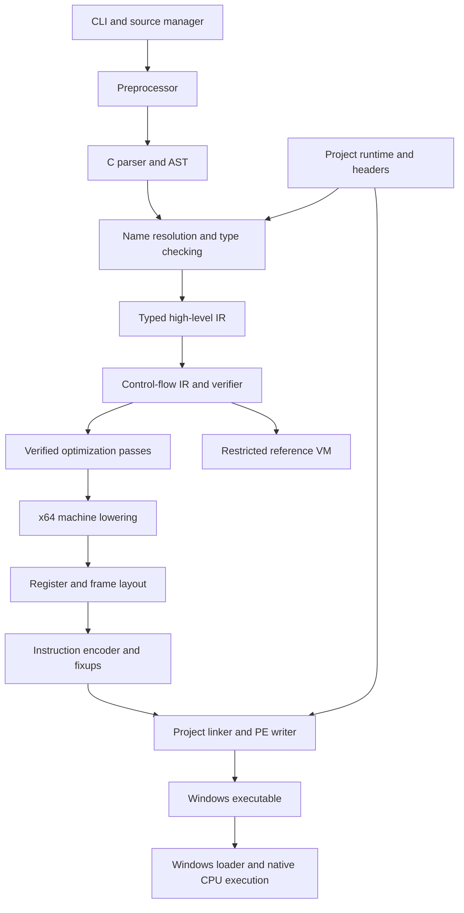
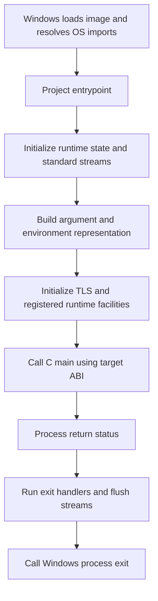
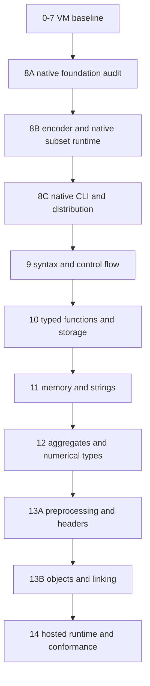

# Compiler in Rust: Product and Engineering Specification

**Canonical file:** `IMPLEMENTATION_PLAN.md`
**Repository:** [compiler-rust](https://github.com/choksi2212/compiler-rust)
**Revision:** 2.0, documentation proposal for review
**Date:** 2026-11-23 (Asia/Calcutta)
**Implementation language:** Rust
**Proposed language/platform target:** hosted ISO C11, Windows x64
**Immediate delivery:** compile the existing supported C subset into genuine native Windows executables
**Long-term delivery:** a project-owned C11 compiler, linker, runtime, headers, and standard library

This is the project's single source of truth. It combines the PRD, technical requirements, architecture, execution flows, implementation sequence, validation strategy, and change control. The README is a usage guide and must derive scope claims from this document. Git history preserves earlier plans; no parallel roadmap or competing specification should be introduced.

**Document-only revision:** this revision specifies future work; it does not implement or certify it. Review this complete revision before native backend or language expansion implementation continues. The user has authorized project-owned development and stage-by-stage testing. A change to the agreed architecture, dependency policy, target, or scope requires asking the user first, then updating this file before coding.

## Contents

1. [Product definition and requirements](#1-product-definition-and-requirements)
2. [Current implementation and evidence](#2-current-implementation-and-evidence)
3. [Scope, ownership, and compatibility contract](#3-scope-ownership-and-compatibility-contract)
4. [User experience and CLI specification](#4-user-experience-and-cli-specification)
5. [Architecture and compilation flows](#5-architecture-and-compilation-flows)
6. [Internal data contracts and module boundaries](#6-internal-data-contracts-and-module-boundaries)
7. [Frontend, preprocessing, and C semantics](#7-frontend-preprocessing-and-c-semantics)
8. [Target data model and Windows ABI](#8-target-data-model-and-windows-abi)
9. [IR, optimization, and native instruction generation](#9-ir-optimization-and-native-instruction-generation)
10. [PE image layout and project-owned linking](#10-pe-image-layout-and-project-owned-linking)
11. [Startup, runtime, headers, and standard library](#11-startup-runtime-headers-and-standard-library)
12. [Diagnostics, resource limits, and failure behavior](#12-diagnostics-resource-limits-and-failure-behavior)
13. [Implementation work packages and stage gates](#13-implementation-work-packages-and-stage-gates)
14. [Verification, conformance, and release policy](#14-verification-conformance-and-release-policy)
15. [Risks, decisions, traceability, and next action](#15-risks-decisions-traceability-and-next-action)
16. [References and preserved history](#16-references-and-preserved-history)

## 1. Product definition and requirements

### 1.1 Problem and intended outcome

The current compiler accepts a small C subset and executes bytecode in a VM. The user wants a compiler they can invoke from a terminal to produce an independent `.exe`, followed by progressive support for substantially more C programs. Both the implementation and its behavior must be explainable in a compiler-design viva.

The native product must translate source expressions, branches, calls, and memory operations into CPU instructions. Creating an executable that merely replays expected output, launches GCC, or interprets embedded source does not meet this requirement.

### 1.2 Users and scenarios

| User | Task | Success condition |
| --- | --- | --- |
| Student | Compile an assignment | A valid supported C source produces an executable with correct observable behavior |
| Viva presenter | Explain compilation stages | Tokens, AST, typed representation, IR, optimizations, and generated instructions can be inspected |
| Compiler developer | Add language support | Specification, implementation, positive and negative tests, and capability status agree |
| Program recipient | Run a built executable | Program runs on the target Windows installation without this compiler, Rust, GCC, or the project's VM |
| Library author | Compile several translation units | Own object writer and linker resolve declarations, definitions, relocations, and runtime calls |

### 1.3 Product requirements

| ID | Requirement | Acceptance evidence |
| --- | --- | --- |
| PR-01 | Native `.exe` output | Execute generated PE images as separate OS processes |
| PR-02 | Project-owned compilation | Audit imports and process launches; no external compile/assemble/link step |
| PR-03 | Correct supported C behavior | Deterministic fixtures, semantic tests, independent expectations, appropriate reference comparisons |
| PR-04 | Honest support reporting | Every feature has an implemented/partial/planned/unsupported status and tests |
| PR-05 | Visible compiler phases | Stable stage dumps with locations, types, and symbol identities |
| PR-06 | Predictable CLI | Documented flags, output paths, exit codes, and errors |
| PR-07 | Standalone distribution | Clean-environment process test with development tools unavailable |
| PR-08 | Progressive C11 coverage | Per-feature and per-library-function traceability to tests and implementation |
| PR-09 | Useful diagnostics | Invalid input identifies a location and cause; compiler does not crash |
| PR-10 | Gated development | Next stage begins only after its prerequisite test gate passes |
| PR-11 | Real implementations | No placeholder function, dummy result, hardcoded demo output, or silent fallback |
| PR-12 | One controlling document | Architecture and status changes land here before dependent implementation |

### 1.4 Quality requirements

Correctness and clarity take priority over optimization. `-O0` must remain a dependable baseline. Build performance is measured after native correctness, not guessed or guaranteed now. Compiler operations should be deterministic given identical inputs, options, target, and library version. Generated programs must follow their selected semantics independently of compiler debug/release mode.

No fabricated speed, coverage, security, or conformance claims are permitted. Passing examples establishes those examples, not full C support. No calendar estimate in this document substitutes for a completed test gate.

## 2. Current implementation and evidence

This section records the inspected repository at commit `da66051`; later stages below are planned unless marked otherwise. Existing validation was recorded in prior implementation turns; this documentation revision does not rerun compiler tests.

| Component | File | Verified baseline | Gap to native/full C |
| --- | --- | --- | --- |
| Driver | `src/main.rs` | Source loading, dump flags, compile-and-run through VM | No native output flag or multi-file driver |
| Lexer | `src/lexer.rs` | Words, signed-range decimal literals, literal strings, supported punctuation/operators, positions | No general preprocessing or complete token vocabulary |
| Parser/AST | `src/parser.rs` | One `int main()`, integers, expressions, blocks, conditionals, loops, calls | No translation-unit grammar, declarators, complete type syntax |
| Semantics | `src/semantic.rs` | Integer checks, lexical scopes, built-in format validation | No general C type system, linkage, conversions or object model |
| IR | `src/ir.rs` | Numbered slots/temporaries, constants, operations, labels, jumps, print, halt, declaration reset | Untyped flat representation; no general functions or memory instructions |
| Optimizer | `src/optimize.rs` | Conservative local constant propagation/folding and straight-line unreachable instruction removal | No typed CFG or memory-effect model |
| VM | `src/bytecode.rs` | Project-owned stack execution and checked runtime failures | Not a native C backend or full-C oracle |
| Native image foundation | `src/native_pe.rs` | PE32+ packaging and generated entrypoint code invoking ExitProcess | Separate from C frontend; fixed sections/base, one import, maximum 4096 code bytes |
| Tests | Unit tests, `src/stress.rs`, `tests/cli.rs` | Arithmetic, errors, malformed input, CLI, six demos, native foundation | No end-to-end C-to-native test yet |
| Optional development oracle | `tools/differential.py` | Generates supported, defined-behavior programs for GCC comparison | Never a compiler/runtime dependency |

### 2.1 Recorded validation baseline

- 31 tests passed in debug and release configurations after the native foundation addition: 27 binary unit tests, two CLI integration tests, and two native library tests on Windows x64.
- Arithmetic stress cases executed 16,150 times across the two VM optimization settings.
- 10,000 deterministic malformed random inputs, source mutations, and oversized syntax tests were exercised.
- 100 generated programs matched GCC in optimized and unoptimized VM execution: 200 output comparisons.
- Actual generated native foundation executables exited with statuses 0, 37, and 255.
- Formatting and Clippy checks passed at that baseline.

The native foundation tests establish executable loading, imported process exit, and their tested layout cases. They do not establish a complete PE implementation, unwind correctness, native arithmetic, library behavior, or C conformance.

### 2.2 Current user-visible restrictions

The CLI currently compiles and executes immediately. It requires one `int main()` ending in literal `return 0;`. It supports the documented integer/loop/conditional subset, literal-string `printf` with `%d` and `%s`, and literal-only `strlen`. Arithmetic is checked signed 32-bit arithmetic; uninitialized variable reads produce runtime errors. Output is buffered until successful execution. Ordinary comments, `++`, arrays, pointers, user functions, general includes, and native `-o` are absent.

Current parser limits are 64 recursive syntax levels and 128 binary operators per expression tail. These are implementation limits, not an assertion that all C11 translation-limit requirements have been met. General nondecimal numbers are rejected. Built-in names are currently reserved locally, unlike the eventual ordinary-identifier rules. The VM stops after ten million instructions; native conforming execution must not inherit an arbitrary instruction budget.

### 2.3 Existing demos

`examples/addition.c`, `loop.c`, `factorial.c`, `pattern.c`, `conditional.c`, and `strings.c` have expected-output files. Their current outputs are regression fixtures. The strings example uses the teaching-mode built-in `strlen`; strict hosted-mode examples will need proper project headers and prototypes. Do not present that fixture alone as proof of strict C11 translation.

## 3. Scope, ownership, and compatibility contract

### 3.1 Meaning of full C support

The target is a documented hosted C11 implementation for one platform. The practical acceptance goal is all applicable standard language requirements plus the required hosted library within published environmental limits. Feature coverage must distinguish constraints, valid semantics, implementation-defined behavior, unspecified behavior, undefined behavior, and optional facilities.

C11's language and library are specified together; this project uses the public N1570 draft as its initial clause map, not as a claim of ISO certification. See [N1570](https://www.open-std.org/jtc1/sc22/wg14/www/docs/n1570.pdf), especially clauses 4-7 and the annex index. The conformance ledger must ultimately account for applicable requirements, reviewed defects, and implementation choices, rather than equating accepted syntax with conformance.

The phrase "any C program" cannot include programs whose behavior is undefined, source requiring a different platform, arbitrary third-party libraries, vendor-only extensions, or another C revision. Those programs need their own compatibility contracts. Within the agreed target, failures on supported, well-defined programs are defects to fix.

### 3.2 Ownership boundary

| Layer | Project builds it | Allowed underlying facility |
| --- | --- | --- |
| Lexer, preprocessor, parser, semantic analysis | Yes | Rust standard library used by compiler implementation |
| IR and optimization | Yes | No LLVM/Cranelift/TCC/C compiler substitution |
| x64 instruction encoder | Yes | Published ISA specifications, CPU execution |
| Symbol resolution, fixups, object support | Yes | No external assembler/linker in production path |
| PE image and import writer | Yes | Windows executable loader |
| CRT startup and C standard library | Yes | Windows system APIs for OS primitives |
| Generated program execution | Native CPU instructions | Windows services and system DLLs |
| Compiler bootstrap build | Rust source compiled by Cargo/rustc | Normal installed Rust build toolchain |
| Test reference executables | Optional independent oracle | GCC or another reference only during development |

Do not copy another compiler implementation or delegate its logic to a downloaded package. Consulting specifications and testing against an independent implementation are allowed. If a new production dependency is needed, ask the user and revise this document first. A requirement to implement Windows or a CPU emulator is outside this ownership boundary.

### 3.3 Scope levels and release names

| Release level | Permitted claim | Must not claim |
| --- | --- | --- |
| VM baseline | C teaching subset compiler with VM | Native C executable support |
| Native subset | Existing subset compiled to Windows x64 | General hosted C support |
| Extended native C | Enumerated additional features work | All standard syntax/library cases |
| Hosted candidate | Coverage ledger complete enough for conformance audit | Independently established conformance before audit |
| Hosted C11 release | Applicable requirements and documented options validated | GNU/MS extensions or other targets by implication |

### 3.4 Conditional and optional facilities

Track variable-length arrays, atomics, threads, and complex arithmetic as explicit work streams. Where C11 permits an implementation to omit a facility and advertise a corresponding feature-test macro, any omission must be reviewed and recorded before a conformance claim. They remain planned capability goals; absence must never be hidden. Optional Annex K interfaces and optional Annex F/G numerical binding claims are separate extensions, not automatic consequences of ordinary math support.

### 3.5 Deferred product scope

Linux/ELF, macOS/Mach-O, ARM, C++, Rust/Go frontends, GNU/MS extension compatibility, dynamic library production, debugger/PDB integration, IDE/LSP, a visual website, code signing, and package-manager publication are separate future decisions. These do not block a Windows console C compiler. No feature is silently added to this list to avoid a required hosted-C obligation.

## 4. User experience and CLI specification

### 4.1 Transitional CLI

Until the user approves a default-behavior change, preserve `compiler file.c` as current compile-and-run VM behavior. Add native generation through an explicit output option. The first native delivery must support:

```powershell
compiler program.c -o program.exe
.\program.exe
compiler program.c -o program.exe --ir --optimized-ir
compiler program.c --run-vm
```

Native compilation must not execute the program automatically. `--run-vm` is explicit teaching-subset execution and must report unsupported typed-IR features cleanly after the native compiler grows beyond VM capabilities.

### 4.2 Final driver command contract (implemented incrementally)

| Command/option | Purpose | Delivery |
| --- | --- | --- |
| `-o PATH` | Select native executable destination | 8C |
| `--tokens`, `--ast`, `--ir`, `--optimized-ir` | Inspect compiler stages | Preserve, then enrich |
| `--bytecode`, `--run-vm` | Existing subset reference mode | 8C compatibility |
| `--emit=machine` | Dump encoded instructions, offsets, symbol fixups | 8B/8C |
| `--help`, `--version` | Usage and build/capability version | 8C |
| `--print-capabilities` | Describe implemented modes and restrictions | 8C, extended each stage |
| `-O0`, `-O1` | Unoptimized baseline and verified basic optimization | Typed/native optimizer stage |
| `--no-opt` | Preserve existing alias for unoptimized mode | Compatibility |
| `--semantics=teaching` | Checked legacy subset behavior | Native migration |
| `--std=c11` | Strict language mode when usable; not a conformance claim | Frontend migration |
| `-E` | Emit preprocessed source/tokens without compilation | 13A |
| `-I DIR`, `-D NAME[=VALUE]`, `-U NAME` | Include and macro configuration | 13A |
| `-fsyntax-only` | Preprocess, parse, and type-check without native output | Typed frontend |
| `-c`, `.obj` inputs | Separate compilation and project-owned linking | 13B |
| Several source inputs | Build and link multiple translation units | 13B |

Unimplemented options must be rejected. No option may succeed while silently skipping its advertised stage. For native mode without an explicit `-o`, a later reviewed CLI revision may select `a.exe`; it is not the initial migration default.

### 4.3 Output and failure contract

Compiler stage dumps and diagnostics go to stderr; program stdout belongs only to program execution. File-generation commands report the output path without mixing code dumps into files. Compile status: 0 success, 1 source/type/link/build failure, 2 invalid CLI usage or unsupported mode. A runner propagates child exit status where representable and reports launch failure distinctly.

Never overwrite an input source, include, object, compiler executable, or directory. Detect aliases through canonical paths and file identity where available, not merely matching path strings. Write a temporary output beside the destination, validate it, close handles, then atomically publish it. Preserve a previously working output if compilation fails. Replacing an existing unrelated destination requires an explicit overwrite policy, initially an `--overwrite` flag. Invalid syntax must not leave a partial executable. No shell-based concatenation of filenames or source text is allowed.

### 4.4 End-user success scenario

The user writes a supported C file, runs the native compiler, and launches the output from a different directory. The executable imports only documented Windows facilities. Removing compiler tools from PATH does not stop it running. Unsupported constructs receive a truthful compile diagnostic, not an `.exe` that later launches another tool or fabricates output.

## 5. Architecture and compilation flows

### 5.1 High-level ownership flow



The initial native subset can lower the existing IR directly. The typed IR stages become mandatory before full types, functions and pointers. Do not implement a pretend preprocessor for the native subset; its existing conventional header accommodation remains labeled teaching-only until 13A supplies real preprocessing.

### 5.2 Native subset compile flow

1. Parse options and validate source/destination identities.
2. Load source with a file identifier and preserve location information.
3. Run existing subset lexer, parser and semantic analysis.
4. Lower to current IR; verify slot definitions, labels, and destination identities.
5. Optimize only if selected; verify again.
6. Lower each operation to native instructions and runtime symbol calls.
7. Lay out locals, initialization flags, constant bytes and function frames.
8. Encode instructions, bind local labels, collect relocations/imports.
9. Resolve runtime symbols; compute PE sections and image-relative addresses.
10. Apply fixups; validate section bounds and image metadata.
11. Publish the output file without running it.
12. Integration tests launch that actual file, capture output and status, and compare with independent expectations.

### 5.3 Runtime startup flow



The earliest native subset needs only the simpler startup path it supports. Each later lifecycle facility needs tests for initialization failure, normal exit and abnormal termination. Calling a Windows service is an OS dependency, not delegation of C implementation.

### 5.4 Multi-file flow

After separate compilation is delivered, each translation unit becomes a project-generated COFF object containing sections, symbols and relocations. The project linker resolves them together with selected runtime objects, diagnoses missing/duplicate symbols, lays out the image, and emits PE32+. In-memory fragments can use the same symbol/relocation model before on-disk object support exists. No external linker is needed in either mode.

## 6. Internal data contracts and module boundaries

### 6.1 Proposed repository organization

Keep migration incremental; paths below describe intended responsibilities, not files already implemented.

| Module family | Responsibility | Core public result |
| --- | --- | --- |
| `driver`, `cli` | Options, compilation jobs, output publication | Validated build configuration |
| `source`, `diagnostic` | Source maps, spans, errors, macro-origin notes | `SourceId`, `Span`, structured diagnostics |
| `lex`, `preprocess` | Translation input, tokens, macros, includes | Preprocessing tokens with expansion provenance |
| `parse`, `ast` | Full declaration/expression grammar | Untyped translation-unit AST |
| `sema`, `types`, `layout` | Scope, type compatibility, conversions, object layout | Typed AST/HIR and symbol table |
| `hir`, `ir`, `verify` | Typed operations and explicit control flow | Verified module IR |
| `opt` | Conservative transformations and pass verification | Equivalent verified IR |
| `codegen/x64` | ABI lowering, register/frame layout, encoding | Machine fragments and fixups |
| `object`, `link` | COFF support and symbol/relocation resolution | Linked section graph |
| `native_pe` / `pe` | Image headers, directories and validation | Executable bytes |
| `runtime`, `include` | Project C runtime and public headers | Runtime objects and C declarations |
| Existing VM modules | Restricted teaching backend/reference | VM execution for supported IR only |

### 6.2 Required identities and records

- `SourceId` indexes immutable input buffers. `Span` carries byte offset/range, with line/column rendering delegated to the source map. Macro expansion stacks preserve spelling and invocation origins.
- `Token` has a kind separate from spelling. Parser decisions must use token kinds and grammar roles, not just text comparisons.
- `TypeId` identifies canonical types in a context; qualifiers, incomplete forms, function signatures and array bounds are represented explicitly.
- `SymbolId` identifies declarations across scopes. Codegen never re-resolves a name string to decide its storage slot.
- `FunctionId`, `BlockId`, `ValueId` and `LocalId` are distinct identities; accidental cross-use is an invariant failure.
- `TargetSpec` owns widths, alignments, endianness, signedness policy, ABI classification, available instructions and image format.
- `MachineFragment` contains bytes, alignment, symbol definitions, unresolved references, and source associations. It must not contain unresolved raw magic offsets.
- `Relocation` specifies location, symbol, addend, kind and permitted range. A linker error results if range or symbol checks fail.
- `Diagnostic` contains severity, stable identifier, primary span, explanation and optional secondary spans/notes.

### 6.3 Invariants at boundaries

The parser returns a complete AST or structured errors. Semantic analysis removes unresolved names and inserts required conversions. IR has typed operands and valid terminators. Codegen receives only verified IR. Linking receives encodable fixups and consistent symbol metadata. The PE serializer accepts an already validated image layout.

Internal assertions diagnose compiler bugs; they must not serve as routine rejection of user syntax. Input-dependent sizes use checked arithmetic before allocation or serialization. Partial pipeline state must not be treated as a successful artifact.

### 6.4 Status and coverage records

Maintain capability entries keyed by stable IDs inside this document until they become too numerous for manual accuracy. Each entry needs requirement/clause reference, owning module, status, test identifiers, mode/target restrictions and known defects. A generated report may derive from code metadata, but this document remains authoritative for scope and release claims. Generating such a report does not authorize inventing a second manual plan.

### 6.5 Concrete migration from the existing crate

The current binary declares the frontend/VM modules itself, while `src/lib.rs` currently exposes only native infrastructure. Move shared compiler modules into the library in a reviewed refactor before a second backend imports them. The driver must use that library instead of building separate incompatible copies of types. Preserve all existing tests during this move; do not combine structural migration with speculative language changes.

Introduce a compilation context carrying target, source manager, diagnostics and semantics mode. Use explicit pipeline results: frontend result, verified IR, machine fragments, linked image and published artifact. The CLI owns filesystem/process policy; core compiler stages operate on provided buffers/records. This allows stage tests without inventing alternate production logic.

Keep a compatibility adapter for the legacy IR during 8B. When typed IR arrives, either lower its supported subset to the VM with an explicit capability check or retain a separate legacy teaching frontend. Do not make the VM silently accept pointers/functions it cannot represent. Record the selected adapter at package 10 before migration code.

## 7. Frontend, preprocessing, and C semantics

### 7.1 Source processing and preprocessor work

Build a source manager before a general preprocessor. The reader must retain byte offsets, handle CRLF/LF consistently, identify encoding errors, and distinguish physical lines from logical lines. Keep normalization maps so a diagnostic points to what the user actually wrote.

The preprocessing engine requires its own token stream, directive parser, macro environment, include resolver, expansion work stack, recursion suppression, conditional-expression evaluator and output renderer. Lexing into ordinary parser tokens happens after preprocessing decisions. A header cannot be implemented by deleting its `#include` line and hoping built-ins cover its declarations.

| Feature ID | Work item | Tests and edge cases |
| --- | --- | --- |
| PP-01 | Ordered translation-input handling | Line splicing, comments, character mapping, source-location preservation |
| PP-02 | Object-like macros | Empty replacement, redefinition compatibility, undefinition, nested expansion |
| PP-03 | Function-like/variadic macros | Balanced arguments, prescan, empty arguments, invocation spacing |
| PP-04 | Stringification and token pasting | Correct spelling, rescanning, invalid resulting token diagnostics |
| PP-05 | Conditional directives | Nested inactive groups, `defined`, expression evaluation and short circuit |
| PP-06 | Include resolution | Quoted/angle paths, search order, cycles, include guards, deterministic diagnostics |
| PP-07 | Source-control directives | Line remapping, deliberate error directives, documented pragmas |
| PP-08 | Predefined macros | Standard/target/feature values match actual capabilities |
| PP-09 | Environmental bounds | Expansion budget, include depth, token growth; publish limits and validate required minima |

The preprocessor must not evaluate an inactive branch as ordinary C code. Macro diagnostics need an invocation trace. Avoid global string replacement: it cannot correctly implement token pasting, comments, string literals or recursive suppression. Until this engine ships, only explicitly documented teaching-mode header handling is allowed.

### 7.2 Lexer requirements

Separate identifiers, keywords, preprocessing numbers, integer/floating constants, character/string literals, and punctuators. Decode escapes into the selected execution encoding only at the appropriate stage. Support literal prefixes and concatenation according to the selected language mode. Interpret suffixes and bases with a target-independent wide accumulator, then assign the correct target type; do not parse every number directly into Rust `i32`.

Use maximal-munch tokenization. Distinguish unsupported syntax from malformed syntax. Track malformed escapes, invalid suffix combinations, overflow during literal conversion, and tokens that are legal in preprocessing but invalid in ordinary expressions. Handle a real embedded NUL in a literal as a stored byte with length metadata; do not assume a Rust string always equals a C string.

### 7.3 Parser strategy and grammar coverage

Retain recursive descent for declarations and statements and a precedence-aware expression parser. The new grammar must parse full translation units instead of requiring one fixed main function. A typedef-name-aware scope interface is needed to distinguish declaration forms from expressions. Declarators must be represented structurally before type construction.

Required grammar families:

- Translation unit: external declarations, function definitions, declarations and definitions with linkage.
- Declaration specifiers: storage class, type specifiers, qualifiers, function specifiers and alignment specifiers.
- Declarators: identifier, nested pointer/array/function forms, abstract declarators and parameter lists.
- Type forms: builtin types, tagged aggregates, enums, typedef names, qualified types and incomplete types.
- Initializers: scalar, aggregate, nested braces, designators, compound literals and inferred array extents.
- Expressions: all required precedence levels, casts, calls, subscripts, members, pointer members, unary operations, assignments, conditional/comma operators, generic selection, size and alignment queries.
- Statements: labeled, compound, expression/empty, selection, iteration and jump forms.
- Remaining language forms: static assertions, variadic declarations, anonymous members, thread-local and atomic declarations, implementation of applicable optional syntax families.

Representative declarators that must be understood before claiming general declarations: pointer-to-int, array-of-pointers, pointer-to-array, function-returning-pointer, pointer-to-function, and array-of-function-pointers. Reject impossible combinations with a type diagnostic, not a parser panic.

A focused operator table must be part of parser tests: postfix; unary/cast; multiplicative; additive; shifts; relational; equality; bitwise AND/XOR/OR; logical AND/OR; conditional; assignment; comma. Every level needs mixed-precedence and associativity tests. Prefix/postfix updates and compound assignments must evaluate an lvalue address once.

### 7.4 Name resolution and declarations

Implement distinct C name spaces, nested scopes, tags, labels and members. Separate declaration identity from spelling. Resolve redeclarations by compatibility and linkage rules; account for prototypes, tentative definitions, file-scope internal/external linkage, block-scope extern declarations and incomplete types. Resolve function-scope labels independently of ordinary identifiers.

The legacy ban on local `main`, `printf` and `strlen` is not the final semantic model. Header declarations, applicable reserved-name rules and actual name lookup must determine legality. Built-in lowering must never override a valid declaration merely because a function has a familiar spelling.

Initialize declaration scope at the correct point, preserving the existing regression that `int x=x;` inside an inner block must not read an outer `x`. Do not promise a universally meaningful value for an uninitialized object; checked teaching mode may diagnose it, while strict-mode behavior follows the selected C contract.

### 7.5 Type system work

| Feature ID | Required facility | Implementation obligations |
| --- | --- | --- |
| TY-01 | Canonical scalar types | Width/rank/signedness independent of compiler host Rust types |
| TY-02 | Qualified types | Preserve const/volatile/restrict/atomic information through analysis |
| TY-03 | Pointer/array/function types | Distinguish decay from object representation, addressability and parameter adjustments |
| TY-04 | Integer conversions | Promotions and usual arithmetic conversions represented as explicit typed operations |
| TY-05 | Floating conversions | Correct rounding/range behavior under the published numerical model |
| TY-06 | Compatible/composite types | Redeclaration and cross-unit checks |
| TY-07 | Completeness and layout | Reject illegal incomplete-type uses; calculate size/alignment once |
| TY-08 | Lvalues and value categories | Modifiability, address formation, loads/stores, bitfield restrictions |
| TY-09 | Constant expressions | Dedicated evaluator with allowed operations and target semantics |
| TY-10 | Initializers | Object byte layout, zero-filled remainder, relocatable address constants |
| TY-11 | Variadic semantics | Argument promotions, va-list representation and builtin support |
| TY-12 | Atomic/thread constructs | Explicit memory effects, storage duration and platform mapping |

`sizeof` must use target layout, not `size_of::<RustType>()`. Unevaluated expressions must not introduce runtime side effects; variable-length forms require their own evaluation rules. Constant evaluation and runtime arithmetic should share target semantics without using host overflow behavior accidentally.

### 7.6 Control-flow semantics

Use explicit break, continue, switch and label contexts. Diagnose jumps that violate the supported lifetime rules. Resolve dangling else to its correct syntactic owner. Give `for` declarations their correct scope; `continue` targets the update block in a `for`, the condition in a `while`, and the condition check in a `do` loop. Switch must support fallthrough and duplicate-case detection.

Function returns carry typed values. Falling off main has its selected standard semantics in strict mode; other function return paths need their own diagnostics and runtime assumptions. No general return is lowered to unconditional process exit: only startup translates the completed main result into process status.

### 7.7 Evaluation order, side effects, and undefined behavior

Represent sequencing and conditional evaluation explicitly. Do not speculate a faulting expression out of a short-circuit branch. Do not duplicate reads/writes while lowering `a[i++] += value`. Calls, volatile operations, atomics and memory stores must carry effects sufficient to prevent unsafe optimization.

Tests involving multiple unsequenced modifications or undefined signed overflow must not demand equality with another compiler. Separate well-defined reference tests from required-diagnostic tests and checked-mode failure tests. An implementation may choose a deterministic permitted evaluation order, but must not document that choice as a universal C guarantee.

### 7.8 Compatibility modes and migration

Keep the existing checked teaching subset available during native migration. Its arithmetic failures, initialization checks and literal-only built-ins are explicitly an educational extension. Strict C11 mode evolves through capabilities and rejects not-yet-supported features; it does not initially advertise conformance.

A legacy VM error on undefined C behavior is not a requirement that all future native C execution trap identically. For comparisons, use defined-behavior programs and match modes. Keep the original six examples stable, then create strict-mode fixtures using correct declarations and headers when preprocessing is available. Any removal of legacy mode or change in default behavior requires approval.

## 8. Target data model and Windows ABI

### 8.1 Proposed implementation choices

These are design choices for this project, not implemented guarantees. Approving this revision freezes them for the initial native target; changing them later requires an ABI revision.

| Property | Initial target contract |
| --- | --- |
| CPU/OS | Windows x64, little-endian |
| Byte | 8 bits |
| `_Bool` / char / signed char / unsigned char | 1 byte; plain char signed |
| short / unsigned short | 2 bytes |
| int / unsigned int | 4 bytes |
| long / unsigned long | 4 bytes |
| long long / unsigned long long | 8 bytes |
| Data/function pointers | 8 bytes; target-defined interchange restrictions remain |
| float | IEEE 754 binary32 storage; numerical guarantees separately tested |
| double | IEEE 754 binary64 storage; numerical guarantees separately tested |
| long double | Proposed 8-byte representation, distinct language type and rank |
| `size_t`, `uintptr_t` | 64-bit unsigned integer type |
| `ptrdiff_t`, `intptr_t` | 64-bit signed integer type |
| `wchar_t` | 16-bit unsigned integer type |
| `wint_t` | 32-bit unsigned type, capable of representing WEOF |
| `max_align_t` | At least 16-byte alignment; allocator must honor it |
| Struct layout | Natural field alignment, padding and target layout table; bitfield policy separately frozen before implementation |
| Execution encoding | UTF-8 narrow strings in project runtime; UTF-16 wide strings; specify conversion and locale rules |
| `NULL` | Appropriate null pointer constant; representation documented as all-zero pointer bits |

Provide alignment entries alongside widths. Integer promotions, rank, floating behavior, bitfields, enum compatible types, signed right shift, implementation-defined conversions, character sets, locale, signal behavior, translation limits and stream modes need entries in the implementation-defined behavior ledger. This table alone is not that complete ledger.

Reject numeric values that cannot fit the selected typed literal rather than wrapping silently during parsing. Long-double layout and external-library ABI compatibility need separate tests; Windows does not imply compatibility with every MinGW extension or compiler configuration.

### 8.2 Calling convention

Native calls must implement the Windows x64 ABI: positional integer/pointer arguments in RCX/RDX/R8/R9, floating arguments in the corresponding XMM registers, additional arguments on the stack, caller-provided shadow space and correct stack alignment. Preserve nonvolatile registers. Handle return classification, aggregate passing, hidden result pointers, and variadic floating arguments deliberately. These rules are verified against [Microsoft's x64 calling-convention reference](https://learn.microsoft.com/en-us/cpp/build/x64-calling-convention?view=msvc-170).

Create one ABI classifier used by function definitions, direct calls, indirect calls, runtime calls and imported OS functions. Do not independently improvise register assignment at each call site. The earliest native subset uses a conservative spill-to-stack frame and a small caller-saved scratch-register set. Later register allocation cannot alter the ABI contract.

### 8.3 Stack frame and unwind model

A frame layout record includes incoming/outgoing arguments, home space, locals, temporaries, saved nonvolatile registers, alignment padding and any checked-mode initialization flags. It must compute offsets with checked size arithmetic. Large frames need a project-owned stack-probe strategy; merely subtracting a large stack size is insufficient.

Emit valid unwind metadata for generated frame-using functions and runtime helpers. Frame prologue/epilogue generation and unwind generation share the same layout description. Microsoft documents the relevant function-table and unwind structures in [x64 exception handling](https://learn.microsoft.com/en-us/cpp/build/exception-handling-x64?view=msvc-170). The existing PE foundation lacks these facilities and must not be treated as production ABI completeness.

### 8.4 Numerical and alignment policy checklist

Before floating code generation, freeze evaluation precision, rounding policy, subnormal handling, floating exception behavior and the published `FLT_EVAL_METHOD`. Do not infer optional numerical-binding compliance merely from IEEE storage. SSE operations, constant folding and decimal conversions must agree on the selected model. Long double may share storage with double while remaining a distinct C type; document that deliberately.

Before aggregate code generation, freeze every scalar alignment, enum representation selection, bitfield unit/order policy, zero-width fields, anonymous members, flexible-array tail layout, aggregate parameter/return classification and maximum alignment support. `alignas` requests must be validated against actual target support. Before atomics, specify alignment and lock-based fallback so lock-free macros match reality.

### 8.5 ABI verification fixtures

Test argument counts 0 through at least 12; signed and unsigned widths; mixed floating and integer parameters; preservation of saved registers; recursion; nested calls; callbacks; function pointers; scalar and aggregate returns; stack alignment; and variadic formatting. Use independently constructed native harnesses or reviewed known bytes in tests where permitted, never a second copy of the same classifier as the only oracle.

## 9. IR, optimization, and native instruction generation

### 9.1 Typed intermediate forms

The current flat IR can serve stage 8B. Its destinations, labels and initialization resets must have explicit invariants before native lowering. For broader C, introduce module/function/global structure, basic blocks, typed values, explicit memory operations and function signatures. Start with ordinary non-SSA IR and stack homes; an SSA conversion is a later optimization decision, not a prerequisite for correct C.

Minimum typed operations: constants; arithmetic/conversions; comparisons; address formation; load/store with width/alignment/volatility; aggregate address operations; calls; returns; branches; switch; lifetime markers where needed; atomic operations when delivered. A function call records its signature, arguments, result and effects. A print built-in is replaced by an ordinary runtime call once general calls exist.

String constants become immutable byte arrays with explicit terminators and symbols. Pointers refer to objects/addresses, not Rust host strings. Globals distinguish initialized storage, zero-filled storage, readonly data, relocatable constants and thread-local data.

### 9.2 IR verifier

Run before and after every enabled transformation. Validate unique identities, type consistency, block terminators, branch targets, legal uses, call arity/signatures, memory alignment constraints and symbol visibility. Use dominance checks where an IR form requires them. Reject a verified-module mismatch as a compiler error before serialization. Test the verifier using intentionally invalid IR; this tests validation logic, not a fake execution path.

### 9.3 Optimization policy

Initial verified passes: target-correct constant folding, local propagation, dead unreachable-block elimination and basic branch simplification. Preserve calls, volatile accesses, atomics and observable stores unless an effect proof justifies removal. Preserve arithmetic checks in teaching mode. In strict mode, apply only transformations justified by its language semantics.

Every pass declares preconditions, modified analyses, preserved invariants, and a focused regression suite. New optimization bugs must have minimal reproducible programs tested at `-O0` and `-O1`. Reaching the same answer through two backends is useful evidence but not a substitute for an independent expected answer when both share the same lowering.

### 9.4 Machine lowering and encoding

Own the entire x64 encoding path: register identifiers, instruction selection, operand width, REX prefix, opcode, ModR/M, SIB, immediates, displacements and fixups. Initially support only the instruction families required by the current subset and runtime. Add instructions with byte-level and execution tests before using them widely.

Required first families include moves, loads/stores, address formation, add/subtract/multiply, signed division/remainder, sign extension, comparison/set-condition, boolean normalization, conditional/unconditional branches, direct and indirect calls, prologue/epilogue and return. Floating-point, atomic and wider-type instructions are later additions with dedicated tests.

Division lowering must account for the operand registers required by the selected instruction, sign extension, zero divisors and the signed minimum divided by negative one. Comparisons must select signed versus unsigned condition codes from types. Branch and call offsets must be checked for displacement range. A fixup overflow is an explicit backend diagnostic, not truncated bytes.

### 9.5 First native subset runtime behavior

Implement integer-to-decimal conversion, literal/string output, format scanning for `%d`/`%s`, length calculation, runtime-error reporting and process exit. These are project-owned machine-code helpers emitted through the encoder; no imported CRT formatter and no precomputed source evaluation. Integer formatting must handle the minimum signed value without negating it in a same-width signed representation.

Model partial OS writes and failures. `printf` returns a computed output count or an error as its supported contract specifies; it cannot return a constant. Initial teaching-mode output buffering may require a project-owned growable buffer to preserve legacy all-or-error output behavior. Streaming hosted `stdio` is a later, separately tested mode. No arbitrary VM instruction quota belongs in a normal standalone native executable.

## 10. PE image layout and project-owned linking

### 10.1 Serializer expansion

Replace fixed offsets in the native foundation with a layout engine. It receives section records, entrypoint symbol, imported symbols, relocation records and function unwind records. It computes aligned file offsets and RVAs, validates all ranges, then serializes headers/directories. Distinguish file offsets, RVAs and VAs in types or strongly named wrappers.

The binary format contract is [Microsoft's PE/COFF specification](https://learn.microsoft.com/en-us/windows/win32/debug/pe-format). This project will emit its own image headers, section table, imports, relocation data and image metadata. Text/data permissions, page/file alignment, image size and directory bounds must agree. Layout must grow beyond the foundation's single code page and one import.

### 10.2 Planned sections

| Section | Content | Access intent |
| --- | --- | --- |
| `.text` | User and project runtime native instructions | Read/execute |
| `.rdata` | Literal bytes, immutable tables, readonly objects | Read |
| `.data` | Initialized writable globals/runtime state | Read/write |
| `.bss` or zero-filled section tail | Static zero-initialized storage | Read/write |
| `.idata` | OS import descriptors, names and address tables | Loader-compatible permissions |
| `.reloc` | Image-base relocations where required | Read |
| `.pdata`, `.xdata` | Function table and unwind records | Read |
| `.tls` and TLS directory data | Thread-local initialization and callbacks | As required by target lifecycle |

Not every executable needs every section. Omitted features must not leave nonzero data directories pointing to absent bytes. Favor RIP-relative references and correct relocations instead of requiring a fixed preferred image address. Enable appropriate relocation/NX/ASLR flags only when the corresponding support is real.

### 10.3 Import and fixup engine

Group imported symbols by OS DLL; deduplicate names deterministically; build lookup/address tables and names with valid terminators and alignment. Bind each import call fixup to its actual IAT entry. The first runtime will require process and output services; later file/memory/thread services expand this explicit allowlist.

Represent relative branches, image-relative fields and absolute address relocations separately. Validate negative and maximum displacements, forward/backward references, missing labels, duplicate definitions, and section growth. Never assume an import remains at a fixed RVA after adding data.

### 10.4 Symbol resolution and object support

An internal linker resolves fragment-local, module-local and external symbols. Later COFF writing/reading must support the exact machine/relocation subset needed by our emitted objects, with a documented capability list. External COFF object compatibility is a separate promise and needs tests; our own `.obj` support alone does not establish compatibility with arbitrary MSVC/GCC objects.

Select runtime objects by unresolved symbols without accidentally resolving user definitions to unrelated built-ins. Diagnose duplicate strong definitions and unresolved external references with originating translation units. Define archive indexing and search rules before delivering static library input. No executable is accepted with guessed zero addresses for missing symbols.

### 10.5 Image validation and portability gates

Perform a project-owned structural validation before publishing. Independently inspect representative files during development using published-format checks and optional external inspection tools, which are never production dependencies. Launch the output on the target OS, verify output/exit status, inspect actual imports and test a clean process environment.

Test code/data growth across alignment boundaries, empty/nonempty sections, strings crossing pages, many imports, relocation at a changed load address, large frames, unwind behavior and malformed internal records. Running one entrypoint once is insufficient evidence for all these properties.

## 11. Startup, runtime, headers, and standard library

### 11.1 Runtime bootstrap strategy

The runtime must be ours, but it must be buildable before the full C compiler exists. Stage 8B emits a small set of runtime helpers through the project's x64 encoder. This is real executable runtime logic, not a stub. As functions and types become available, portable runtime algorithms can be expressed in project C sources compiled by this compiler. Retain minimal platform glue in the encoder where necessary.

There must be no hidden Rust standard-library or system CRT dependency in generated programs. The compiler itself may use Rust standard-library IO; generated C programs may not call back into the compiler process to obtain results. A runtime function is shipped only when its implementation, declaration, calling convention and tests all exist.

### 11.2 Startup responsibilities

Initialize process-global runtime state, standard streams, argument/environment storage, floating environment policy, TLS when delivered, and exit-handler bookkeeping. Provide `main(void)` and `main(int, char **)` under the eventual hosted contract. Decode Windows process arguments according to a published project policy and test quotes, backslashes, empty arguments, Unicode and environment access. Do not treat splitting on spaces as a finished argument parser.

Translate main's returned int into process exit through the runtime. Normal `exit` runs registered handlers and stream finalization in the specified order. `_Exit`, abort paths, initialization failures and unhandled runtime checks use separate paths. Define reentrancy and error behavior before advertising each facility.

### 11.3 OS abstraction layer

Keep system import declarations and platform glue separate from portable runtime algorithms. Proposed primitive families: read/write handles; open/close/seek files; process environment and exit; memory reservation/allocation; time; synchronization/thread creation; locale/encoding support; console handling where distinct from redirected files. Each wrapper must translate OS results into the runtime's documented errors and preserve thread-local error state as required.

The generated import list must contain OS services needed by delivered capabilities, not `msvcrt`/UCRT formatting, allocation, parsing or standard-library implementations. Test interrupted/short/failed writes, inaccessible files, zero-length operations, allocation failure and invalid handle paths. OS failure injection is a test mechanism; production logic must still call real services and handle their actual results.

### 11.4 Memory and string runtime

Implement memory copy/move/set/compare with explicit overlap contracts and size handling. Implement string functions over C object memory, including terminator behavior and bounded forms. String tests must include empty input, embedded NUL storage, zero lengths, high bytes, overlapping memory where legal, alignment variations and values near allocation boundaries.

Implement an allocator over Windows memory services, with metadata integrity, alignment, overflow-checked size calculations, coalescing/reuse policy and failure behavior. `realloc` must preserve the required portion and leave the original allocation usable on allocation failure; calloc needs checked multiplication and zero initialization. Never claim `malloc` because an API call returns some bytes: the C-visible alignment, lifetime and ownership contract must also pass tests.

### 11.5 Full hosted-library inventory

This is an implementation inventory for our runtime. Every required interface in a family needs its own declaration, definition, semantic edge cases and test IDs before the family is complete. Clause-level requirements are resolved against the referenced C11 source; the table is not a substitute for those interfaces.

| Header family | Project work | Critical acceptance cases |
| --- | --- | --- |
| `assert.h` | Debug assertions and disabled form | Expression evaluation count, NDEBUG, file/function/line reporting |
| `complex.h` | Complex types and operations if selected | Representation, conversion, branch-sensitive numerical cases |
| `ctype.h` | Character classification/conversion | EOF, unsigned-char range, locale behavior |
| `errno.h` | Error constants and per-thread state | Independent threads and documented error propagation |
| `fenv.h` | Floating environment control/status | Rounding modes, exception flags, optimizer interaction |
| `float.h` | Numeric characteristics macros | Values agree with actual codegen/runtime |
| `inttypes.h` | Integer formats and conversions | Width-specific formats, limits and parse errors |
| `iso646.h` | Alternative spelling macros | Expansion and ordinary parsing |
| `limits.h` | Integer limits | Exact target widths and signedness |
| `locale.h` | Locale records and selection | C locale baseline, later named locales, stable storage/lifetime |
| `math.h` | Real math and classification | Accuracy, rounding, domain/range errors, special values |
| `setjmp.h` | Save/restore execution context | Preserved state, nested calls, specified return behavior |
| `signal.h` | Signal interfaces | Documented Windows mapping, handlers, unsupported circumstances |
| `stdalign.h` | Alignment convenience macros | Match parser and target layout |
| `stdarg.h` | Variadic access support | ABI promotion rules, copies, mixed arguments |
| `stdatomic.h` | Atomic types/operations if selected | Ordering, fences, lock-free claims and fallback behavior |
| `stdbool.h` | Boolean macros | Consistency with builtin type and conversions |
| `stddef.h` | Size/difference types, NULL, offsetof | Target identity, member layout and constant-expression behavior |
| `stdint.h` | Fixed/minimum/fast-width integer types | Correct type availability, widths and macros |
| `stdio.h` | Streams and formatted/unformatted IO | Buffering, errors, EOF, file position, text/binary mode, variadic formats |
| `stdlib.h` | Allocation, conversions, termination, utilities | Boundary parsing, overflow, sorting callbacks, exit order |
| `stdnoreturn.h` | Noreturn macro | Declaration validation and call flow |
| `string.h` | Byte/string operations | Bounds, terminators and legal overlap rules |
| `tgmath.h` | Type-generic dispatch | Real/complex argument types and evaluation counts |
| `threads.h` | Threads/mutexes/conditions/TLS if selected | Lifetime, contention, wakeup and thread result behavior |
| `time.h` | Calendar/process time conversion | Epoch policy, range, formatting, time-zone assumptions |
| `uchar.h` | UTF conversion types/functions | Stateful conversions, invalid sequences, partial inputs |
| `wchar.h` | Wide IO/string/conversion | UTF-16 policy, stream orientation and conversion state |
| `wctype.h` | Wide classification/conversion | Supported locale and valid wide-character domains |

No header may declare an apparently supported function backed by an always-success, always-zero or unimplemented implementation. A not-yet-supported header/interface gets an explicit diagnostic and capability entry. Never define hosted/feature macros that overstate delivered functionality.

### 11.6 Formatted IO work packages

Start with the existing `%d`/`%s` teaching behavior. General `printf`-family support then needs flags, width, precision, length modifiers, integer bases, pointers, characters, floating conversions, positional policy where relevant, output count and errors. `scanf`-family support is a distinct parser with input consumption, matching failure, assignment counts, whitespace and width handling; it cannot be implemented by reversing printf.

Share a project-owned format parser where useful, but keep output and input semantics separate. `snprintf` needs exact truncation/termination/count tests. Variadic ABI tests must accompany new formats. Locale-sensitive formatting waits for a specified locale subsystem. Floating conversion and accurate math need independently reviewed numerical algorithms and error budgets before their work package begins.

### 11.7 Runtime and standard-library release boundary

A native subset release may ship only a small runtime and clearly list it. A full hosted claim waits for applicable library requirements, headers, startup, environment and conformance work. Runtime version and compiler ABI version must be embedded in build metadata or inspectable diagnostics to prevent silently mixing incompatible objects.

## 12. Diagnostics, resource limits, and failure behavior

### 12.1 Diagnostic format

Human-readable format: `path:line:column: severity [ID]: message`, followed by a relevant source excerpt and notes where available. Use stable categories: CLI, preprocessing, lexical, syntax, name/type, IR invariant, backend, linkage, file IO and runtime. Macro/include errors add expansion/include context. Invalid user input must not show an unhandled Rust panic trace.

Multiple-error recovery is an incremental feature. Use synchronizing tokens only where the grammar allows; bound cascading diagnostics. A clean first-error diagnostic is better than dozens of misleading follow-on messages. Do not report successful compilation if errors were recovered for display.

### 12.2 Runtime error distinction

Teaching mode keeps explicit checks where supported. Native hosted mode is not a universal memory-safety runtime. Optional diagnostics for undefined behavior must not be described as required C semantics or guaranteed protection. OS faults, library error returns and deliberate project runtime failures have distinct reporting paths.

### 12.3 Resource handling

Publish and enforce limits for source bytes, token counts, preprocessing expansion, include depth, parser recursion, AST/IR size, image size, runtime allocation and compiler job count. Check arithmetic before allocation. Exceeding a configured limit produces a clear diagnostic. Before a hosted conformance claim, review limits against the applicable environmental requirements rather than retaining the teaching parser's limits blindly.

Infinite loops are legal in many source contexts; compilation must not execute source to discover its output. Test runners need child-process timeouts and cleanup. Ordinary generated executables have no hidden instruction budget. The compiler should support cancellation without leaving a final partial artifact.

### 12.4 Filesystem and repository behavior

Preserve user-created files such as the current untracked `addition.c`. Do not stage or overwrite them incidentally. Native output must not replace source. Handle read-only destinations, denied permissions, invalid names, paths with spaces/Unicode, long-path failure and aliases. Keep generated artifacts under ignored build/output directories during development. Do not execute arbitrary source programs inside the compiler process.

### 12.5 Determinism and artifact integrity

Use deterministic symbol/section ordering and a reproducible timestamp policy. Byte-for-byte reproducibility is a tested property of the selected options, not an assumption. Avoid embedding host absolute paths unless explicitly requested for diagnostics. Validate PE field sizes and directory bounds before writing. Use writable data and executable code permissions appropriate to their contents; do not use universal writable/executable sections to bypass layout work.

## 13. Implementation work packages and stage gates

### 13.1 Global stage protocol

For every stage: specify the detailed contract here; implement real behavior; add tests for valid cases, errors and boundaries; run focused tests; run prior regressions; inspect actual outputs; record evidence here; only then begin the next stage. If a prerequisite fails, repair it rather than carrying a known defect into dependent work. No stage is complete because its files exist or a compilation command exits successfully.

Historical stage numbers 0-7 identify the VM baseline. Stage 8A identifies the existing native foundation. The packages below refine the native/full-C roadmap. This dependency order governs work; a later feature may be specified early but cannot be reported implemented before its dependencies and acceptance gate pass.

### 13.2 Dependency overview



The order prioritizes end-to-end native demos. Therefore stages before 13A use explicitly limited teaching/header handling or header-free declarations. Do not claim that standard library include-based programs already work during those stages. If preprocessing needs to move earlier to enable real usage, ask for that sequencing change and update this graph first.

### 13.3 Package 8A: native foundation audit and expansion prerequisites

**Status:** basic implementation exists; broader audit work remains.
**Inputs:** `native_pe::image`, machine-code payload fixtures.
**Outputs:** validated PE layout records and foundation regression evidence.

Tasks:

1. Preserve recorded real-process tests for exit statuses 0/37/255.
2. Audit header and directory fields against the PE reference; add independent field checks rather than checking only signatures and total file length.
3. Verify raw/virtual ranges, section permissions, file alignment, image alignment and size arithmetic across code-size boundaries.
4. Separate fixed-foundation assumptions from reusable layout interfaces; document the fixed-base/no-relocation constraint until removed.
5. Add function unwind support and relocation requirements to the layout design before production native delivery.

**Gate:** structural checks and real process tests pass, known foundation limits are explicit, and the encoder/runtime can use symbolic imports rather than depending on fixed offsets indefinitely. Existing 8A evidence is preserved, not inflated into completion of this broader audit.

### 13.4 Package 8B: real native backend for the current subset

**Status:** planned.
**Depends on:** 8A gate.
**Deliverable:** in-memory native image generation from every operation in the current IR.

| Step | Concrete work | Required tests before next step |
| --- | --- | --- |
| 8B-1 | IR verifier and typed identities for legacy slots/labels | Invalid destinations/labels rejected; existing IR accepted |
| 8B-2 | Instruction encoder primitives and fixups | Reviewed encodings, displacement boundaries, executed arithmetic sequences |
| 8B-3 | Dynamic PE layout/import symbols | Multiple imports, growth beyond code page, readonly constants and writable state |
| 8B-4 | Frame layout and ABI helper | Alignment, preserved registers, outgoing arguments, unwind metadata |
| 8B-5 | Constants, copies, reset/check state, unary/binary arithmetic | Boundary arithmetic and legacy failures as actual process results |
| 8B-6 | Labels, branches, loops, boolean short circuit | Forward/backward branches, nested loops, faulting skipped operands |
| 8B-7 | Project formatting/output/string helpers | Minimum integer, empty strings, count/errors, short writes |
| 8B-8 | Startup/exit and runtime diagnostics | Correct exit paths, stdout/stderr contract and no compiler callback |
| 8B-9 | All six C demos through native output | Native output/status match expected files and both legacy VM modes |

**Gate:** all existing subset programs have real native execution, not just packaged bytecode. Inspect generated images and imports. Complete branch/error tests and code/data growth tests. No external production tool invocation, mock output or unimplemented fallback. Instruction/resource-limit differences from the VM are explicit in comparison tests.

### 13.5 Package 8C: native CLI and installation

**Status:** planned.
**Depends on:** complete 8B gate.
**Deliverable:** usable `compiler source.c -o output.exe`.

Implement validated options, compiler-specific exit codes, output alias detection, temporary-file publication, overwrite policy, machine dumps and capability reporting. Retain current default behavior and explicit VM mode. Update install/portable packaging instructions to match actual behavior.

**Gate:** compile and execute all native examples from paths with spaces and from another directory; verify no compiler tools are required at program runtime; test source protection, permissions, existing outputs, compile failure cleanup, malformed flags and unknown options. A release archive must contain the tested binary and current usage instructions, with no claim of completed full C support.

### 13.6 Package 9: conventional syntax and flow

**Status:** planned.
**Depends on:** 8C and documented AST/IR changes.

Implement comments and literal improvements first; then operators with lvalue evaluation rules; then general returns in main, break/continue, do/while, switch and labels/goto under their valid semantic restrictions. Retain legacy parsing regressions in teaching mode while adding strict-mode grammar tests. Freeze integer suffix/base and escape policies before lexing changes.

**Gate:** precedence/associativity matrix, update-address evaluation counts, loop continue targets, switch fallthrough/default and duplicate labels/cases, malformed input rejection, ordinary demo source with `i++`, and output equivalence at both optimization levels. General function returns await package 10's function IR.

### 13.7 Package 10: typed IR, functions, declarations and storage

**Status:** planned.
**Depends on:** 9.

1. Implement type context, target widths/ranks, explicit conversions and layout queries.
2. Add translation-unit AST, declarators, symbols, function signatures and prototypes.
3. Implement typed module/function/basic-block IR plus verifiers; migrate legacy lowering without losing its tests.
4. Add parameter passing, scalar returns, recursion, direct/indirect calls and frame lifetime.
5. Implement integer type families, qualified operations, globals, static/extern storage and constant initialization.
6. Add va-list/compiler builtin support needed by general runtime calls; maintain the shared ABI classifier.

**Gate:** recursion and nested calls; compatibility/redeclaration diagnostics; 0-12 arguments; preserved registers; signed/unsigned conversions; separate local lifetimes; constant/global initialization; optimization equivalence on defined behavior. Do not advance on a typed-IR migration that silently drops currently supported print or reset semantics.

### 13.8 Package 11: objects, pointers, arrays and mutable strings

**Status:** planned.
**Depends on:** typed IR and general calls.

Specify object identity, pointer representation, address arithmetic, alignment, array decay, storage duration and lifetime before implementing loads/stores. Add multidimensional arrays, pointer-to-array and function-pointer declarators, string/character arrays, literals with terminators, address/dereference, subscripting, sizeof and initializers. Implement portable memory/string functions and allocator primitives as real project runtime code.

**Gate:** pointer scaling by target type; array row strides; valid overlap operations; NUL termination; bounds-adjacent valid cases; allocation failure/overflow; stack/global/heap object distinctions; indirect calls; function/array argument adjustments; alias-sensitive optimization tests. Undefined memory accesses are not compared for a prescribed C result.

### 13.9 Package 12: aggregates, numerics and remaining type forms

**Status:** planned.
**Depends on:** 11.

Freeze struct/union/enum layout, bitfield allocation policy and aggregate ABI before code. Implement members, designated/aggregate initialization, compound literals, typedefs, alignment facilities, generic selection and static assertions. Add floating arithmetic/conversions with a specified numerical model and later complex operations as tracked. Validate qualifiers and supported atomic type forms.

**Gate:** independently calculated layout fixtures, nested aggregates, flexible members where applicable, bitfield boundaries, aggregate calls/returns, float exceptional values and rounding, decimal conversion accuracy, address constants and relocations. Finalize every implementation-defined choice in the target ledger.

### 13.10 Package 13A: preprocessing and project headers

**Status:** planned.
**Depends on:** source manager and stable declarations; scheduled after 12 for this roadmap.

Implement PP-01 through PP-09 with a token-based engine. Add own public headers only for interfaces implemented or explicitly marked unavailable. Produce strict-mode demo variants and eliminate teaching-only include treatment from strict mode. Add standard/target/feature macros only to the level actually delivered; partial releases must not pretend all hosted requirements are met.

**Gate:** macro conformance corpus, include provenance, inactive branches, recursion suppression, concatenation/stringification/variadics, include search order, resource bounds, header self-containment and repeated inclusion. Strict examples must compile using actual project headers, never accidentally finding a system compiler's headers.

### 13.11 Package 13B: object files and project linking

**Status:** planned.
**Depends on:** stable module/symbol/type model and 13A.

Define the supported COFF object subset, relocation mapping and symbol resolution policy. Write/read own objects; link multiple source units; implement runtime object selection and archive format/search if shipped. Preserve deterministic image layout and own PE validation. Add type-consistency information sufficient for our cross-unit diagnostics without misrepresenting what standard object records can prove.

**Gate:** multi-source main/helper programs, extern/global sharing, internal linkage isolation, duplicate/missing symbols, relocation range errors, recursive cross-unit calls, same result as single-unit build, object path safety and no external linker invocation.

### 13.12 Package 14: hosted library and conformance program

**Status:** planned; substantial long-term work.
**Depends on:** required language, preprocessing, object and runtime features.

Split into reviewed subpackages: startup/environment; memory/strings; streams/files; formatting/scanning; numeric parsing/utilities; wide/Unicode/locale; time/signals/context; numerical math/fenv; atomics/threads/TLS; remaining language and optional-facility decisions. Each requires exact interface lists, target behavior, tests and quantitative numerical criteria where applicable before its implementation begins.

Build a clause/interface ledger against the C11 reference and documented defect decisions. Fill gaps in old-style declaration forms, rare declarators, diagnostics, literal/initializer forms, environmental limits and library edge behavior. Run independently sourced conformance tests where licensing permits, while retaining project-owned regression cases. Any downloaded test suite is development input, not compiler logic.

**Gate:** applicable language/library requirements mapped to evidence; implementation-defined behavior documented; optional-feature macros truthful; all required headers self-contained; multi-file and runtime failure tests pass; clean-environment distribution works; unresolved nonconformance is disclosed. Do not label a release fully hosted-conforming while this gate remains incomplete.

## 14. Verification, conformance, and release policy

### 14.1 Test layers

| Layer | What it establishes | What it cannot establish alone |
| --- | --- | --- |
| Source/token fixtures | Spelling, location, preprocessing behavior | Correct native execution |
| Parser/semantic positives and negatives | AST/type rules and diagnostics | ABI or image correctness |
| IR verifier tests | Internal invariants and rejection | Semantic equivalence of every lowering |
| Constant-evaluator tests | Target arithmetic and permitted expression handling | Runtime memory semantics |
| Encoder byte fixtures | Intended instruction encoding | Correct whole-program control flow |
| Native sequence execution | CPU behavior of selected encodings | Complete C semantics |
| Native program tests | Actual generated output/status and side effects | Full standard coverage |
| Cross-backend comparisons | Migration regressions in the shared subset | Independence from shared frontend bugs |
| Reference-compiler comparisons | Defined-behavior compatibility cases | A universal oracle for unspecified/undefined behavior |
| Structural PE checks | File-format consistency | Correct runtime logic |
| Clean-environment execution | Distribution dependency contract | Every target OS configuration |
| Fuzz/mutation/resource tests | Robustness against exercised inputs | Absence of all compiler crashes |
| Standard/library coverage ledger | Traceable scope and missing requirements | Correctness without passing substantive tests |

### 14.2 Required test case record

A meaningful regression records source/input, language/semantics mode, target, options, expected output/status or expected diagnostic category, the requirement it exercises and a reproducible command. Random testing records seeds and minimized failing inputs. A test that only repeats the implementation's formula without independent justification is insufficient for a complex ABI/layout case.

Test production logic directly. Intentionally malformed AST/IR/PE inputs test validators; failure injection tests OS error handling; neither permits mock production features. Real-process native tests remain mandatory even if encoder snapshots pass.

### 14.3 Native subset release corpus

Required initial cases: six existing demos; negative arithmetic and remainder; minimum/maximum integers; all comparisons; chained boolean expressions; short-circuit division by zero; nested loops with scoped declarations; both conditional arms; empty output; strings with tabs/newlines; `%d`/`%s` count/type errors; declaration resets; uninitialized-read teaching diagnostics; early main termination; code/data growth across section boundaries.

For every valid defined-behavior case, test unoptimized native, optimized native when enabled, independently expected behavior, and both VM modes where representable. Include programs that depend on runtime input once IO is supported, so precomputing output cannot accidentally pass the corpus.

### 14.4 Future feature test inventory

- Frontend: every keyword/operator, declarator shape, required conversion, qualifier, constant-expression restriction, tag/typedef scope, redeclaration and initializer family.
- Preprocessor: token growth, inactive syntax, include cycles, recursive macros, empty/variadic arguments, spelling/expansion diagnostic mapping.
- Functions: recursive and mutually recursive calls, indirect calls, separate prototypes, aggregate/variadic arguments, frame alignment and preserved state.
- Memory: arrays and subarrays, pointer arithmetic, aliasing-sensitive cases, object lifetime and allocation failures under valid contracts.
- Runtime: EOF versus error, partial IO, format boundaries, conversion range, buffer sizes, termination order, thread-local errors, locale/encoding transitions.
- Numerical: signed/unsigned boundaries, shifts, division/remainder, conversion edges, finite/nonfinite floats, rounding modes, independent accuracy references.
- Link/image: relocation boundaries, missing/duplicate symbols, zero-initialized storage, readonly protections, unwind metadata and imported OS services.
- Robustness: deeply nested and large valid inputs, truncated input, random tokens, malformed files, cancellation, destination aliasing and stale outputs.

### 14.5 Test execution policy

Use `cargo fmt --check`, `cargo clippy --all-targets -- -D warnings`, focused `cargo test` filters and the full `cargo test` suite after implementation stages. Use release tests when integer arithmetic, optimizer behavior, code generation, binary layout or build-mode assumptions change. Native child tests need bounded waits and cleanup. Do not rerun expensive random/reference suites after documentation-only changes.

The optional GCC comparison script remains a developer-only oracle; it does not make the generated program dependent on GCC. If the user later prohibits even independent test-tool usage, replace that oracle with reviewed reference fixtures and other permitted validation, record the resulting confidence limit here, and do not alter the compiler's production ownership boundary.

### 14.6 Conformance ledger format

| Entry | Required fields |
| --- | --- |
| Language requirement | Clause/facility, supported mode, implementation module, positive/negative/boundary tests, status |
| Library interface | Header, exact prototype, type prerequisites, implementation, errors, tests, status |
| Implementation-defined choice | Reference, target decision, rationale, observable test, documentation location |
| Conditional feature | Chosen support policy, advertised macro, actual implementation/tests, known limits |
| Known defect | Minimal reproduction, affected options/target, workaround if any, owner and blocking release gate |

Allowed statuses: planned, in progress, implemented but unverified, verified for stated cases, conforming requirement reviewed, deferred by approved optional policy. A single verified case must not upgrade an entire library/header to complete.

### 14.7 Definition of done for a feature

The specification is explicit; implementation contains real logic; the capability registry is accurate; focused tests cover successes and failures; regressions pass; actual native behavior is tested where relevant; diagnostics and usage are updated; no unintended dependency or stub is present; status/evidence are recorded here. Performance claims require measurements. Open correctness defects block completion.

### 14.8 Definition of done for a release

The promised scope is enumerated and tested; generated executables work without the compiler tools; imports and runtime ownership are audited; packaging contains the tested binary and truthful instructions; output safety tests pass; release notes are derived from this document. Publish/upload an official release only when requested. Git commits to the maintained repository may contain reviewed completed work; do not stage user sample files incidentally.

## 15. Risks, decisions, traceability, and next action

### 15.1 Risk register

| Risk | Consequence | Required mitigation |
| --- | --- | --- |
| Treating subset success as full C | Unsupported programs miscompile | Feature ledger and staged release claims |
| Reusing string names as identity | Shadowing/linkage bugs | Stable symbols and typed bindings |
| Host arithmetic leaks into target | Incorrect conversions/constant folding | Target evaluator and boundary fixtures |
| ABI/frame mismatch | Crashes or corrupted arguments | Shared classifier, independent harnesses, unwind tests |
| Fixed PE offsets survive growth | Invalid imports or sections | Symbolic layout and range-checked fixups |
| Runtime standard functions secretly delegated | Violates ownership requirement | Import/process-launch audit |
| Full library underestimated | Claimed support exceeds actual functionality | Interface inventory and separate runtime gates |
| Optimizer ignores effects | Wrong calls/memory/volatile behavior | Explicit effects and before/after verification |
| Shared VM/native bug | Comparison passes falsely | Independent expectations and reference tests |
| Undefined test programs | Misleading compatibility failures | Classify behavior before oracle comparison |
| Frontend input exhausts stack/memory | Compiler crash | Explicit budgets and graceful limits |
| Library bootstrap cycle | Runtime cannot be built | Small encoded bootstrap runtime; migrate portable helpers later |
| Calling WinAPI confused with using a C compiler | Architecture misunderstanding | Explicit ownership/OS boundary |
| Scope growth without review | Plan stops governing implementation | Update this file before architectural deviations |

### 15.2 Architectural decisions

| ID | Decision | State |
| --- | --- | --- |
| ADR-01 | Rust implements the compiler | Existing, retained |
| ADR-02 | Own native instruction encoder, image writer and linker | User-directed constraint |
| ADR-03 | Own C runtime and headers; Windows APIs provide OS primitives | Defined boundary for review |
| ADR-04 | Windows x64 first | Proposed target, consistent with current foundation |
| ADR-05 | Hosted C11 as the language coverage target | Proposed for this revision; no current conformance claim |
| ADR-06 | VM preserved as a restricted educational/reference backend | Existing behavior retained during migration |
| ADR-07 | Conservative stack homes before advanced allocation/SSA | Proposed implementation sequence |
| ADR-08 | Teaching checks separated from strict-mode semantics | Required migration design |
| ADR-09 | Optional external tools only for development verification | Existing test practice; no production use |
| ADR-10 | This file is the sole product/architecture/implementation plan | User-required governance |
| ADR-11 | No new default CLI behavior until approved | Compatibility safeguard |
| ADR-12 | Own runtime bootstrap helpers first, self-compiled C runtime later | Proposed bootstrap strategy |

Approving this document approves its proposed baseline choices for implementation. It does not waive the requirement to ask before a subsequent architecture/scope/dependency change. Routine coding choices that satisfy these contracts do not need repeated approval.

### 15.3 Product-to-engineering traceability

| Product requirement | Owning sections/packages | Acceptance gate |
| --- | --- | --- |
| PR-01 native output | 8-10, 8A-8C | Actual C-source-to-executable process tests |
| PR-02 ownership | 3, 9-11 | No external production tool/import delegation |
| PR-03 behavior | 7-11, 14 | Feature-specific expected results and regressions |
| PR-04 honest status | 2-3, 14.6 | Capability and conformance ledger review |
| PR-05 visibility | 4, 6, 9 | CLI dump tests and useful typed identities |
| PR-06 CLI | 4, 12, 8C | Command/error/output safety matrix |
| PR-07 distribution | 10-11, 8C, 14.8 | Clean-environment execution |
| PR-08 C11 progression | 7, 11, 9-14 packages | Applicable language/library requirement ledger |
| PR-09 diagnostics | 6, 12 | Source/macro locations, malformed-input tests |
| PR-10 stage gates | 13-14 | Evidence recorded before advancing |
| PR-11 real logic | 3, 9-11, 14 | Native/runtime audit and runtime-dependent tests |
| PR-12 single source | Preamble, 15 | No competing manual plan; changes reconciled here |

### 15.4 What changes require asking first

Ask before using an external assembler/linker/compiler in production, adding a production dependency, changing target OS/CPU or C revision, dropping the owned-runtime requirement, switching to an embedded interpreter/transpiler, changing default CLI semantics, removing an agreed capability, or reordering dependency stages materially. State the issue and a concrete proposal. After approval, update this document first, then code.

Do not ask repeatedly for already approved routine implementation within a stage. When a bug is within the stated behavior, fix it and add a regression. When specifications conflict, resolve the conflict with the user rather than selecting whichever is easier to implement.

### 15.5 Review checklist for this revision

- Confirm hosted C11 on Windows x64 as the initial target.
- Confirm ownership boundary: Rust toolchain builds our compiler; Windows services support our generated runtime; no external compiler/assembler/linker/CRT supplies C implementation logic.
- Confirm data model and teaching/strict-mode migration policy.
- Confirm initial native CLI retains the existing default and adds explicit `-o` compilation.
- Confirm progressive deliverables rather than an immediate promise of arbitrary C acceptance.
- Confirm packages 8A audit, 8B and 8C precede language expansion and all gates are mandatory.

This is a review checklist, not a request to approve six separate actions individually. One review of the document can establish the baseline. Outstanding questions discovered during implementation must be concrete and tied to an actual dependency or specification conflict.

### 15.6 Immediate next action after document review

Resume package 8A audit and symbolic native-layout prerequisites. Do not start coding a broad C frontend or output CLI before that gate. Then implement the 8B steps in order, testing each. The first user-visible native milestone is the current six demos compiling into standalone `.exe` files through the entirely project-owned path. Later packages expand language support without claiming unfinished capabilities.

## 16. References and preserved history

### 16.1 Technical references

External specifications define language/platform contracts; they are not competing implementation plans and do not supply compiler code.

1. [WG14 N1570: public C11 committee draft](https://www.open-std.org/jtc1/sc22/wg14/www/docs/n1570.pdf). Initial language/library clause map, not an ISO certification and not a replacement for reviewing applicable corrections.
2. [Microsoft PE/COFF format](https://learn.microsoft.com/en-us/windows/win32/debug/pe-format). Image/object layout and loader-facing structures.
3. [Microsoft x64 calling convention](https://learn.microsoft.com/en-us/cpp/build/x64-calling-convention?view=msvc-170). External function-call compatibility contract.
4. [Microsoft x64 exception handling](https://learn.microsoft.com/en-us/cpp/build/exception-handling-x64?view=msvc-170). Frame/unwind metadata contract.
5. [Microsoft ExitProcess](https://learn.microsoft.com/en-us/windows/win32/api/processthreadsapi/nf-processthreadsapi-exitprocess). OS process termination boundary already exercised by native foundation tests.

Future encoder implementation must cite and check the relevant CPU instruction reference before extending encoding families. Future runtime wrappers must check the official OS API contracts they use. Do not infer detailed field/ABI behavior from a demo alone.

### 16.2 Preserved implementation history

| Commit | Established work |
| --- | --- |
| `733bf57` | Initial Rust C-subset compiler, IR optimizer and VM |
| `a4454e2` | Aggressive regression/differential testing, semantic fixes and installed command |
| `da66051` | Own PE foundation with actual native exit-process tests and native roadmap |

The original bytecode-only architecture remains historical context, not an alternative active target. This revision reconciles the user's subsequent native/full-C direction and supersedes earlier inconsistent plan passages. No previous completed native-C capability is being removed: end-to-end native C output was never implemented at this baseline.

### 16.3 Change record

Revision 2.0: documentation-only consolidation into PRD, TRD, architecture, flows, runtime/library inventory, implementation packages, acceptance gates, test policy, compatibility choices, risk register and conformance requirements. Existing source files and current compiler behavior are unchanged by this revision. Future status updates must record actual implementation evidence rather than silently converting planned requirements into completed claims.
